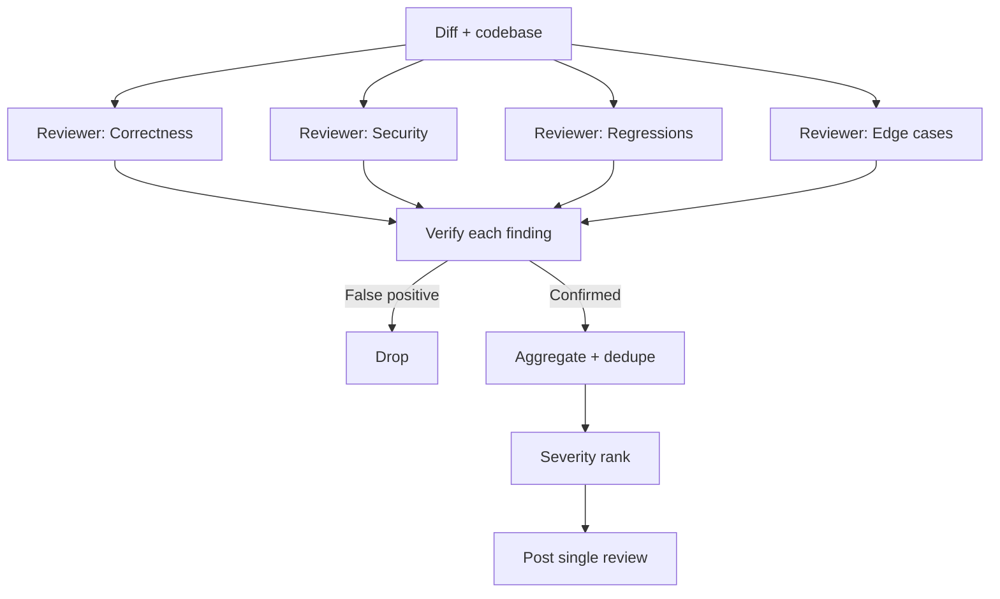

# Cloud Parallel Review Pattern

> Fan out code review across multiple agents in a remote sandbox, verify each candidate finding against actual code behavior, then aggregate into a single severity-ranked review posted back to the PR.

Multiple reviewer agents examine the diff in parallel, each scoped to a different defect class. A verification step reproduces each candidate finding against code behavior. The orchestrator deduplicates, severity-ranks, and posts one consolidated review. Fan-out + verify + aggregate runs off the developer's machine as a single review artifact. That differs from [committee review](committee-review-pattern.md) (voting with implementer iteration) and [tiered code review](tiered-code-review.md) (escalation by risk class).

## Structure

Four stages run in sequence. Fan-out covers defect classes: correctness, security, regressions, and edge cases. Verify checks each candidate against code behavior. Aggregate deduplicates surviving findings and ranks them by severity. Post publishes one review with inline comments and a severity summary.



## Canonical implementation

Claude Code's `/code-review ultra` "launches a fleet of reviewer agents in a cloud sandbox to find bugs in your branch or pull request" ([ultrareview docs](https://code.claude.com/docs/en/ultrareview)). The docs call `/ultrareview` an alias when ultrareview is available to your account, and the [changelog](https://code.claude.com/docs/en/changelog) lists it as added in v2.1.111 (2026-04-16). Anthropic's managed GitHub Code Review runs the same four stages ([Code Review docs](https://code.claude.com/docs/en/code-review#how-reviews-work)): "several agents examine the diff and the surrounding code in parallel", "a verification step checks the candidate findings against the code and filters out false positives", "the findings that remain are deduplicated and ranked by severity", and "the review posts its results on the pull request".

## Why verification is load-bearing

Fan-out without verification amplifies noise: each agent contributes its own false positives, and aggregation cannot tell real findings from hallucinated ones. Verification reproduces each candidate against code behavior. That turns a high-recall, low-precision fan-out into a high-precision output.

Per the [EMNLP 2024 peer-review simulation study](https://aclanthology.org/2024.emnlp-main.70), dimension-scoped reviewers activate narrower reasoning pathways, so their error populations are largely non-overlapping. Fan-out captures more real defects. Verification discards the non-overlapping false positives each reviewer introduces.

## Cloud execution trade-offs

- Latency is asynchronous. For `/code-review ultra`, "a review typically takes 5 to 15 minutes" ([ultrareview docs](https://code.claude.com/docs/en/ultrareview)), and managed Code Review [runs on Anthropic infrastructure](https://code.claude.com/docs/en/code-review). The developer's session is not blocked.
- Cost is per-review. After the free runs, ultrareview costs "typically \$5 to \$25 in usage credits depending on the size of the change" ([ultrareview docs](https://code.claude.com/docs/en/ultrareview)). Managed Code Review has [no flat per-review price](https://code.claude.com/docs/en/code-review-costs).
- The trust boundary expands. Ultrareview "is not available when using Claude Code with Amazon Bedrock, Google Cloud's Agent Platform, or Microsoft Foundry, and it is not available to organizations that have enabled Zero Data Retention or have the HIPAA configuration applied" ([ultrareview docs](https://code.claude.com/docs/en/ultrareview)). Organizations that use customer-managed encryption keys cannot run it either.

## When to trigger

Three trigger modes: once per PR (fixed cost), every push (cost multiplied by push count), and manual (`/ultrareview` or `@claude review`). Review after every push "runs on each push, multiplying cost by the number of pushes" ([Code Review costs](https://code.claude.com/docs/en/code-review-costs#how-often-reviews-run)). For high-iteration PRs, `@claude review once` runs a single non-subscribing review to bound cost.

## Relationship to CI gates

By itself, a managed Code Review [does not approve or block](https://code.claude.com/docs/en/code-review), but its result counts toward approvals where a Claude Approvals policy file uses it. Its check run [never concludes as a failure](https://code.claude.com/docs/en/code-review-pull-requests#check-run-output). To gate merges on findings, parse the severity breakdown from the check run in your own CI.

## Comparison to related patterns

| Pattern | Shape | Artifact |
|---------|-------|----------|
| [Committee review](committee-review-pattern.md) | Fan-out + vote/defer, implementer iterates | Accept/revise loop |
| [Tiered code review](tiered-code-review.md) | Risk classification routes to different reviewers | Per-tier approval gate |
| [Fan-out synthesis](../patterns/multi-agent/fan-out-synthesis.md) | Parallel generation + synthesis merge | Merged output |
| Cloud parallel review | Fan-out + verify + aggregate, cloud-executed | Single posted review |

Load-bearing differentiators: the verification step, cloud execution, and a single posted review rather than an iteration loop.

## When this backfires

- Small diffs. A paid ultrareview, typically 5 to 15 minutes and \$5 to \$25, is wasted on typo fixes. A local [`/code-review`](https://code.claude.com/docs/en/code-review-local) runs in your own session and counts toward your plan's usage or API billing the same way the rest of the session does.
- Low-diversity reviewer axes. If "correctness" and "bugs" surface the same findings, aggregation dedupes most of the parallel work and the pattern buys nothing.
- High-iteration PRs with push triggers. Review after every push multiplies cost by the number of pushes ([Code Review costs](https://code.claude.com/docs/en/code-review-costs#how-often-reviews-run)). Use manual or once-per-PR triggers for long-running branches.
- Air-gapped or ZDR environments. Cloud execution is not optional. On Bedrock, Agent Platform, Foundry, Zero Data Retention, or HIPAA setups, ultrareview is unavailable and `/code-review ultra` "runs a local review in your session instead" ([ultrareview docs](https://code.claude.com/docs/en/ultrareview)). Managed Code Review is also unavailable to Zero Data Retention organizations ([Code Review docs](https://code.claude.com/docs/en/code-review#availability)).

## Tuning

Anthropic's managed Code Review reads two kinds of file ([customize docs](https://code.claude.com/docs/en/code-review-customize)). It reads `CLAUDE.md` files as project context, and "a change that violates one of their rules becomes a finding at whichever severity level fits the issue". `REVIEW.md` holds review-only rules: "the agents that find issues and the agents that verify them receive its contents as your repository's review instructions, alongside Code Review's default review guidance". It is the surface for severity recalibration, skip rules, per-repo checks, and nit caps. Lowering severity, excluding findings, and capping nits [need the root file on a protected default branch](https://code.claude.com/docs/en/code-review-customize#which-branch-review-md-is-read-from).

## Example

A team enables the managed Code Review on a backend service repo, with push-triggered reviews on PRs under 500 lines and manual triggers above that threshold. They add `REVIEW.md` at the root:

```markdown
# Review instructions

## What Important means here

Reserve Important for findings that would break behavior, leak data,
or block a rollback: incorrect logic, unscoped database queries, PII
in logs or error messages, and migrations that aren't backward
compatible. Style, naming, and refactoring suggestions are Nit at
most.

## Cap the nits

Report at most five Nits per review. If you found more, say "plus N
similar items" in the summary instead of posting them inline.

## Do not report

- Anything CI already enforces: lint, formatting, type errors
- Generated files under `src/gen/` and any `*.lock` file

## Always check

- New API routes have an integration test
- Log lines don't include email addresses, user IDs, or request bodies
- Database queries are scoped to the caller's tenant
```

A 400-line PR that adds a new API route triggers review on push. Several agents search in parallel. The review flags a missing tenant scope on one query, a changed response shape for an existing endpoint, and a new log line that includes the user ID. Each finding is verified against code before posting. The aggregated review posts three inline comments with severity markers and a summary: "2 Important, 1 Nit." The check run completes with a neutral conclusion, so it does not fail a required check. The team's own CI parses the machine-readable severity counts and blocks merge while `normal > 0`.

## Key Takeaways

- Cloud parallel review is parallel-decompose + verify + aggregate, distinct from committee voting and tiered escalation
- The verification step is load-bearing: without it the pattern amplifies false positives rather than reducing them
- Cloud execution runs the review in the background, so the developer's session stays unblocked
- Cost scales with PR size and trigger mode; push-triggered review on long PRs is the primary budget risk
- The default check run is neutral: gate on findings in your own CI by parsing the severity breakdown
- `REVIEW.md` is the intended tuning surface for severity, skip rules, and nit caps; `CLAUDE.md` contributes project context, and breaking one of its rules produces a finding

## Related

- [Committee Review Pattern](committee-review-pattern.md) — voting-style multi-agent review with implementer iteration, the canonical contrast
- [Tiered Code Review](tiered-code-review.md) — risk-based escalation across review depths
- [Fan-Out Synthesis Pattern](../patterns/multi-agent/fan-out-synthesis.md) — parallel generation with a synthesis merge step, the generative cousin
- [Agentic Code Review Architecture](agentic-code-review-architecture.md) — tool-calling reviewer architecture that many of these agents use
- [Signal Over Volume in AI Review](signal-over-volume-in-ai-review.md) — the precision principle the verification step enforces
- [Agent-Assisted Code Review](agent-assisted-code-review.md) — the broader context of routing review work to agents
- [Review-Then-Implement Loop](review-then-implement-loop.md) — iteration pattern after review findings land
