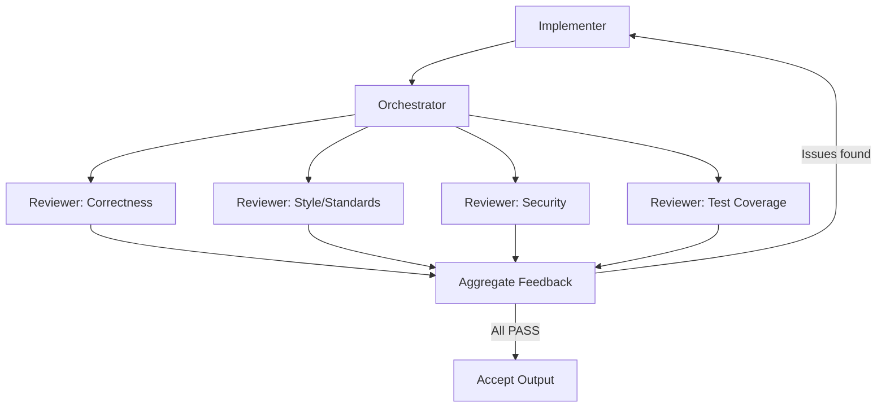

# Committee Review Pattern

> A committee review pattern routes agent-produced work through specialized reviewers — each applying a distinct lens — before accepting or iterating on the output.

The committee review pattern routes agent-produced work through multiple specialized reviewer agents running in parallel, each evaluating a single dimension (correctness, security, test coverage). An orchestrator aggregates structured verdicts and either accepts the output or routes feedback to the implementer for revision.

## Structure

The pattern has three roles:

- Implementer agent — produces the initial output (code, document, plan)
- Reviewer panel — multiple agents, each scoped to a single review dimension
- Orchestrator — runs reviewers in parallel, aggregates verdicts, routes feedback back to the implementer

Each reviewer returns structured output (JSON with verdict and issues) so the orchestrator can triage programmatically rather than parsing prose.



## Why use multiple reviewers

Separate implementer and reviewer roles, and scope each reviewer to one dimension, such as correctness, security, or test coverage. The proposed benefit is more focused scrutiny (inference), not a guarantee that reviewers find different defects or avoid confirmation bias.

[OpenAI's Harness engineering post](https://openai.com/index/harness-engineering/) describes agent-to-agent review with optional human review. It reports a workflow, not a measurement of reviewer error independence.

[AgentReview (EMNLP 2024)](https://aclanthology.org/2024.emnlp-main.70/) studies simulated academic peer review and how reviewer biases affect paper decisions. It does not measure code-review coverage or establish independent errors between security and correctness reviewers.

## Reviewer design

Each reviewer should have:

- A single-focus system prompt that defines exactly what it evaluates
- A structured output schema, for example `{"verdict": "PASS|FAIL", "issues": [...], "notes": [...]}`
- Explicit pass criteria — what counts as PASS must be unambiguous

An industrial evaluation at Ericsson splits its panel along quality attributes: readability, maintainability, reliability and performance, each with its own reviewer expert. A separate context builder assembles the input each reviewer sees. Across 200+ developer-validated issues the system reached 96% accuracy; about 69% of correctly identified issues were rated important and about 33% severe ([Ericsson multi-agent code review study](https://arxiv.org/abs/2609.15877v1)).

Reviewers run in parallel. The orchestrator waits for all verdicts before aggregating. If any reviewer returns FAIL, the issue list goes back to the implementer.

## Loop termination

Set a maximum round limit as local policy. For example, cap review at two rounds, then escalate unresolved findings to a human. This is a cost and escalation rule, not an evidence-based claim about how many rounds usually suffice. Check task specifications and reviewer criteria when reviews do not converge.

## When this backfires

The committee pattern adds cost, latency, and orchestration complexity that can outweigh its benefits in specific conditions:

- Low-risk or trivial changes — typo fixes, config tweaks, and one-liners rarely benefit from multi-reviewer overhead. A single scoped reviewer or no agent review costs less and finishes faster.
- Misaligned reviewer criteria — when two reviewers evaluate overlapping dimensions (for example, both correctness and security flag the same auth logic from different angles), the orchestrator gets contradictory feedback that is harder to act on than a single consolidated review.
- High-frequency iteration loops — many small revisions with 3 or more reviewers per round multiply token cost and latency. Consolidate reviewers until the implementation stabilizes.
- Underspecified tasks — without clear acceptance criteria, reviewers FAIL for different reasons across rounds with no convergence. Fix task specification before scaling reviewer count.

## Cross-model adversarial review

Cross-model review assigns reviewers to different providers, such as OpenAI, Google, and Anthropic. Different providers may offer different failure modes (inference). Measure their finding overlap and accuracy on representative changes; provider diversity does not establish independence.

The [Anvil agent](https://github.com/burkeholland/anvil/blob/main/agents/anvil.agent.md) implements this: three review subagents run in parallel on different models, each receiving the same staged diff. It stores each verdict as structured data with the model name attached. Review prompts focus on bugs, security, logic errors, and edge cases and exclude style to reduce noise.

### Risk-proportional scaling

The [Anvil agent](https://github.com/burkeholland/anvil/blob/main/agents/anvil.agent.md) scales reviewer count by risk:

| Risk | Reviewers | Trigger |
|------|-----------|---------|
| Low | 0 | Typos, config, one-liners |
| Medium | 1 | Bug fixes, features, refactors |
| High | 3 (cross-model) | Auth, crypto, payments, schema migrations |

File-level risk classification drives automatic escalation — changes to authentication or data-deletion code trigger the high tier regardless of task scope. Its local policy caps adversarial review at two rounds, then records remaining findings as known issues and presents the result with low confidence.

## Key Takeaways

- Separate implementer and reviewer roles; compare their findings against [self-review](agent-self-review-loop.md) on representative changes
- Assign each reviewer a single evaluation dimension; do not combine concerns in one reviewer
- Run reviewers in parallel and aggregate before routing feedback back
- Require structured output (JSON) from reviewers so the orchestrator can triage without parsing prose
- Set a maximum round limit and escalate to human review if unresolved
- Evaluate different model providers by finding overlap and accuracy; do not assume independent errors
- Scale reviewer count to task risk — one for medium tasks, three cross-model for high-risk changes
- Consider Anvil's policy of leaving style to the linter and focusing agent review on defects

## Example

A security-focused code review committee for a Python web service. Three reviewers run in parallel on the same diff; the orchestrator aggregates and routes.

Correctness reviewer system prompt:

```
You review Python code for logic errors, off-by-one errors, and incorrect assumptions.
Return JSON only: {"verdict": "PASS|FAIL", "issues": [{"line": N, "description": "..."}], "notes": []}
PASS if no logic errors are found. Do not comment on style or security.
```

Security reviewer system prompt:

```
You review Python code for security vulnerabilities: injection, auth bypass, secrets in code, insecure deserialization.
Return JSON only: {"verdict": "PASS|FAIL", "issues": [{"line": N, "cwe": "CWE-N", "description": "..."}], "notes": []}
PASS if no vulnerabilities are found. Do not comment on correctness or style.
```

Orchestrator aggregation logic (pseudocode):

```python
results = await asyncio.gather(
    correctness_reviewer.review(diff),
    security_reviewer.review(diff),
    test_coverage_reviewer.review(diff),
)

all_issues = []
for result in results:
    if result["verdict"] == "FAIL":
        all_issues.extend(result["issues"])

if all_issues:
    implementer.revise(diff, issues=all_issues, round=round + 1)
else:
    accept(diff)
```

Give each reviewer the diff without earlier verdicts to limit direct influence between reviews. This input separation does not establish independent errors. The orchestrator merges issue lists by line number and deduplicates overlapping findings before sending consolidated feedback to the implementer.

## Related

- [Task-Specific vs Role-Based Agents](../patterns/agent-design/task-specific-vs-role-based-agents.md)
- [Adversarial Multi-Model Development Pipeline](../patterns/multi-agent/adversarial-multi-model-pipeline.md) — extends cross-model review into a full six-phase pipeline with a dedicated adversary role
- [Tiered Code Review](tiered-code-review.md)
- [Diff-Based Review Over Output Review](diff-based-review.md)
- [Signal Over Volume in AI Review](signal-over-volume-in-ai-review.md)
- [Agentic Code Review Architecture](agentic-code-review-architecture.md)
- [Self-Improving Code Review Agents — Learned Rules](learned-review-rules.md) — adaptive rule extraction to reduce noise across review rounds
- [Evidence-Grounded Disagreement in Agentic Code Review](evidence-grounded-disagreement.md) — what happens when reviewers interact instead of running in parallel, and the verdict grammar that keeps the interaction honest
