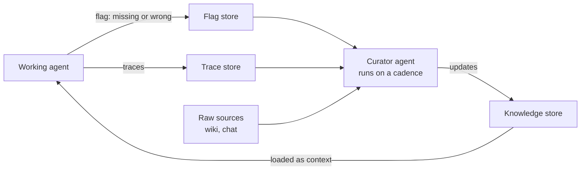

# Curator Agent and Missing-Knowledge Flag for Agent Knowledge

> A curator agent maintains company knowledge in the background while working agents flag what is missing or wrong.

A curator loop keeps the knowledge your agents read current by splitting the work in two. Working agents report gaps and errors as they hit them. A separate curator agent, running on a schedule, reads those reports and edits the knowledge. Harrison Chase of LangChain describes this as part of a "knowledge factory" ([LangChain blog, 2026-11-21](https://www.langchain.com/blog/knowledge-factory)). The post reports it in use for LangChain's internal GTM and content studio agents, and gives no measurements.

## Knowledge is not context

Chase separates two terms. "Context is what an agent has available when doing a task." Knowledge is "the reusable understanding we maintain so it can do that task correctly: what a metric means, which source to trust, or how we handle a particular situation." Knowledge is one input to context, and "often not (and shouldn't be) the only context the agent gets" ([source](https://www.langchain.com/blog/knowledge-factory)). Other data you already store reliably can go to the agent directly.

The post names three kinds of knowledge to maintain:

| Kind | Source's definition | Staleness note in the source |
|---|---|---|
| Skills | "Procedures, instructions, and scripts for accomplishing tasks the way your company expects" | Often never written down; passed "coworker to coworker" |
| Domain knowledge | "Definitions, policies, and facts about your products, customers, competitors, and organization" | "Does not go stale frequently", but usually incomplete or incorrect |
| Data access guidance | "Which sources to use, what data lives where, and how to query it" | Keep guidance, not a copy, when the data source is already complete and current |

## The three parts of the loop

### A flag tool

The post says to have agents flag knowledge problems as they work: they cannot find information, or they find information they discover is wrong. The tool should "at a minimum report what is wrong, and optionally suggest the correct update."

### A curator agent

It runs in the background on some cadence. The post says it should read the raw sources where knowledge is scattered (Notion and Slack are the examples), the working agents' traces, and the flags. Traces let it codify how people use the agents into skills.

### Storage

The post says storage is "in some ways" the "least important thing" and "in other ways" the "least explored area". Its examples are skill files in GitHub, a single Notion file, an OKF-format store in LangSmith Context Hub, and a Neo4j knowledge graph. It says the curator should handle all of them and that "no standard has yet emerged" for semantic memory.

## Why the working agent mainly flags

The post gives two reasons for the split. Working agents "are great at flagging what's wrong or missing, but fixing it requires deep understanding of the underlying knowledge and other sources of data." Agents "mainly trying to accomplish their own goals" would, in Chase's words, make the knowledge "unruly and full of contradictions." That is an argument from the author, not a measured result. The post also rules out manual upkeep as "too much work."

The post does not compare the loop to a per-agent memory store. One reading, not a claim from the source: the post says knowledge should not be kept current "solely by the agents that use it", so the working agents mainly report, and the curator decides how the shared knowledge changes. For a related split between a writer model and a reader model, see [Memory Store Writer Ceiling](memory-store-writer-ceiling.md).

## Example from the source

An agent prepares a revenue report. Raw numbers sit in BigQuery and Salesforce. Skills for report style live in GitHub, the ARR definition in a company wiki, and data-access skills in LangSmith Context Hub.

1. The agent finds a renamed BigQuery column, works out the new name, and uses its tool to flag the issue and suggest the name.
2. The finance lead, working with the agent in the same session, tells it to use a new header on all LangChain documents.
3. That night the curator reads the flag and the trace of the exchange with the finance lead. It updates the skills to use the new column and the new header.

## Limits

- One source, written by a vendor. LangChain sells the tooling the post mentions and invites readers to ask for help. The post reports no error rates, cost, or before-and-after comparison.
- The source recommends starting small: "Start with one recurring workflow, inspect where agents struggle, and close that loop."
- The curator reads raw sources, traces, and agent-written flags, then edits the instructions other agents follow. The post does not discuss the risk. A reasonable inference, not a claim from the source: treat flags and scraped documents as untrusted input to the curator, and have a person review its edits to skills before they go live.

## Key Takeaways

- Knowledge is the maintained, reusable understanding behind a task. Context is whatever the agent holds for one run.
- The post lists three kinds to maintain: skills, domain knowledge, and data access guidance.
- Give working agents a tool to report what is missing or wrong, with an optional suggested fix.
- A background curator applies the fixes, and the working agents mainly report. The post's two reasons are the author's argument, with no measurement behind them.
- The evidence is one vendor post with a single worked example and no metrics. Pilot it on one recurring workflow.

## Related

- [Evolving Playbooks](evolving-playbooks.md)
- [Organizational Context Layer for Agents](organizational-context-layer.md)
- [Discoverable vs Non-Discoverable Context](discoverable-vs-nondiscoverable-context.md)
- [Memory Store Writer Ceiling](memory-store-writer-ceiling.md)
- [Context Hub](context-hub.md)
