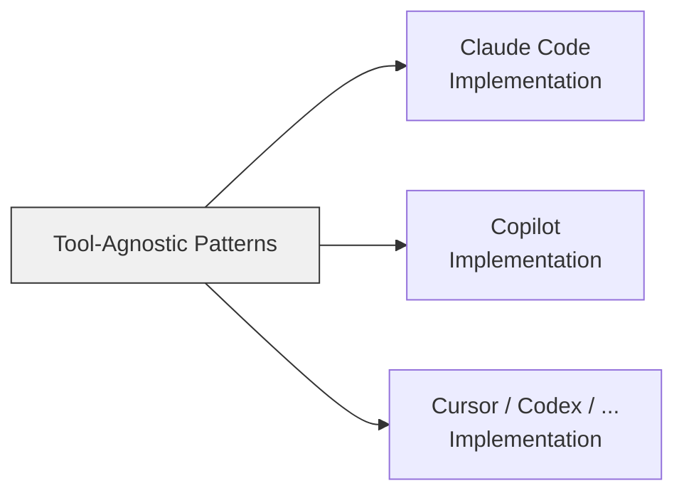

# Cross-Tool Translation: Learning from Multiple AI Assistants

> Cross-tool translation applies shared concepts across AI assistants, while each tool's runtime determines which instructions and skills work unchanged.

[Agent Skills](https://agentskills.io) and [AGENTS.md](https://agents.md) define shared formats for skills and project instructions. Check each assistant's implementation before reusing either format.

## Open standards enable portability

Anthropic reports adoption of Agent Skills: "More than 70 agent platforms, including ChatGPT, Cursor, GitHub Copilot, and VS Code, have integrated Agent Skills since we published the standard in December 2025" ([Anthropic, October 2026](https://www.anthropic.com/news/donating-agent-skills-to-the-agentic-ai-foundation)). This is Anthropic's tally; the post names four examples.

[AGENTS.md](https://agents.md) is stewarded by the Linux Foundation's Agentic AI Foundation. It carries project instructions such as build steps, test commands, and conventions. Agent Skills now sits there too. Anthropic donated "the Agent Skills name and logo, the GitHub organization, and the" agentskills.io domain to the same foundation ([Anthropic, October 2026](https://www.anthropic.com/news/donating-agent-skills-to-the-agentic-ai-foundation)). Engineers from Anthropic, Google, OpenAI and other companies "will maintain the standard as individuals".

## Cross-tool file compatibility

Supported paths provide a concrete starting point:

- VS Code discovers Claude-format agent files in `.claude/agents/`. Available tools and controls depend on the selected harness ([VS Code custom agents](https://code.visualstudio.com/docs/copilot/customization/custom-agents)).
- Copilot discovers project skills in `.github/skills/`, `.claude/skills/`, and `.agents/skills/`. Personal-skill locations depend on the surface ([GitHub agent skills](https://docs.github.com/en/copilot/concepts/agents/about-agent-skills)).

## Terminology translation table

| Concept | Claude Code | GitHub Copilot | Cross-Tool Standard |
|---|---|---|---|
| Project instructions | `CLAUDE.md` | `.github/copilot-instructions.md` | `AGENTS.md` |
| Custom agents | `.claude/agents/*.md` | `.agent.md` / VS Code custom agents | — |
| Reusable skills | `.claude/skills/<name>/SKILL.md` | `.github/skills/<name>/SKILL.md` | [Agent Skills](https://agentskills.io) |
| Tool extensibility | MCP servers | MCP servers | [MCP Protocol](../standards/mcp-protocol.md) |
| Task delegation | [Sub-agents](../tools/claude/sub-agents.md) | [Agent mode](../tools/copilot/agent-mode.md) with tools | Isolated task delegation |

## Learning from the best docs

- When a concept is unclear, read whichever tool documents it best
- When you need configuration detail, use your target tool's reference material
- Patterns transfer: [context engineering](../context-engineering/context-engineering.md) principles such as [prompt altitude](../instructions/system-prompt-altitude.md), just-in-time loading, and sub-agent architectures apply the same way across tools



## Asking the tool to translate

AI assistants can translate concepts directly:

```text
In Copilot, .github/copilot-instructions.md sets project-wide behavior.
What's the Claude Code equivalent and what differences should I expect?
```

Verify the translated answer against the destination tool's documentation.

## Gaps in translation

Not all concepts have equivalents:

- Check coordination features against the destination harness; a shared file format does not define scheduling or shared state
- Hooks have similar concepts across tools but use different event models
- Translation works best for foundational patterns. Advanced features may stay tool-specific

## When this backfires

- Execution-model mismatch: tools differ in token budgets, tool-call approval flows, and sandboxing policies. A skill that runs silently in Claude Code may surface approval prompts or fail outright in Copilot because the permission models differ.
- Tool availability: VS Code states that a custom agent's tools and controls depend on the selected harness. Verify each required tool in that harness before using the definition ([VS Code custom agents](https://code.visualstudio.com/docs/copilot/customization/custom-agents)).
- Standard version drift: Agent Skills and AGENTS.md are still evolving. A `SKILL.md` written against one tool's reading of the spec may rely on a feature another tool has not implemented yet. Test portability claims. Do not assume them.

## Example

Copilot's documented project-skill paths include `.claude/skills/` alongside `.github/skills/` and `.agents/skills/` ([GitHub agent skills](https://docs.github.com/en/copilot/concepts/agents/about-agent-skills)). A skill already stored in `.claude/skills/<name>/SKILL.md` therefore has a supported project location in Copilot.

That establishes discovery. It does not establish that the destination supplies every tool, permission, or executable the skill needs. The same documentation says supported locations depend on the surface and warns against assuming a personal skill is available to a cloud agent. Use the destination's setup guide, then test the workflow there.

## Key Takeaways

- Separate file discovery from execution compatibility. Confirm required tools, permissions, and dependencies in the destination harness.
- Tools read each other's files — VS Code reads `.claude/agents/`, Copilot discovers `.claude/skills/`
- Learn concepts, not tool syntax — [context engineering](../context-engineering/context-engineering.md) principles apply regardless of which tool runs them
- Use AI assistants to translate — ask the tool itself to map concepts between ecosystems

## Sources

- [Agent Skills open standard](https://agentskills.io) — Shared skill format and integration guidance
- [AGENTS.md open standard](https://agents.md) — Cross-tool project instruction format under the Linux Foundation
- [Claude Code: Sub-agents](https://code.claude.com/docs/en/sub-agents) — Isolated task delegation, context preservation, tool restrictions
- [Claude Code: Agent teams](https://code.claude.com/docs/en/agent-teams) — Experimental parallel agent coordination
- [GitHub Copilot: Agent skills](https://docs.github.com/en/copilot/concepts/agents/about-agent-skills) — Copilot's implementation of Agent Skills
- [VS Code: Custom agents](https://code.visualstudio.com/docs/copilot/customization/custom-agents) — Reads `.claude/agents/` format
- [Anthropic: Context engineering for AI agents](https://www.anthropic.com/engineering/effective-context-engineering-for-ai-agents) — Tool-agnostic patterns
- [Anthropic: Donating Agent Skills to the Agentic AI Foundation](https://www.anthropic.com/news/donating-agent-skills-to-the-agentic-ai-foundation) — Agent Skills name, logo, GitHub organization, and domain donated to the Linux Foundation body; 70+ platform integrations reported

## Related

- [Copilot vs Claude Billing Semantics](copilot-vs-claude-billing-semantics.md)
- [Initiatives and Community](initiatives-community.md)
- [Instruction File Ecosystem](../instructions/instruction-file-ecosystem.md)
- [Agent Skills Standard](../standards/agent-skills-standard.md)
- [AGENTS.md Standard](../standards/agents-md.md)
- [Empirical Baseline: Agentic AI Coding Tool Configuration](../instructions/empirical-baseline-agentic-config.md)
- [Cognitive Load and AI Fatigue](cognitive-load-ai-fatigue.md)
- [Context Ceiling](context-ceiling.md)
