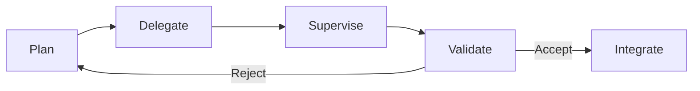

# Developer Control Strategies for AI Coding Agents

> Developer control strategies combine planning and review, but observed checking shifts between inspecting artifacts, delegating through dialogue, and seeking explanations.

## The evidence

[Huang et al. (2025)](https://arxiv.org/abs/2512.14012v2) observed 13 professional developers and surveyed 99 more (3 to 25 years experience). The central finding: experienced developers "carefully control the agents through planning and supervision" rather than adopting hands-off [vibe coding](../patterns/anti-patterns/vibe-coding.md).

| Study | Design | Key finding |
|-------|--------|-------------|
| [Huang et al. (2025)](https://arxiv.org/abs/2512.14012v2) | 13 observations + 99 surveys | Observed planning and supervision practices |
| [METR (2025)](https://metr.org/blog/2025-07-10-early-2025-ai-experienced-os-dev-study/) | RCT, 16 experienced OSS devs | AI made developers take 19% longer, yet they estimated 20% faster |
| [Anthropic (2026)](https://www.anthropic.com/research/AI-assistance-coding-skills) | RCT, 52 mostly junior engineers | AI-assisted group scored ~17 points lower on comprehension |
| [Dhanorkar et al. (2026)](https://arxiv.org/abs/2606.05391v1) | 17 developer interviews | Oversight splits into four forms: a priori control, co-planning, real-time monitoring, post hoc review |

The METR result compares perceived and measured speed; it does not establish that skipping control causes the slowdown.

### What workplace checking includes

A [workplace shadowing study (v1)](https://arxiv.org/abs/2610.33588v1) reports 11 developers across two workplaces, a multinational enterprise and an open-source foundation. The paper describes in-person recruitment at a US office. Observations lasted about 90 minutes in meeting-free sessions. The study recorded 13 sessions and excluded 2, leaving 11 for analysis. Developers spent 33.4% of observed time on prompting and response checking: 11.3% formulating prompts plus 22.1% checking AI responses. Those are time shares, not defect-detection rates ([study, sections 3 and 4.1](https://arxiv.org/abs/2610.33588v1)).

The authors describe Supervisor, Delegator, and Learner as overlapping patterns. Supervisors inspect artifacts directly; Delegators coordinate through dialogue and delegate checking; Learners seek explanations to build understanding. Developers can shift between these practices. The patterns are neither fixed developer types nor estimates of prevalence ([study, sections 3.4 and 4.5](https://arxiv.org/abs/2610.33588v1)).

For review records, distinguish reading an agent's explanation of a change from inspecting the changed artifact or its test evidence. Asking the agent to check its work records delegated checking; it does not establish independent inspection. This is a practical implication of the observed patterns, not a tested intervention. For a concrete contrast, the Billing task in [oversight stage attribution](../verification/oversight-stage-attribution.md#example) needs evidence that exposes an omitted refund. A generic request to check the code can leave that defect undiscovered.

## The plan-supervise-validate loop

Use this loop as review guidance. The studies above report varied practices rather than universal validation of every output:

Independent interviews with 17 developers surface the same structure as four oversight forms — a priori control and co-planning before execution, real-time monitoring during it, and post hoc review after ([Dhanorkar et al., 2026](https://arxiv.org/abs/2606.05391v1)). These reported oversight forms support the loop as a way to organize review, without proving that every developer performs each step.

### Plan before delegating

Developers decompose work before delegating. Planning includes:

- Scoping the task — what the agent should change and what it must not touch
- Specifying constraints — files, APIs, or patterns the agent must follow
- Choosing granularity — breaking complex work into smaller, verifiable units

This is the decomposition that makes [execution-first delegation](../patterns/agent-design/execution-first-delegation.md) effective: a contract (goal plus boundaries), not a script.

### Supervise during execution

Developers monitor output and redirect before the agent commits to the wrong direction. This maps to [human-in-the-loop placement](../workflows/human-in-the-loop.md) — gating on irreversible actions while letting reversible steps proceed.

### Validate the artifact

As review guidance, read diffs, run tests, and check behavior against the original intent. Validation separates controlled agent use from [comprehension debt](../patterns/anti-patterns/comprehension-debt.md) that builds up when developers accept unreviewed code.

## Task suitability

Agents proved effective for well-described, straightforward tasks and ineffective for complex tasks that need nuanced judgment.

| Agent-suitable | Agent-unsuitable |
|---------------|-----------------|
| Code generation from clear specs | Architectural decisions |
| Debugging with reproducible errors | Cross-cutting design changes |
| Boilerplate and repetitive patterns | Tasks requiring implicit domain knowledge |
| Well-scoped refactoring | Novel problem exploration |

This mirrors the [vibe coding](../patterns/anti-patterns/vibe-coding.md) boundary: vibe coding works for low-risk, well-scoped work; control strategies cover everything else.

## What to assess in a control loop

Use the loop to examine whether planning exposed ambiguity and whether review produced evidence about the artifact. Keep comprehension and defect detection separate when assessing the result. The authors caution that observing checks does not establish that developers validated the correctness of an agent's output ([study, section 4.4](https://arxiv.org/abs/2610.33588v1)).

## When this backfires

Control overhead is not free. The loop costs more than it saves when:

- Work is trivial or throwaway — one-line fixes or prototypes rarely repay the planning step. For low-risk, reversible work, [vibe coding](../patterns/anti-patterns/vibe-coding.md) is the better default.
- Supervision is theatre — rubber-stamping diffs without real review is nominal control only, and it recreates [comprehension debt](../patterns/anti-patterns/comprehension-debt.md) while looking diligent.
- Plans harden against changing requirements — over-specifying exploratory work locks the agent out of useful pivots.
- Agent count exceeds the attention budget — too many parallel agents degrade validation across all of them; see [attention management](attention-management-parallel-agents.md).

Apply the full loop when work is production-bound, touches shared surfaces, or is hard to revert. Relax it when work is cheap to throw away.

## Developer sentiment

Despite the overhead, developers are positive. One 20-year veteran said "there is no way I'll EVER go back to coding by hand." Satisfaction depends on keeping control — developers in control report a productivity multiplier; those who lose control report frustration and rework.

About 23% of developers already use AI agents at least weekly, per the [2025 Stack Overflow Developer Survey](https://survey.stackoverflow.co/2025/ai) — a sizeable minority, but still well short of majority adoption.

## Practical implications

For developers: decompose tasks before prompting, review every diff, and match task complexity to agent capability — delegate boilerplate, keep architectural decisions.

For tool designers: support planning workflows, make supervision cheap with real-time output and diff-first review, and surface confidence signals for trust calibration.

## Key Takeaways

- Treat plan-supervise-validate as review guidance; observed developers shift between overlapping checking practices
- Record what the developer checked: the agent's account, the artifact, or evidence capable of exposing a defect
- Agent-suitable tasks are well-scoped; complex architectural work still requires human judgment

## Related

- [Vibe Coding](../patterns/anti-patterns/vibe-coding.md) — the approach these developers explicitly reject for production work
- [Skill Atrophy](skill-atrophy.md) — comprehension loss from skipping the validate step
- [Human-in-the-Loop Placement](../workflows/human-in-the-loop.md) — where to place supervision gates
- [Execution-First Delegation](../patterns/agent-design/execution-first-delegation.md) — contract-based delegation that aligns with how experienced developers plan
- [Comprehension Debt](../patterns/anti-patterns/comprehension-debt.md) — debt from accepting agent output without review
- [Addictive Flow in Agent Development](addictive-flow-agent-development.md) — the flow state that tempts developers to skip validation
- [Attention Management for Parallel Agents](attention-management-parallel-agents.md) — supervision strategies for multiple concurrent agents
- [Progressive Autonomy and Model Evolution](progressive-autonomy-model-evolution.md) — how calibrated trust feeds progressive delegation
- [Cognitive Load, AI Fatigue, and Sustainable Agent Use](cognitive-load-ai-fatigue.md) — the supervision and review burden that control strategies impose
- [Monitor or Wait: The Supervision Choice During Agent Execution](../workflows/monitor-or-wait-during-agent-execution.md) — the stage-level version of the supervise step, and what it costs to leave a run
- [Rigor Relocation](rigor-relocation.md) — where engineering discipline moves when agents write the code
- [Strategy Over Code Generation](strategy-over-code-generation.md) — why planning matters more than generation speed
- [Adapting AI Assistant Configuration to Developer Interaction Style](developer-interaction-style-adaptation.md) — control strategies vary by cognitive style; persona configuration is one way to encode them
