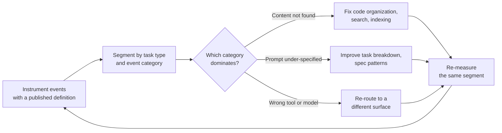

# Intervention Rate as a Diagnostic North Star, Not a Target

> Intervention rate is a segmented diagnostic signal that needs a named unit and event type to mean anything.

For interactive work, we propose measuring intervention rate as the share of turns on which a developer interrupts, corrects, or redirects an AI assistant. Publish what counts as a turn before using this definition. It points at prompt quality, code organization, task breakdown, and tool choice. It fails as a target. DORA warns that setting a metric as a goal makes teams more likely to game it ([DORA](https://dora.dev/guides/dora-metrics/)), and no source cited here supplies a rate to aim for. Segment it and name its unit before you diagnose with it.

## Conditions for a useful reading

Treat the metric as a diagnostic only when all four conditions hold.

- Publish the definition. Continue reports that Chip Huyen found a 24.5% rate across 1,746 Claude Code commands, but describes it only as interrupting or correcting the AI ([Metcalf, Continue, 2025](https://blog.continue.dev/intervention-rates-are-the-new-build-times)). The post gives no counting rule; its command-based figure cannot be converted to our proposed turn-based rate from the information supplied.
- Segment by task type. The same post reports that one developer's rate varied between 15% and 60% by task. That range describes one person, not a benchmark.
- Pair it with other measures. The authors Noda summarizes find that one combined measure is "harder to understand and less actionable" ([Noda, DX](https://newsletter.getdx.com/p/developer-productivity-metrics)). DX Core 4 spans speed, effectiveness, quality, and impact ([Noda, DX Core 4](https://newsletter.getdx.com/p/introducing-the-dx-core-4)).
- Keep correction directions separate. Anthropic's expertise classifier considers whether the user corrects Claude or Claude corrects the user. This is a classifier signal, not an intervention-rate formula ([Anthropic, 2026](https://www.anthropic.com/research/claude-code-expertise)). We propose counting developer-to-assistant corrections in the intervention numerator. Record assistant-to-developer corrections as a separate diagnostic signal.

## Why it works

Investigate whether an intervention follows an input you can change: an under-specified prompt, missing context, an oversized task, or the wrong tool. A rising count points at those inputs only when the categories under it are visible. In Continue's account, 35% of errors in the 1,746-command analysis were "Content Not Found". The developer restructured the codebase so the AI could find files, and average steps per task fell from 8 to 7 ([Metcalf, Continue, 2025](https://blog.continue.dev/intervention-rates-are-the-new-build-times)). That is one developer's result, and the build-time analogy it follows supplies no target rate.

## Extending the metric to factory runs

In a [software factory](../workflows/software-factory-model.md), agents take work from tickets and chat and open pull requests, so human effort falls before and around the code host. Two Warp measures count different events. DORA's rework measure sits at a third level.

| Measure | What it counts | Boundary |
|---|---|---|
| Human touches per PR ([Warp post](https://www.warp.dev/blog/adapting-for-a-world-of-software-factories)) | In the post's walkthrough: the first prompt, supplied context such as mocks, spec iteration, and manual code review | Defined by example. No counting rule or touch figures. |
| Autonomy ([Warp docs](https://docs.warp.dev/factories/measure-and-improve/)) | Share of merged PRs that "needed no human code push before merging". A human opening the PR counts as a human push. | Needs a connected code host. Covers only activity after connection. |
| Deployment rework rate ([DORA](https://dora.dev/guides/dora-metrics/)) | Ratio of deployments that are unplanned and result from a production incident | Deployment level, not a pre-merge repair count |

A PR with no human code push can still carry a prompt, a spec review, and an approval. "No human code push" therefore never means "no human involvement".

### Proposed event dictionary (synthesis)

We propose this dictionary as synthesis. No source defines these five types or validates them. They rest on three boundaries: Warp's touches mix prompting, spec work, and review; its autonomy counts code pushes only; DORA ties rework to production incidents.

| Event type | Definition | Unit |
|---|---|---|
| Planned specification | A human writes or reviews a spec the process schedules before implementation | Touches per merged change |
| Required approval | A human sign-off your policy requires | Touches per merged change, reported as a control |
| Corrective prompting | A human re-prompts or redirects after wrong agent output | Touches per merged change; correction time per change |
| Manual code repair | A human commits code to the agent's change before merge | Repair share: merged changes with a pre-merge human code commit divided by all merged changes in the same selected cohort |
| Recovery | A human restores state after a merged change misbehaves | Recovery actions per deployment. Count DORA rework only when recovery produces an unplanned deployment caused by a production incident. |

Accounting rules, also our synthesis:

1. Print the unit, cohort, and observation cutoff on every chart, and plot one unit per chart. Use the same merged-change cohort for numerator and denominator; report effort on failed and still-open work separately. DORA lists "Making disparate comparisons" as a pitfall.
2. Report required approvals as a control (see [evidence-bundled PRs](../verification/evidence-bundled-agent-prs.md)). If every change requires approval, folding approvals into a failure count holds it at one or more per change and rewards removing the check.
3. When reporting Warp dashboard autonomy, use its no-human-code-push definition, including its PR-opening rule. Define other autonomy claims separately.
4. Count each human action once. Record its purpose as the event type and its channel or source in a separate field. Include work in chat or tickets: Warp's post describes prompting through Slack and Jira, while its autonomy metric counts code pushes.
5. Use a dashboard change to pick runs to inspect. Warp's docs say it cannot show what caused the change.

## When this backfires

- Different task scopes obscure comparisons. Continue reports task-specific variation in one developer's rate ([Metcalf, Continue, 2025](https://blog.continue.dev/intervention-rates-are-the-new-build-times)). Record task scope alongside the rate; use [ambition scaling](ambition-scaling.md) to review the work you assign.
- Gaming. Tied to performance reviews, the rate falls when people accept weaker output or narrow scope. DORA and the DX authors both flag this pressure. Warp expects touches per PR to fall as its factory improves, and that expectation carries the same risk.
- Small teams with one tool. DORA says integrations that give precise data "might not be worth the initial investment". A simple count, quality measures, and inspection of individual runs can be enough.
- Hand labels. Someone must assign the five event types, and no source reports how consistent such labels are. Write the rule down and spot-check it.

Use [cost per accepted change](../factory-engineering/cost-per-accepted-change.md) for the cohort and observation-cutoff contract.

## Key Takeaways

- Trace one merged PR through its ticket, chat, and commits. Check whether each recorded human action appears exactly once.
- Have two reviewers classify the same run with the proposed dictionary. Resolve disagreements before comparing team totals.
- For a recovery event, inspect the deployment record before assigning DORA rework. Keep missing evidence visible in the report.

## Related

- [Ambition Scaling: Moving the Target as Model Capability Increases](ambition-scaling.md) — the ambition axis a low rate alone cannot reveal.
- [Progressive Autonomy: Scaling Trust with Model Evolution](progressive-autonomy-model-evolution.md) — uses intervention rate as one input to the autonomy decision.
- [Cohort Segmentation in the Copilot Usage Metrics API](cohort-segmentation-copilot-usage-metrics.md) — diagnostic-over-aggregate logic applied to Copilot adoption cohorts.
- [Developer Control Strategies for AI Coding Agents](developer-control-strategies-ai-agents.md) — empirical baseline for how experienced developers intervene.
- [Label Prompt Intent Before Comparing Prompt Counts](prompt-intent-mix.md) — the same categories-under-the-number move applied to a prompt total.
- [Suggestion Gating: Fewer Completions, Better DX](suggestion-gating.md) — the autocomplete-surface analogue, where acceptance rate is the signal.
- [Verification Capacity Saturation](../verification/verification-capacity-saturation.md) — queue limits on the review step that approvals depend on.
- [Factory Engineering](../factory-engineering/index.md) — the section this page belongs to.
