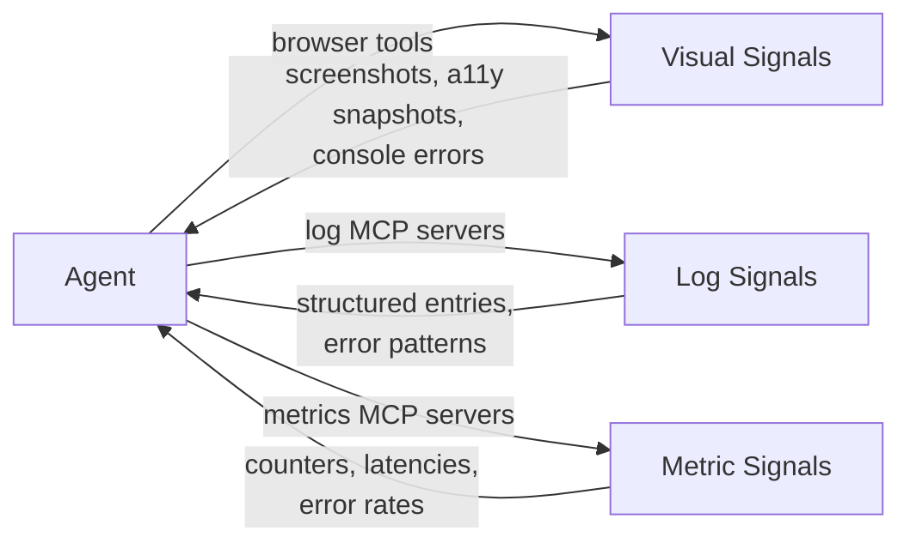

# Making Application Observability Legible to Agents

> Wire browser automation, metrics, and structured logs into agent context so agents can reproduce bugs, verify fixes visually, and reason about system behavior.

## The gap

!!! note "Not about observing agents"
    [Agent Observability (OTel)](agent-observability-otel.md) covers humans watching agent behavior. The inverse: agents watching application behavior through tools.

Agents write code, run tests, and read output. They cannot:

- Check whether a UI change renders correctly
- Query production metrics to confirm a fix reduced error rates
- Search logs for the error pattern a user reported

Without these signals, agents operate in "write and hope" mode. [Closing the loop](observability-feedback-loop.md) enables "write, observe, and verify" workflows.

## Three signal categories



### Visual signals: browser automation

Agents verify rendering and UI behavior by driving a browser.

| Tool | Approach | Key capability |
|------|----------|----------------|
| [Playwright MCP](https://github.com/microsoft/playwright-mcp) | Accessibility snapshots | Structured a11y tree, console capture, network logging -- no screenshots needed |
| [Rodney](https://github.com/simonw/rodney) | Persistent headless Chrome via CDP | State persists across CLI calls; exit-code assertions for CI/CD |
| [agent-browser](https://github.com/vercel-labs/agent-browser) | Accessibility-first Rust CLI | Elements as `@e1`, `@e2` references; built-in network interception and profiling |
| Puppeteer MCP (generic) | Screenshots | Visual verification via captured images; no structured DOM access |

Accessibility snapshots and screenshots serve different needs. Snapshots return structured text (roles, names, states) that LLMs reason about directly. Screenshots need a vision model, so use them only for layout bugs.

!!! warning "Blind spot: modal dialogs"
    Puppeteer MCP cannot see browser-native alert modals (`window.alert`, `window.confirm`, `window.prompt`) -- this is a known architectural gap. Use Playwright MCP when the workflow includes native dialog interactions; its accessibility snapshot model captures dialog state that screenshot-only tools miss.

[Showboat](https://github.com/simonw/showboat) gives executable proof of work. It mixes narrative and runnable code blocks with captured output. Its `verify` command re-executes every block and checks that the outputs match.

### Log signals: structured logs as agent context

Agents need structured, filterable log data -- not raw streams:

| Server | Platform | Capabilities |
|--------|----------|-------------|
| [Axiom MCP](https://github.com/axiomhq/mcp-server-axiom) | Axiom | Natural language queries via APL, trace analysis, alert monitoring |
| [Datadog MCP](https://github.com/winor30/mcp-server-datadog) | Datadog | Log search, APM traces, incident management, RUM events (20 tools) |
| [Datadog Labs MCP](https://github.com/datadog-labs/mcp-server) | Datadog | Official preview -- logs, metrics, traces, incidents |

### Metric signals: application metrics as verification

Agents use metrics to verify a change had the intended effect:

- After fixing an auth bug: query error rate, confirm it dropped
- After a performance optimization: query p99 latency, confirm it decreased
- After a deployment: check RUM data for regressions

The same MCP servers that expose logs also expose metrics. [Arize Phoenix MCP](https://github.com/Arize-ai/phoenix/tree/main/js/packages/phoenix-mcp) adds span retrieval and annotation.

## Production database state: transient evidence

[Pinto, 2026](https://arxiv.org/abs/2611.17304v1) is one author's retrospective observation of one Claude Code agent across eight database incidents in one production message-dispatch engine (27 sessions, about 3,000 tool calls). About 79% of model calls went to an open-weights model (DeepSeek) and about 17% to Claude Opus (§3). All five incidents that depended on runtime concurrency had an access gap, such as no live lock view or a truncated deadlock report. In four the gap combined with a reasoning error. By the author's coding, none was limited by reasoning alone (§5). The other three incidents needed nothing the agent lacked.

The paper cannot show causation: "without a controlled comparison we cannot show that the former caused the latter", and "A frontier model might have avoided some of the reasoning errors in the mixed incidents" (§7). In four incidents the information that refuted the wrong hypothesis was within the agent's reach (§4.10).

Studies that supply telemetry point the other way. In an OpenRCA audit of 70 cases, 28 (40.0%) were reasoning gaps and 1 (1.4%) was data ambiguity, a lower bound because the label was given ([Gopal and Krishnan, 2026](https://arxiv.org/abs/2607.13548v2), Table 12). Across 1,675 runs of five models, hallucinated data interpretation appeared in 1,193 (71.2%), and the framework provides metrics, logs and traces for every incident ([Kim et al., 2026](https://cloudintelligenceworkshop.org/papers/aiops26-Kim.pdf), Table 3). Access looks necessary for this bug class, not sufficient.

The paper proposes a read-only, audited surface over `pg_locks`, `pg_stat_activity` and query plans, and lists building it as future work (§6.2, §9). `pg_locks` shows locks held by active processes ([PostgreSQL docs](https://www.postgresql.org/docs/current/view-pg-locks.html)), and `log_lock_waits` is off by default ([PostgreSQL docs](https://www.postgresql.org/docs/current/runtime-config-logging.html)). See [scoped runtime access](../patterns/agent-design/scoped-devtools-access-runtime-diagnosis.md) for the exposure risks.

## Context management: JIT loading

Observability data is high-volume. Two patterns keep context lean:

JIT references. Agents store lightweight identifiers -- query strings, metric names, time ranges -- and load data on demand instead of pulling full payloads upfront.

```text
# Agent stores a reference, not the data
log_query: "service:auth level:error @timestamp:[now-1h TO now]"

# Agent executes query only when it needs to verify a fix
datadog_log_search(query=log_query)
Result: 3 results (down from 47 before the fix)
```

[Programmatic tool calling](../tool-engineering/advanced-tool-use.md#programmatic-tool-calling-code-based-orchestration). Agents write code that calls observability tools and filters large payloads before they reach the context window.

## Verification ladder: cheap to expensive

Simon Willison's [agentic manual testing guide](https://simonwillison.net/guides/agentic-engineering-patterns/agentic-manual-testing/) maps the verification spectrum:

| Signal type | Tool | Use case |
|-------------|------|----------|
| Unit-level | `python -c` | Quick assertions on code behavior |
| API-level | `curl` | Endpoint verification |
| Browser-level | Playwright, Rodney | Visual and interaction verification |
| Proof-of-work | Showboat | Self-verifying demo documents |

## Example

An agent fixes a login bug using all three signal categories:

```text
# 1. Agent reads the error report and searches logs via Datadog MCP
datadog_log_search(query="service:auth level:error @message:*InvalidCredentials* @timestamp:[now-24h TO now]")
→ 312 errors, stack trace points to session.validate()

# 2. Agent fixes session.validate(), runs tests — all pass

# 3. Agent verifies the UI fix via Playwright MCP
playwright_navigate("https://staging.example.com/login")
playwright_fill("#email", "test@example.com")
playwright_fill("#password", "valid-password")
playwright_click("#login-button")
playwright_snapshot()
→ a11y snapshot shows role=heading "Dashboard" — login succeeded

# 4. Agent checks metrics to confirm error rate dropped
datadog_metric_query(query="sum:auth.errors{service:auth}.as_count()", from="-1h")
→ 3 errors in the last hour (down from 312 in the prior 24h)
```

The agent closed the loop: logs identified the root cause, tests confirmed the code fix, browser automation verified the UI, and metrics proved errors dropped.

## When this backfires

Wiring observability into agent context adds complexity that can degrade reliability:

- MCP server outage blinds the agent. If the Datadog or Axiom MCP server is down, the agent loses all log and metric visibility. It may proceed silently without realizing its verification step returned nothing.
- Stale or sampled data misleads. Metrics dashboards aggregate and sample. An agent querying error rate 30 seconds after a deploy may read pre-deploy data and wrongly conclude the fix worked.
- Large payloads bloat the context. Log queries without tight time or count limits can return thousands of entries, consuming the context window and [reducing reasoning quality](../context-engineering/context-window-dumb-zone.md). JIT references (described above) reduce this but require deliberate query discipline.
- Screenshot-heavy workflows are slow. Vision-model verification via screenshots adds latency to each check. On long test suites this compounds, so prefer accessibility snapshots for functional checks and screenshots only for layout verification.

## Key Takeaways

- Agents that only read code and test output operate in "write and hope" mode; wiring visual, log, and metric signals into context lets them write, observe, and verify.
- Accessibility snapshots beat screenshots for functional verification — structured text reasons cleanly without a vision model and consumes a fraction of the tokens.
- Treat observability data as JIT references: store query strings and time ranges, then load payloads on demand so context windows stay lean.
- Climb the verification ladder from cheapest signal up — `python -c` and `curl` before browser drivers, browser drivers before vision screenshots.
- Plan for the failure modes: MCP outages turn agents blind, stale metrics mislead post-deploy verification, and untrimmed log queries shred the context window.
- For database incidents that depend on concurrency, one observation found access gaps in every case, but full-telemetry studies still find reasoning failures, so treat access as necessary and not sufficient.

## Related

- [OpenTelemetry for AI Agent Observability and Tracing](../standards/opentelemetry-agent-observability.md) -- OTel semantic conventions for agent spans and instrumentation
- [Agent Debugging](agent-debugging.md) -- diagnosing agent failures using logs, traces, and tool call inspection
- [Browser Automation for Research](../tool-engineering/browser-automation-for-research.md) -- using Playwright to fetch web content, distinct from debugging applications
- [Semantic Tool Output](../tool-engineering/semantic-tool-output.md) -- designing tool outputs for agent readability
- [Trajectory Logging via Progress Files](trajectory-logging-progress-files.md) -- agent-written audit trails
- [Event Sourcing for Agents](event-sourcing-for-agents.md) -- immutable event logs as an observability substrate
- [Context Engineering](../context-engineering/context-engineering.md) -- JIT loading and observation masking patterns that keep observability payloads from saturating the window
- [Agent-Recorded Video Demos as a Verification Artifact](../verification/agent-recorded-video-demos.md) -- the agent records a screencast as proof-of-work for a human reviewer, rather than wiring signals in to self-verify
