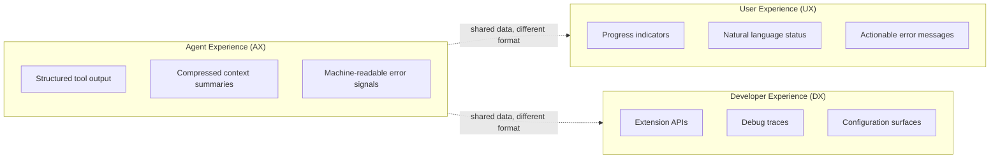

# AX/UX/DX Triad: Three Experience Layers in Agent Systems

> Agent Experience (AX), User Experience (UX), and Developer Experience (DX) are distinct design surfaces; evaluate each audience's information needs before choosing a shared format.

## The problem

Agent systems have three audiences: the LLM, the end user, and the developer. CCA separates these audiences ([CCA paper](https://arxiv.org/abs/2512.10398v6)). Agents need structured, machine-readable interfaces ([Nordic APIs](https://nordicapis.com/what-is-agent-experience-ax/)). Microsoft defines AX through two measurable questions ([Microsoft, What is Agent Experience (AX)](https://devblogs.microsoft.com/blog/what-is-agent-experience-ax/)). Propensity asks "does the agent find your technology and choose it?"; efficacy asks "once the agent uses your technology, does it use it correctly?"

## Three layers



### Agent Experience (AX)

What the model sees at each step of the [Agent Turn Model](agent-turn-model.md). Curate context for inference quality. When the illegibility lives on a public surface the agent calls from outside, the outward-facing complement is [Designing for Agent Consumers](../../tool-engineering/designing-for-agent-consumers.md):

- Structured tool output: JSON or typed returns, not prose descriptions
- Context management: hierarchical working memory plus compression improved Claude Sonnet 4 from 42.0% to 48.6% on a 100-example SWE-Bench-Pro subset where both variants produced executable solutions ([CCA ablation](https://arxiv.org/abs/2512.10398v6))
- Machine-readable error signals: stack traces and [RFC 9457 structured error fields](../../tool-engineering/rfc9457-machine-readable-errors.md), not user-friendly messages
- Persistent notes: a second run on the same 151 tasks with notes from the first run scored 54.4%, versus 53.0% initially ([CCA paper §3.5](https://arxiv.org/abs/2512.10398v6))

### User Experience (UX)

What the human sees. Clear status, predictable behavior, actionable feedback:

- Progress indicators: streaming status, not raw tool call logs
- Natural language summaries: what was done and why, not the internal reasoning chain, per [Controlling Agent Output](../../instructions/controlling-agent-output.md)
- Actionable error messages: what went wrong and what to try, not stack traces

Raw traces can obscure current status. Offer a concise summary while keeping diagnostic detail available.

### Developer Experience (DX)

What the builder configures and debugs. Composable extension points and observable internals:

- Extension APIs: typed interfaces for adding tools and memory backends without modifying core scaffold code
- Debug traces: reasoning chains, tool call sequences, and token usage on demand, per [Agent Debugging](../../observability/agent-debugging.md)
- Configuration surfaces: behavior tuning without code changes

DX degrades when internals are opaque or when AX concerns leak into the extension API.

## Why conflation fails

| Conflation | What happens |
|-----------|-------------|
| AX = UX | Human-facing logs waste model context on formatting; agent sees prose where it needs structured data |
| AX = DX | Debug traces in agent context add noise; configuration complexity leaks into prompts |
| UX = DX | End users exposed to debug interfaces; developers forced to polish internal tools |

The complete CCA scaffold scored 52.7% on SWE-Bench-Pro with Claude Sonnet 4.5. This result does not isolate the effect of AX/UX/DX separation ([CCA paper](https://arxiv.org/abs/2512.10398v6)).

## Why it works

CCA presents distinct AX, UX, and DX principles as a foundation for scalable, analyzable, and reproducible agent behavior ([CCA paper §1](https://arxiv.org/abs/2512.10398v6)). Treat the table above as design risks to test. Neither structured output nor separate representations guarantee better results.

## When this backfires

Separation adds overhead. It is less valuable when:

- Simple single-user tools: a small CLI may serve its audiences with one well-structured log. Test whether separate formats add value.
- Prototype or exploratory work: maintaining separate transformation layers slows iteration when requirements change frequently.
- Thin context budgets: adding a transformation layer near context limits requires care; naive separation can introduce overhead of its own, the cost [context compression strategies](../../context-engineering/context-compression-strategies.md) exist to manage.
- Scale constraints: CCA reports 57.8% for tasks editing 1--2 files and 44.1% for 5--6 files, but 52.6% for 7--10 files. These task groups are observational, not an ablation of the triad ([CCA paper §3.4.2](https://arxiv.org/abs/2512.10398v6)).

Microsoft warns that "a change that sounds agent-friendly can still make agents worse with your technology, or more expensive" ([Microsoft, What is Agent Experience (AX)](https://devblogs.microsoft.com/blog/what-is-agent-experience-ax/)).

## Applying the triad

Audit each information flow against three questions:

1. Who consumes this output? If both the model and the user consume it, test whether one format serves both.
2. What format serves that consumer? Structured data for agents, natural language for users, typed APIs for developers.
3. Where does the boundary live? Use an explicit transformation layer where the consumers need different representations.

## Example

A file-search tool returns results. Each layer gets a different representation of the same data:

```python
# AX layer — structured data for the model
def tool_return_ax(results):
    return {"matches": [{"path": f, "score": s} for f, s in results]}

# UX layer — human-readable summary
def tool_return_ux(results):
    if not results:
        return "No files found."
    return f"Found {len(results)} files. Top match: {results[0][0]}"

# DX layer — full debug payload
def tool_return_dx(results, query, elapsed_ms):
    return {"query": query, "elapsed_ms": elapsed_ms,
            "matches": results, "index_version": "v3"}
```

The model receives compact JSON (the `matches` array) it can parse. The user sees a one-line summary. The developer gets timing and index metadata for debugging. One data source, three format contracts.

## Key Takeaways

- AX, UX, and DX are distinct design surfaces with different optimization targets
- Check whether model-facing output and human-facing output meet their consumers' needs
- CCA's results support evaluating the whole scaffold; they do not establish a standalone benefit from the triad
- Add separate formats when evaluation shows the audiences need them

## Related

- [Harness Engineering](harness-engineering.md) -- AX/UX/DX separation is an architectural principle within harness design
- [Controlling Agent Output](../../instructions/controlling-agent-output.md) -- matching response format to consumer needs, a direct AX-aware application
- [Memory Synthesis from Execution Logs](memory-synthesis-execution-logs.md) -- hindsight failure notes implement log synthesis
- [Context Compression Strategies](../../context-engineering/context-compression-strategies.md) -- structured compression near context capacity
- [Agent Backpressure](agent-backpressure.md) -- feedback signals are AX-layer concerns that must not leak into UX
- [Progressive Disclosure for Agent Definitions](progressive-disclosure-agents.md) -- loading context proportional to task complexity is an AX optimization
- [Agent Debugging](../../observability/agent-debugging.md) -- DX-layer concerns for diagnosing agent behavior
- [AX Evals: Measure the Agent-Facing Surface, Not the Model](../../verification/ax-evals-agent-facing-surface.md) -- how to evaluate the AX layer once you have separated it, with the model held fixed
