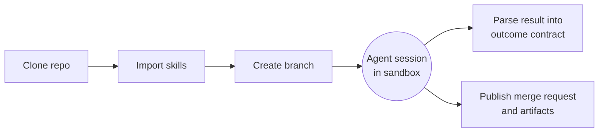

# Internal Remote-Agent Platform: Coding Agents Behind One API

> An internal remote-agent platform runs sandboxed coding-agent tasks for internal teams through one API call, and returns the result as a merge request.

An internal remote-agent platform is a shared service that accepts a prompt and environment requirements over an API, runs a coding agent in an isolated sandbox against a target repository, and hands back a merge request plus a machine-readable outcome. This page draws three conditions from the sources below: many repositories, tasks that recur across them, and a team that can own the runtime after launch. iFood, with more than 15,000 repositories, built one and reports more than 25,000 runs at an average inference cost of US$0.04 per run ([OpenAI customer story](https://openai.com/business/customer-stories/ifood)). The figures come from a customer story that OpenAI published.

## The problem it removes

The story's lessons for leaders name the gap: "Several teams already knew what they wanted to automate; they lacked an environment in which to run it" ([OpenAI customer story](https://openai.com/business/customer-stories/ifood)). Before the platform, iFood says, each team tackled the problem in its own way and hit the same obstacle. The platform turns that into a call. iFood's security team "didn't need to build its own agentic runtime or become experts in agent orchestration. It needed to call an API."

## How the runner is built

iFood's lifecycle has three steps. A caller "submits a prompt and environment requirements through a REST call", the platform runs the task "on a dedicated remote runner inside an isolated sandbox", and "the result is retrieved later" ([OpenAI customer story](https://openai.com/business/customer-stories/ifood)).

Inside the runner, fixed code wraps one agentic step:

- Deterministic bookends: cloning, importing skills, and setting up the branch run before the agent. Publishing the merge request and the artifacts runs after it. The story's lessons for leaders note that cloning, publishing, and making artifacts available "don't require a model".
- One agentic step: the agentic execution sits between the bookends and runs GPT-5.6 Luna inside the sandbox.
- An outcome contract: iFood passes the session result through Structured Outputs, which "ensures we can always get a response from the agent's session, whether positive or negative."
- A prepared sandbox: the Ubuntu sandbox carries the toolchains iFood's repositories need, including Python, Java, Kotlin, and Go.

## Cost per run is a design input

A per-run cost that looks trivial for one task sets the budget at platform scale. The story's lessons for leaders state that "the cost per task determines what is feasible to automate" ([OpenAI customer story](https://openai.com/business/customer-stories/ifood)). iFood picked its model on intelligence, efficiency, and speed considered together, rather than on just one of them. Its more than 25,000 runs used more than 27 billion tokens.

## Why it works

A shared runtime pays for fixed work once and passes every improvement to every caller. Spotify reports this effect from running its background agent on its fleet infrastructure: "improvements to the agent configuration and tools now apply to any PRs generated, no matter the source of the task" ([Spotify Engineering](https://engineering.atspotify.com/2025/11/spotifys-background-coding-agent-part-1)). Spotify also names shared commit tagging, LLM quotas, and traces. The deterministic bookends take model decisions away from steps that have one right answer. Stripe found that coding such steps "saves tokens (and CI costs) at scale and gives the agent a little less opportunity to get things wrong" ([Stripe Minions, part 2](https://stripe.dev/blog/minions-stripes-one-shot-end-to-end-coding-agents-part-2)). The outcome contract gives each run a readable result. The story's lessons for leaders give the reason: "Without a structured response, there's no way to know at scale whether the agent achieved its objective" ([OpenAI customer story](https://openai.com/business/customer-stories/ifood)).

## When this backfires

- A small engineering team or a simple dev setup. Warp, which sells a competing product, says owning the entire stack makes sense for companies with "large engineering teams and very complex dev setups", and adds: "the MVP is pretty easy, but the remaining pieces to manage agents at scale is actually where the bulk of the work is" ([Warp](https://www.warp.dev/blog/build-vs-buy-coding-agents-at-scale)). For most companies, Warp's advice is to "figure out the essential parts that make sense for you to own, which are typically related to the idiosyncrasies of your dev setup, and find ways to buy the rest."
- No owner after launch. Warp lists features teams start to want once an MVP exists, including handoff, audit logs, evals, and integrations into other apps. Warp says these start "to become a pretty big effort" ([Warp](https://www.warp.dev/blog/build-vs-buy-coding-agents-at-scale)).
- Reading a schema-valid result as success. OpenAI's guide says an application using Structured Outputs "still needs to handle refusals, incomplete responses, and API errors, and validate any business rules that the schema does not express" ([OpenAI Structured Outputs](https://developers.openai.com/api/docs/guides/structured-outputs)). This page's advice goes further: check a positive outcome in the contract with tests, CI, and review before merge.
- Tasks that need judgment mid-run. The API returns a merge request later. Spotify notes that agents "can take a long time to produce a result, and their output can be unpredictable" ([Spotify Engineering](https://engineering.atspotify.com/2025/11/spotifys-background-coding-agent-part-1)). iFood frames its platform around routine tasks a developer can "delegate without having to monitor".

## Example

iFood's first large caller is an internal security product that scans the 15,000 repositories for vulnerable dependencies and tries to fix them ([OpenAI customer story](https://openai.com/business/customer-stories/ifood)). After it moved onto the platform, the story reports that the security product "more than doubled both the accuracy of its fixes and the number of vulnerabilities resolved." The story does not say how accuracy was measured.

## Key Takeaways

- Warp, a vendor, says owning the whole stack makes sense for large engineering teams with very complex dev setups, and advises most companies to own the parts tied to their dev setup and buy the rest.
- Keep clone, branch, and publish as plain code so the model decides only inside the task.
- Treat the outcome contract as routing data. It makes results readable at scale, and tests and review still decide correctness.
- Set a cost-per-run budget before scaling. At thousands of runs it limits which tasks are worth automating.

## Related

- [Bounded Agent Steps Inside a Deterministic Workflow](bounded-agent-step.md) — The fenced agent stage that the runner's bookend design is one case of
- [Cloud-Agent Session Bootstrap](cloud-agent-session-bootstrap.md) — How to prepare the sandbox environment each remote run starts from
- [Issue-to-PR Delegation Pipeline for AI Agent Development](../../workflows/issue-to-pr-delegation-pipeline.md) — Staged handoffs from issue to merged change, including Stripe's mixed deterministic and agent steps
- [Swarm Migration Pattern](../multi-agent/swarm-migration-pattern.md) — Parallel agents applying one change across a codebase, a common caller of such a platform
- [Sizing an Agent Migration Fan-Out by Diff Uniformity](../../workflows/agent-fanout-migration-diff-uniformity.md) — When a cross-repo change suits fan-out at all
