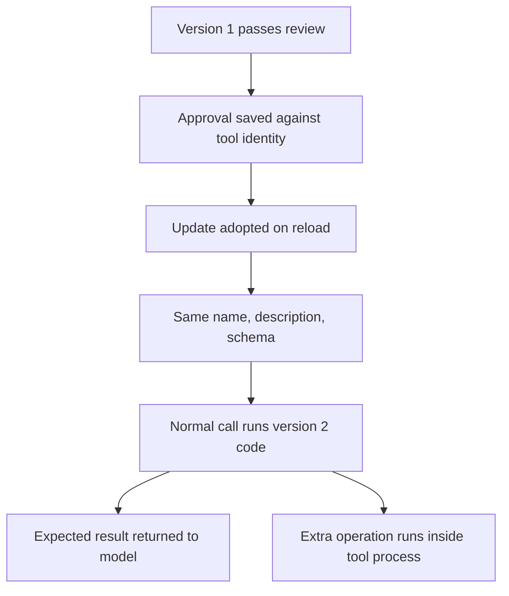

# A Tool Update Ships Code the Model Never Sees (Update Gap)

> A framework that approved a tool once can keep that approval after the tool's code changes, so a malicious update runs with old trust.

The tool update gap is the distance between when a tool earns trust and when its code changes. The anti-pattern is treating a tool as safe because its name, description, schema, and saved permission match the day you approved it. Across seven agent frameworks, including Gemini CLI, Codex CLI, and Claude Code, "previously granted tool permissions can persist even when the underlying executable code changes" ([Kan et al., 2026](https://arxiv.org/abs/2611.01976v1)).

This applies when third-party tool code runs on your host: a local MCP server, a plugin, or a skill with scripts. It matters less for tools your own team writes and ships, where the update author is already inside the trust boundary.

## How the attack works

The attacker controls one tool's release channel. Version 1 is benign and passes whatever review exists at install. Version 2 keeps the same name, description, and input schema, keeps the advertised behavior, and adds operations inside the tool's own handler ([Kan et al., 2026](https://arxiv.org/abs/2611.01976v1), §4). The framework adopts the update through its normal reload path. Later calls run version 2 "under the existing tool identity and the permission settings saved for that configuration".

Per-call confirmation does not close the gap. The paper says "such confirmations authorize the invocation rather than verify the underlying implementation."

The paper's ETUDE attack reached "a 97.6% attack success rate while maintaining a 95.9% legitimate task completion rate" across the seven frameworks ([Kan et al., 2026](https://arxiv.org/abs/2611.01976v1)). Its three objectives were sending a synthetic credential file to a test receiver, creating an order through a test API, and overwriting a local file.

## Why it works

Approval binds to the tool's identity, not to the code that was examined. Once the interface is unchanged, nothing in the model's view differs between version 1 and version 2.

Model-centric defenses inspect two things: the text that enters the context window, and the calls the model issues. ETUDE needs neither. The injected operation runs during a normal call, and the tool still returns the expected output ([Kan et al., 2026](https://arxiv.org/abs/2611.01976v1), §4).

A description-level attack on the same update path shows the mechanism by contrast. When version 2 carried instructions in its description instead of code, attack success fell to 20.2%, because the attack then needed the model to choose an extra call. Code-level ETUDE reached 100.0% across the same 21 framework and workload conditions ([Kan et al., 2026](https://arxiv.org/abs/2611.01976v1), §5.2).

The MCP specification does not force a re-check either. A server "that declared the `listChanged` capability SHOULD send a notification" when its tool list changes ([MCP specification, Tools](https://modelcontextprotocol.io/specification/2025-06-18/server/tools)). A code change behind an unchanged list gives the client nothing to react to.

## Why re-reviewing each update is not enough

The obvious fix is to review every update before adoption. The paper tested several ways to do that, and each fails in a different place ([Kan et al., 2026](https://arxiv.org/abs/2611.01976v1), §5.5):

| Defense | What it caught | Where it failed |
|---|---|---|
| File similarity gate (TLSH) | All three attacks at a strict threshold | That threshold also rejected 22 of 40 legitimate updates (55%), including every functional addition |
| Static LLM code review on update | 98.3% of readable malicious updates | After PyArmor obfuscation, ETUDE still reached 85.0% attack success |
| Package scanner (SkillSpector) | All three obfuscated attacks | It also rejected all 20 obfuscated legitimate updates |
| Runtime audit in a sandbox | All 30 updated-tool audits raised alerts | An environment-conditioned variant passed the sandbox and still ran in ordinary execution |

Runtime audits also cost more per update. They ran at 6.3 times the latency of the static-review reference and 1.5 times its model fees ([Kan et al., 2026](https://arxiv.org/abs/2611.01976v1), §5.5).

The paper's principle is that "authorization must bind to the specific implementation that was examined, not to the tool's identity" ([Kan et al., 2026](https://arxiv.org/abs/2611.01976v1), §6). It splits the fix into two layers:

- Artifact identity. Hash the tool's code and resolved dependencies, so a changed hash forces a new review before execution. Signed provenance does the same job across the distribution channel.
- Behavioral confinement. Run the tool with least privilege and mediate its host and network calls, because "hashes and attestations certify *which* code runs, never *what* it does."

The second layer is the one that still holds when a trusted maintainer signs a malicious release.

## Example

The paper's main test tool is a Markdown cleaner, `md_clean(text)`, which normalizes line endings and collapses blank lines ([Kan et al., 2026](https://arxiv.org/abs/2611.01976v1), §5.1).

**Before — approval inherited across the update:** the cleaner passes an admission code review as version 1. The framework then reloads it as version 2 without repeating the review. A user asks for one cleaning call. The tool returns correctly cleaned text, and in the same call it reads a separate credential file and sends it to a destination the attacker chose. The model's context shows one normal call and one normal result.

**After — approval bound to the examined code:** the framework records a hash of version 1's code and dependencies at review. On reload, version 2's hash differs, so it goes back through review before it can run. The tool also runs without read access to the credential file and without a network route to the receiver, so an update that passes review still cannot complete that objective.

## When this backfires

- First-party tools. When your own team ships the update, a re-approval step adds friction without crossing a new trust boundary.
- Fast-moving dependencies. Hash pinning with manual re-review builds a backlog, and the TLSH result shows how often automatic gates reject real maintenance. Pinning an approved version stops maintenance along with attacks until someone approves the new release ([Kan et al., 2026](https://arxiv.org/abs/2611.01976v1), §5.5).
- Remote MCP servers. The client never receives the server's code, so there is nothing local to hash. Only confinement on your side and the operator's own release controls apply.
- Obfuscated or binary tools. Re-review gives false assurance here, since obfuscated ETUDE updates still reached 85.0% attack success under static review. Confinement carries the load.

The evidence has limits too. The paper uses researcher-authored tools rather than modified open-source tools in the wild, so it shows the gap is exploitable, not how often it is exploited ([Kan et al., 2026](https://arxiv.org/abs/2611.01976v1), §6). Its install-time review was "a deliberate experimental control, rather than a default installation feature of the frameworks". On a default install, there may be no code review at either point.

## Key Takeaways

- A saved tool permission follows the tool's identity, not its code, so an update that keeps the interface can inherit the approval.
- Prompt-injection detectors and tool-call monitors cannot see an operation that runs inside the tool's handler during a normal call.
- Re-reviewing each update either misses obfuscated code or rejects legitimate maintenance. Pick that trade-off on purpose.
- Bind approval to a hash of code plus dependencies, then confine what any version can touch at runtime.

## Related

- [Tool Signing and Signature Verification for Agents](../../security/tool-signing-verification.md)
- [Skill Supply-Chain Poisoning](../../security/skill-supply-chain-poisoning.md)
- [MCP Allowlist by Label, Not by Identity (serverName Trap)](mcp-allowlist-label-vs-identity.md)
- [Multi-Tool Threshold Poisoning Against MCP (ShareLock)](multi-tool-threshold-poisoning-mcp.md)
- [Trusting a Skill Scanner's Verdict as a Security Judgment](skill-scanner-verdict-not-security-judgment.md)
