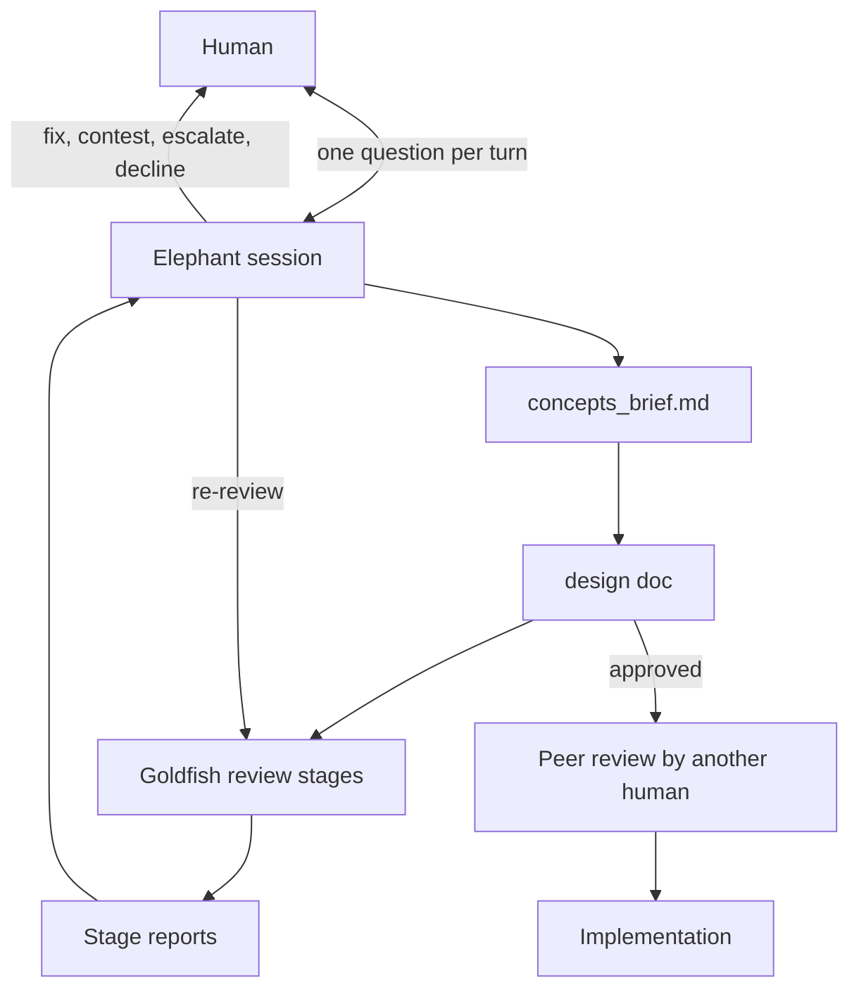

# Elephant-Goldfish Design Review: Deep-Context Drafting with Zero-Context Review

> A long-context session drafts a design document with the human, then fresh reviewer subagents with no conversation history read it and report gaps.

The Elephant-Goldfish Model (EGM) splits design work across three roles. A long-context Elephant session interviews the developer and drafts the specification. Goldfish reviewer subagents read the draft and its referenced files "without the earlier conversation", and the human approves the specification ([EGM README](https://github.com/google/elephant-goldfish-model/blob/36343a16f0e0d830a7ed78b0da97695379ab3243/README.md#L16-L20)). The design document is the output, and it carries decisions across a [phase boundary](../agent-design/discrete-phase-separation.md). The upstream workflow then asks the author to send the design to another human as a pull request ([getting started](https://github.com/google/elephant-goldfish-model/blob/36343a16f0e0d830a7ed78b0da97695379ab3243/docs/getting_started.md#L72-L74)). Implementation happens afterward, when you "Tell AI to build to the plan" ([getting started](https://github.com/google/elephant-goldfish-model/blob/36343a16f0e0d830a7ed78b0da97695379ab3243/docs/getting_started.md#L76-L79)).

EGM is an Apache 2.0 plugin from Google engineers, and its README says it is "not an officially supported Google product" ([README](https://github.com/google/elephant-goldfish-model/blob/36343a16f0e0d830a7ed78b0da97695379ab3243/README.md#L128)). The method comes from Dave Rensin's article, whose [abstract](https://research.google/pubs/elephants-goldfish-and-the-new-golden-age-of-software-engineering/) describes the Goldfish as "A brand-new AI chat session with no memory". The abstract has the human ask that session to read the design document. If it "cannot understand the plan based only on that document, the document needs more details". The plugin automates that check with seven reviewer personas. The [Google Open Source Blog launch post](https://opensource.googleblog.com/2026/10/introducing-elephant-goldfish-model-plugin.html) frames the problem as faster production of slop, bugs, and session context collapse. This page describes the plugin at commit `36343a1`.

## Roles, flow, and artifacts

The packager requires 7 skills and 9 persona files: 7 reviewers, a synthesizer, and a bootstrap orchestrator ([pack_plugin.py](https://github.com/google/elephant-goldfish-model/blob/36343a16f0e0d830a7ed78b0da97695379ab3243/scripts/pack_plugin.py#L27-L48)). Every skill sets `disable-model-invocation: true` ([egm-review](https://github.com/google/elephant-goldfish-model/blob/36343a16f0e0d830a7ed78b0da97695379ab3243/skills/egm-review/SKILL.md#L4)). On Claude Code this stops the model from starting a skill on its own, and the user starts the workflow. A running review then reads and follows the loop and resolve skills in the same thread ([Claude integration](https://github.com/google/elephant-goldfish-model/blob/36343a16f0e0d830a7ed78b0da97695379ab3243/docs/claude.md#L20-L24)). Prompts direct the staging and the approvals, and no separate controller that enforces them appears in the plugin (inference). The design-only rule and the one-question-per-turn rule live in `resources/execution_instructions.md`, which `egm-draft` must read ([egm-draft](https://github.com/google/elephant-goldfish-model/blob/36343a16f0e0d830a7ed78b0da97695379ab3243/skills/egm-draft/SKILL.md#L21-L23), [rules](https://github.com/google/elephant-goldfish-model/blob/36343a16f0e0d830a7ed78b0da97695379ab3243/resources/execution_instructions.md#L3-L34)). They are prompt text too.

| Skill | Output | Human role |
|---|---|---|
| [`egm-brainstorm`](https://github.com/google/elephant-goldfish-model/blob/36343a16f0e0d830a7ed78b0da97695379ab3243/skills/egm-brainstorm/SKILL.md#L46-L56) | [`concepts_brief.md`](https://github.com/google/elephant-goldfish-model/blob/36343a16f0e0d830a7ed78b0da97695379ab3243/skills/egm-brainstorm/SKILL.md#L160-L176) | Answers open questions over many turns and confirms the "anchored working hypothesis" before six reviewers, each with a different lens, run in parallel |
| [`egm-draft`](https://github.com/google/elephant-goldfish-model/blob/36343a16f0e0d830a7ed78b0da97695379ab3243/skills/egm-draft/SKILL.md#L63-L71) | [`design_draft.md`](https://github.com/google/elephant-goldfish-model/blob/36343a16f0e0d830a7ed78b0da97695379ab3243/skills/egm-draft/SKILL.md#L26-L28), then `docs/designs/<feature>.md` by default ([final placement](https://github.com/google/elephant-goldfish-model/blob/36343a16f0e0d830a7ed78b0da97695379ab3243/skills/egm-draft/SKILL.md#L271-L305)) | Approves each gated section ([gates](https://github.com/google/elephant-goldfish-model/blob/36343a16f0e0d830a7ed78b0da97695379ab3243/skills/egm-draft/SKILL.md#L89-L133)) and picks every architecture option |
| [`egm-review`](https://github.com/google/elephant-goldfish-model/blob/36343a16f0e0d830a7ed78b0da97695379ab3243/skills/egm-review/SKILL.md#L198-L205) | One report per stage | Picks one of 4 presets: all stages with checkpoints, an uninterrupted consolidated report, stages 5 to 8 only, or stage 9 only. Checkpointed presets offer proceed, edit by hand, or pause at every gate. The gates after stages 7 and 9 also offer agent resolution ([gates](https://github.com/google/elephant-goldfish-model/blob/36343a16f0e0d830a7ed78b0da97695379ab3243/skills/egm-review/SKILL.md#L218-L233)) |
| [`egm-review-loop`](https://github.com/google/elephant-goldfish-model/blob/36343a16f0e0d830a7ed78b0da97695379ab3243/skills/egm-review-loop/SKILL.md#L149-L173) | `goldfish_review_report.md` per round | Runs within stages 7 and 9 before their final gates, or on its own. Approves each new round and decides at the cap or on churn |
| [`egm-resolve`](https://github.com/google/elephant-goldfish-model/blob/36343a16f0e0d830a7ed78b0da97695379ab3243/skills/egm-resolve/SKILL.md#L110-L145) | Annotated report and edits | Chooses auto accept, continue without fixes, interactive breakdown, or comments |
| [`egm-drift-report`](https://github.com/google/elephant-goldfish-model/blob/36343a16f0e0d830a7ed78b0da97695379ab3243/skills/egm-drift-report/SKILL.md#L45-L48) | `{YYYY-MM-DD}_DRIFT_REPORT.md` | Picks whether the doc or the code changes ([design](https://github.com/google/elephant-goldfish-model/blob/36343a16f0e0d830a7ed78b0da97695379ab3243/docs/designs/drift_report.md#L56)) |
| [`egm-bootstrap`](https://github.com/google/elephant-goldfish-model/blob/36343a16f0e0d830a7ed78b0da97695379ab3243/skills/egm-bootstrap/SKILL.md#L66-L68) | Per-directory `README.md` contracts | Approves runs over 15 directories |



Except in the feature-only preset, the review skill splits the document at `## Detailed Implementation Plan` into a feature range and a detailed range. The feature-only preset skips the split and treats the whole document as the feature range ([egm-review](https://github.com/google/elephant-goldfish-model/blob/36343a16f0e0d830a7ed78b0da97695379ab3243/skills/egm-review/SKILL.md#L153-L175)). A full review then runs five stages in order, and reviewers inside one stage run in parallel ([Claude integration](https://github.com/google/elephant-goldfish-model/blob/36343a16f0e0d830a7ed78b0da97695379ab3243/docs/claude.md#L41-L44)). The stages are numbered 5 to 9 after four setup steps in the skill: inputs, preset, split, and staging ([egm-review](https://github.com/google/elephant-goldfish-model/blob/36343a16f0e0d830a7ed78b0da97695379ab3243/skills/egm-review/SKILL.md#L83-L205)):

| Stage | Reviewers | Target |
|---|---|---|
| 5 Zoom Out | `zoom_out` | Full document |
| 6 Comprehension | `comprehension`, dispatched directly | Both ranges |
| 7 Critic | `design_critic`, `structural`, `style` | Feature range |
| 8 Intermediate Zoom Out | `zoom_out`, focused on additions | Full document |
| 9 Implementation readiness | `implementation_readiness`, `codebase_details`, `style` | Detailed range |

## Why EGM works this way

The table marks each reason as stated by the authors, with a quote, or as inference. Inference applies where the upstream text gives a rule and no reason. Many quotes come from design docs, and [issue #271](https://github.com/google/elephant-goldfish-model/issues/271) reports that those docs drift from the shipped skills.

| Choice | Reason | Basis |
|---|---|---|
| Separate drafter and reviewer contexts | "The model validates its own faulty assumptions instead of detecting errors." | Stated, [architecture.md](https://github.com/google/elephant-goldfish-model/blob/36343a16f0e0d830a7ed78b0da97695379ab3243/docs/designs/architecture.md#L25-L28) |
| Fresh reviewers | "The model assumes the context it holds in memory is obvious from the text" | Stated, [review.md](https://github.com/google/elephant-goldfish-model/blob/36343a16f0e0d830a7ed78b0da97695379ab3243/docs/designs/review.md#L30-L31) |
| Stop when no fresh subagent exists | "a review in the same context is not a Goldfish review" | Stated, [egm-review](https://github.com/google/elephant-goldfish-model/blob/36343a16f0e0d830a7ed78b0da97695379ab3243/skills/egm-review/SKILL.md#L28) |
| Human owns every design decision | "AI is a tool, not a decision-maker." | Stated, [docs index](https://github.com/google/elephant-goldfish-model/blob/36343a16f0e0d830a7ed78b0da97695379ab3243/docs/index.md#L70-L72) |
| Design only, no production code | Coding agents "default to writing code immediately in nearby files" | Stated, [architecture.md](https://github.com/google/elephant-goldfish-model/blob/36343a16f0e0d830a7ed78b0da97695379ab3243/docs/designs/architecture.md#L29-L31) |
| Write artifacts, not chat | Long chat output "degrades LLM context performance" | Stated, [architecture.md](https://github.com/google/elephant-goldfish-model/blob/36343a16f0e0d830a7ed78b0da97695379ab3243/docs/designs/architecture.md#L32-L34) |
| Brainstorm before drafting | Plain chat brainstorming "runs the risk of sycophancy" | Stated, [brainstorm.md](https://github.com/google/elephant-goldfish-model/blob/36343a16f0e0d830a7ed78b0da97695379ab3243/docs/designs/brainstorm.md#L25-L26) |
| Brainstorm lenses run in parallel | The skill runs them simultaneously "to prevent sequential bias" | Stated, [egm-brainstorm](https://github.com/google/elephant-goldfish-model/blob/36343a16f0e0d830a7ed78b0da97695379ab3243/skills/egm-brainstorm/SKILL.md#L54-L56) |
| Drafter does not grade its draft | "The session that wrote the draft agrees with it" | Stated, [egm-draft](https://github.com/google/elephant-goldfish-model/blob/36343a16f0e0d830a7ed78b0da97695379ab3243/skills/egm-draft/SKILL.md#L251-L255) |
| Drafter reconciles the draft against the brief | "No Goldfish can do this check, because no Goldfish reads the brief" | Stated, [egm-draft](https://github.com/google/elephant-goldfish-model/blob/36343a16f0e0d830a7ed78b0da97695379ab3243/skills/egm-draft/SKILL.md#L251-L255) |
| Directory-level docs for existing code (bootstrap) | Without them agents "lack context on local invariants, public interfaces, and side effects" | Stated, [bootstrap.md](https://github.com/google/elephant-goldfish-model/blob/36343a16f0e0d830a7ed78b0da97695379ab3243/docs/designs/bootstrap.md#L17-L20) |
| A drift report on existing designs | An outdated spec makes people and agents "make flawed assumptions" | Stated, [drift_report.md](https://github.com/google/elephant-goldfish-model/blob/36343a16f0e0d830a7ed78b0da97695379ab3243/docs/designs/drift_report.md#L23-L26) |
| Zoom Out runs first | Checks problem framing and reuse of existing infrastructure "before investing in detailed review passes" | Stated, [review.md](https://github.com/google/elephant-goldfish-model/blob/36343a16f0e0d830a7ed78b0da97695379ab3243/docs/designs/review.md#L69-L72) |
| Zoom Out runs again at stage 8 | The second pass purges "speculative complexity and YAGNI elements" that earlier fixes added; see [altitude-first staged review](../../code-review/altitude-first-staged-review.md) | Stated, [review.md](https://github.com/google/elephant-goldfish-model/blob/36343a16f0e0d830a7ed78b0da97695379ab3243/docs/designs/review.md#L86-L92) |
| The loop needs two clean rounds | "One clean round is not enough, because the next fresh reviewer can find a different gap in the same text" | Stated, [egm-review-loop](https://github.com/google/elephant-goldfish-model/blob/36343a16f0e0d830a7ed78b0da97695379ab3243/skills/egm-review-loop/SKILL.md#L165-L166) |
| Synthesizer sits between parent and reviewers | Direct fan-out "floods the primary context window" | Stated, [synthesizer.md](https://github.com/google/elephant-goldfish-model/blob/36343a16f0e0d830a7ed78b0da97695379ab3243/docs/designs/synthesizer.md#L22-L24) |
| Comprehension skips the synthesizer | "its report keeps only findings, and the author must see the paraphrase" | Stated, [egm-review](https://github.com/google/elephant-goldfish-model/blob/36343a16f0e0d830a7ed78b0da97695379ab3243/skills/egm-review/SKILL.md#L328-L331) |
| Comprehension writes a paraphrase first | "A list of undefined terms does not find a document whose terms are all defined but whose parts do not connect." | Stated, [persona](https://github.com/google/elephant-goldfish-model/blob/36343a16f0e0d830a7ed78b0da97695379ab3243/agents/comprehension.md#L37) |
| Owner picks architecture; the agent may not rank options or mark a default | The rule is stated without a reason. Keeping accountability with the human fits it. | Inference from [egm-draft](https://github.com/google/elephant-goldfish-model/blob/36343a16f0e0d830a7ed78b0da97695379ab3243/skills/egm-draft/SKILL.md#L63-L71), consistent with the stated principle in the [docs index](https://github.com/google/elephant-goldfish-model/blob/36343a16f0e0d830a7ed78b0da97695379ab3243/docs/index.md#L70-L72) |
| One question per turn, no `(Recommended)` tag | No reason given. The rule keeps the human on one decision without steering. | Inference from [egm-review](https://github.com/google/elephant-goldfish-model/blob/36343a16f0e0d830a7ed78b0da97695379ab3243/skills/egm-review/SKILL.md#L65-L69) |
| Same model for drafter and reviewers | The Claude adapters set `model: inherit`. Independence then comes from the context reset and the rubric. | Config stated, intent inferred, [Claude integration](https://github.com/google/elephant-goldfish-model/blob/36343a16f0e0d830a7ed78b0da97695379ab3243/docs/claude.md#L130-L131) |

## How it is built

### Reviewer roster

All seven reviewers open with the same preamble: strictly read-only, no conversation history ([design_critic](https://github.com/google/elephant-goldfish-model/blob/36343a16f0e0d830a7ed78b0da97695379ab3243/agents/design_critic.md#L9-L13)). Each persona has a REVIEW mode and a BRAINSTORM mode.

| Persona | Review focus |
|---|---|
| `zoom_out` | YAGNI, reuse of existing code, problem framing |
| `comprehension` | Paraphrase first, then undefined project terms ([persona](https://github.com/google/elephant-goldfish-model/blob/36343a16f0e0d830a7ed78b0da97695379ab3243/agents/comprehension.md#L37)) |
| `design_critic` | Faulty assumptions, single points of failure |
| `structural` | Headings, hierarchy, links |
| `style` | Filler and subjective claims |
| `implementation_readiness` | Plans that leave no design choice open |
| `codebase_details` | Doc against code; a contradiction is a Blocker ([persona](https://github.com/google/elephant-goldfish-model/blob/36343a16f0e0d830a7ed78b0da97695379ab3243/agents/codebase_details.md#L47)) |
| `synthesizer` | Spawns reviewers, removes duplicates, sorts Blocker, Major, Nit |
| `bootstrap_orchestrator` | Partitions a source tree for per-directory docs |

Bootstrap workers return JSON that follows [`worker-return.schema.json`](https://github.com/google/elephant-goldfish-model/blob/36343a16f0e0d830a7ed78b0da97695379ab3243/skills/egm-bootstrap/references/worker-return.schema.json#L1-L20). It requires only `subtree_index`, with a `path` and a `summary` per entry. The skill asks workers to follow it ([egm-bootstrap](https://github.com/google/elephant-goldfish-model/blob/36343a16f0e0d830a7ed78b0da97695379ab3243/skills/egm-bootstrap/SKILL.md#L328-L343)). The repository ships no validator for it (inference from the repository contents).

### Document standards

Most rubrics under `resources/document_standards/` embed a fresh-reader test. The zoom-out standard instead opens with a context-sufficiency check that fails at once when the objective is unclear. The feature-spec standard passes when "a competent engineer (or fresh AI session) who is unfamiliar with the codebase" understands the feature and its trade-offs ([feature-spec](https://github.com/google/elephant-goldfish-model/blob/36343a16f0e0d830a7ed78b0da97695379ab3243/resources/document_standards/feature-spec-standard.md#L8-L11)). Its Alternatives Rule fails a spec that proposes one path with no rejected alternatives ([Alternatives Rule](https://github.com/google/elephant-goldfish-model/blob/36343a16f0e0d830a7ed78b0da97695379ab3243/resources/document_standards/feature-spec-standard.md#L13-L18)). The implementation-readiness standard's Zero-Decision Rule fails a plan that leaves the implementer to pick a schema, API path, or dependency ([implementation-readiness](https://github.com/google/elephant-goldfish-model/blob/36343a16f0e0d830a7ed78b0da97695379ab3243/resources/document_standards/implementation-readiness-standard.md#L12-L18)).

### Isolation and its limits on each host

The parent spawns a new reviewer per review and never forks or resumes one. It passes only the task, target, persona and standard paths, and an optional reading list the human supplies ([Claude integration](https://github.com/google/elephant-goldfish-model/blob/36343a16f0e0d830a7ed78b0da97695379ab3243/docs/claude.md#L125-L128), [egm-review](https://github.com/google/elephant-goldfish-model/blob/36343a16f0e0d830a7ed78b0da97695379ab3243/skills/egm-review/SKILL.md#L73-L76)). Reviewers also read every file the design document links. The authors state the boundary: "This is context and tool isolation, not filesystem isolation" ([Claude integration](https://github.com/google/elephant-goldfish-model/blob/36343a16f0e0d830a7ed78b0da97695379ab3243/docs/claude.md#L149-L150)).

| Host | Fresh-context mechanism | What enforces read-only |
|---|---|---|
| Claude Code | Agent tool; the reviewer adapters set `tools: [Read, Grep, Glob]` and `omitClaudeMd: true` (needs Claude Code [2.1.271 or later](https://github.com/google/elephant-goldfish-model/blob/36343a16f0e0d830a7ed78b0da97695379ab3243/docs/claude.md#L8)). The [synthesizer adapter](https://github.com/google/elephant-goldfish-model/blob/36343a16f0e0d830a7ed78b0da97695379ab3243/.claude-plugin/agents/synthesizer.md#L1-L7) has `Agent, Read, Grep, Glob, Write` and no `omitClaudeMd` | Host tool list ([claude.md](https://github.com/google/elephant-goldfish-model/blob/36343a16f0e0d830a7ed78b0da97695379ab3243/docs/claude.md#L130-L135)) |
| Claude Cowork | Subagents cannot nest, so the main context dispatches reviewers ([claude.md](https://github.com/google/elephant-goldfish-model/blob/36343a16f0e0d830a7ed78b0da97695379ab3243/docs/claude.md#L38-L40)) | Reviewer tool restrictions remain unverified there ([claude.md](https://github.com/google/elephant-goldfish-model/blob/36343a16f0e0d830a7ed78b0da97695379ab3243/docs/claude.md#L165-L167), [TESTING.md](https://github.com/google/elephant-goldfish-model/blob/36343a16f0e0d830a7ed78b0da97695379ab3243/TESTING.md#L126)) |
| Codex | `fork_context: false` or `fork_turns: "none"`; a general-purpose child reads the persona file ([codex.md](https://github.com/google/elephant-goldfish-model/blob/36343a16f0e0d830a7ed78b0da97695379ab3243/docs/codex.md#L44-L51)) | No host control documented; the shared persona text asks for read-only (inferred, see #262 below) |
| Antigravity | `invoke_subagent` with named personas ([harnesses.md](https://github.com/google/elephant-goldfish-model/blob/36343a16f0e0d830a7ed78b0da97695379ab3243/docs/harnesses.md#L84-L96)) | No host control documented; the shared persona text asks for read-only and has no tool list ([design_critic](https://github.com/google/elephant-goldfish-model/blob/36343a16f0e0d830a7ed78b0da97695379ab3243/agents/design_critic.md#L1-L13)) (inferred, see #262 below) |
| ChatGPT | The package declares local execution. Some Work sessions expose `spawn_agent` with `fork_turns: "none"`; without it the skill stops ([codex.md](https://github.com/google/elephant-goldfish-model/blob/36343a16f0e0d830a7ed78b0da97695379ab3243/docs/codex.md#L98-L117)) | Not verified. One Work run completed nine reviewers, with the final artifact and child tool traces outstanding ([TESTING.md](https://github.com/google/elephant-goldfish-model/blob/36343a16f0e0d830a7ed78b0da97695379ab3243/TESTING.md#L129)) |
| omp (community-tested) | Native `task` agents with nesting, and a Claude-compatible [manifest fallback](https://github.com/google/elephant-goldfish-model/blob/36343a16f0e0d830a7ed78b0da97695379ab3243/docs/harnesses.md#L71) ([harnesses.md](https://github.com/google/elephant-goldfish-model/blob/36343a16f0e0d830a7ed78b0da97695379ab3243/docs/harnesses.md#L96)) | Not verified. The end-to-end fixtures were not run ([TESTING.md](https://github.com/google/elephant-goldfish-model/blob/36343a16f0e0d830a7ed78b0da97695379ab3243/TESTING.md#L130)) |
| Standalone Antigravity IDE | No subagent tool | Review stops ([harnesses.md](https://github.com/google/elephant-goldfish-model/blob/36343a16f0e0d830a7ed78b0da97695379ab3243/docs/harnesses.md#L102-L106)) |

Not every EGM subagent is read-only. The bootstrap orchestrator adapter allows `Bash` and `Edit`, and its Bash is not a filesystem or network sandbox ([Claude integration](https://github.com/google/elephant-goldfish-model/blob/36343a16f0e0d830a7ed78b0da97695379ab3243/docs/claude.md#L138-L142)). `omitClaudeMd` is how Claude reviewers avoid project instruction files; see [per-subagent instruction inheritance](../../instructions/per-subagent-instruction-inheritance.md). Other hosts have no equivalent in the plugin, which is the subject of issue #237 below.

### Resolution and convergence

The Elephant answers each finding with one of four verdicts: PROPOSE FIX, CONTEST, ESCALATE, or DECLINE ([egm-resolve](https://github.com/google/elephant-goldfish-model/blob/36343a16f0e0d830a7ed78b0da97695379ab3243/skills/egm-resolve/SKILL.md#L56-L68)). A contest must cite evidence the reviewer could read, such as a file and symbol. When the evidence sits outside every readable file, the finding goes to the human as ESCALATE. The skill says "Do not add context only to satisfy a reviewer". Add context a human reader needs, and ESCALATE what only a zero-context subagent needs. The skill also forbids contesting a comprehension gap, because a fresh reader who could not follow the document shows the document is missing context ([egm-resolve](https://github.com/google/elephant-goldfish-model/blob/36343a16f0e0d830a7ed78b0da97695379ab3243/skills/egm-resolve/SKILL.md#L74-L80)). The resolver also guards against its own bias: "A wish to contest is not evidence that the reviewer is wrong" ([egm-resolve](https://github.com/google/elephant-goldfish-model/blob/36343a16f0e0d830a7ed78b0da97695379ab3243/skills/egm-resolve/SKILL.md#L81-L82)). The protocol has its own page, [four producer verdicts for resolving reviewer findings](../../code-review/resolving-reviewer-findings.md).

Within `egm-review`, stages 7 and 9 invoke the review loop in every preset except the consolidated report ([stage 7](https://github.com/google/elephant-goldfish-model/blob/36343a16f0e0d830a7ed78b0da97695379ab3243/skills/egm-review/SKILL.md#L350-L353), [stage 9](https://github.com/google/elephant-goldfish-model/blob/36343a16f0e0d830a7ed78b0da97695379ab3243/skills/egm-review/SKILL.md#L377-L381), [consolidated report](https://github.com/google/elephant-goldfish-model/blob/36343a16f0e0d830a7ed78b0da97695379ab3243/skills/egm-review/SKILL.md#L261-L283)). The loop skill also runs on its own. The human confirms each new round ([egm-review-loop](https://github.com/google/elephant-goldfish-model/blob/36343a16f0e0d830a7ed78b0da97695379ab3243/skills/egm-review-loop/SKILL.md#L175-L179)). The loop stops after two consecutive clean rounds, at a cap of 5 rounds, or on churn. Churn means a new finding lands at the scope of an applied fix, and reverting that fix would resolve it. A round is clean when no reviewer raises an unsettled Blocker or Major finding, judged on the findings before that round's fixes. Nits do not block, and a reviewer that did not run makes the round not clean. The skill explains why zero findings is the wrong target: "Fresh reviewers sample differently each round" ([egm-review-loop](https://github.com/google/elephant-goldfish-model/blob/36343a16f0e0d830a7ed78b0da97695379ab3243/skills/egm-review-loop/SKILL.md#L149-L173)).

A contested finding or an accepted risk is settled and stays closed. A fixed finding re-opens if a later reviewer raises it again ([settled and fixed findings](https://github.com/google/elephant-goldfish-model/blob/36343a16f0e0d830a7ed78b0da97695379ab3243/skills/egm-review-loop/SKILL.md#L154-L164)). At the cap or on churn the human chooses to accept, continue, or return to drafting. The cap is a checkpoint, not a hard limit ([cap and churn](https://github.com/google/elephant-goldfish-model/blob/36343a16f0e0d830a7ed78b0da97695379ab3243/skills/egm-review-loop/SKILL.md#L165-L179)). A reviewer that fails twice is recorded as "not run", never as zero findings ([egm-review-loop](https://github.com/google/elephant-goldfish-model/blob/36343a16f0e0d830a7ed78b0da97695379ab3243/skills/egm-review-loop/SKILL.md#L132-L136)).

A separate cap allows one re-audit per stage after a manual edit or an agent resolution. If the human requests another manual update after that re-audit, the skill records the residual findings as accepted trade-offs. It then advances to the next stage ([egm-review](https://github.com/google/elephant-goldfish-model/blob/36343a16f0e0d830a7ed78b0da97695379ab3243/skills/egm-review/SKILL.md#L242-L256)). The skills do not state how the two caps interact.

### Packaging

One source tree feeds every host. `scripts/pack_plugin.py` builds a `claude` and an `openai` target from explicit allowlists ([pack_plugin.py](https://github.com/google/elephant-goldfish-model/blob/36343a16f0e0d830a7ed78b0da97695379ab3243/scripts/pack_plugin.py#L22-L26)). Antigravity installs from the repository root ([harnesses.md](https://github.com/google/elephant-goldfish-model/blob/36343a16f0e0d830a7ed78b0da97695379ab3243/docs/harnesses.md#L11)). A unit test compares every path and byte of the checked-in `distributions/claude/` with a fresh build ([test](https://github.com/google/elephant-goldfish-model/blob/36343a16f0e0d830a7ed78b0da97695379ab3243/tests/unit/test_packaging.py#L350-L364)). Upstream rejects separate packages because "Separate hand-maintained packages would drift" ([runtime_packaging.md](https://github.com/google/elephant-goldfish-model/blob/36343a16f0e0d830a7ed78b0da97695379ab3243/docs/designs/runtime_packaging.md#L62-L64), [L100](https://github.com/google/elephant-goldfish-model/blob/36343a16f0e0d830a7ed78b0da97695379ab3243/docs/designs/runtime_packaging.md#L100)).

Install the whole plugin, because the skills read `agents/` and the standards at run time ([harnesses.md](https://github.com/google/elephant-goldfish-model/blob/36343a16f0e0d830a7ed78b0da97695379ab3243/docs/harnesses.md#L21-L23)). The Claude marketplace entry points at the repository root, not at `distributions/claude/` ([marketplace.json](https://github.com/google/elephant-goldfish-model/blob/36343a16f0e0d830a7ed78b0da97695379ab3243/.claude-plugin/marketplace.json#L7-L9)). The freshness test therefore guards the generated bundle only, and it says nothing about host isolation. The general practice is in [portable agent definitions](../../standards/portable-agent-definitions.md) and [per-surface plugin verification](../../tool-engineering/per-surface-plugin-verification.md).

## Trade-offs

| Chose | Over | Cost |
|---|---|---|
| Context reset plus rubric (inferred; upstream does not discuss a second model) | A second model family | Same-model blind spots can repeat (see the next section) |
| Many narrow reviewers in stages | One general critic | 9 reviewer launches in one full review pass. The recorded fixture runs launched 15 or 16 with brainstorm included ([test_codex.py](https://github.com/google/elephant-goldfish-model/blob/36343a16f0e0d830a7ed78b0da97695379ab3243/tests/integration/test_codex.py#L319), [TESTING.md](https://github.com/google/elephant-goldfish-model/blob/36343a16f0e0d830a7ed78b0da97695379ab3243/TESTING.md#L124-L129)). Review loops and retries add launches |
| Recall over precision | Fewer findings | "This will provide *a lot* of feedback by design" ([getting started](https://github.com/google/elephant-goldfish-model/blob/36343a16f0e0d830a7ed78b0da97695379ab3243/docs/getting_started.md#L69-L70)); the human triages |
| A human gate at each step | An autonomous flow with no human decisions | Excessive documentation "can become a bottleneck" ([FAQ](https://github.com/google/elephant-goldfish-model/blob/36343a16f0e0d830a7ed78b0da97695379ab3243/docs/faq.md#L30-L32)); skip EGM for a small, clear bug fix ([README](https://github.com/google/elephant-goldfish-model/blob/36343a16f0e0d830a7ed78b0da97695379ab3243/README.md#L20)). The consolidated preset skips the stage checkpoints and keeps the final human triage |
| Stop without a fresh context | Fall back to same-context review | Unusable on hosts with no subagent tool |
| Normal host permissions | An auto-approve hook | More permission prompts (inference). A denied read stops that reviewer, and upstream says "A denied read must stop the affected reviewer" ([runtime_packaging.md](https://github.com/google/elephant-goldfish-model/blob/36343a16f0e0d830a7ed78b0da97695379ab3243/docs/designs/runtime_packaging.md#L68-L70)) |

The authors also state limits. "A review does not replace tests or human judgment" ([README](https://github.com/google/elephant-goldfish-model/blob/36343a16f0e0d830a7ed78b0da97695379ab3243/README.md#L95)). A document complete enough for a zero-context agent is achievable "Sometimes, but not always" ([FAQ](https://github.com/google/elephant-goldfish-model/blob/36343a16f0e0d830a7ed78b0da97695379ab3243/docs/faq.md#L48-L52)).

## Same model or different model

EGM and the [critic agent pattern](../agent-design/critic-agent-plan-review.md) disagree on where reviewer independence comes from. The critic page says a different model creates genuine disagreement because it does not share the planner's blind spots. It cites a 64.5% self-correction blind-spot rate. That study injects the same error into a conversation and credits it to the model or to the user. It tests 14 open-source non-reasoning models ([arXiv 2507.02778](https://arxiv.org/abs/2507.02778v3)). It does not test one model reviewing another model's output. A fresh reviewer receives the draft by path with no author attached, so it may not treat the draft as its own output (inference). The figure therefore does not decide between the two designs. EGM's Claude adapters use `model: inherit` ([Claude integration](https://github.com/google/elephant-goldfish-model/blob/36343a16f0e0d830a7ed78b0da97695379ab3243/docs/claude.md#L130-L131)). The authors do not say why. Independence then comes from a context reset, a rubric file, and read access to source code (inference). The launch post says the Goldfish "share no 'blind spots' with the designer" ([Google Open Source Blog](https://opensource.googleblog.com/2026/10/introducing-elephant-goldfish-model-plugin.html)). With inherited models that holds for conversation history and not for training (inference). The [adversarial multi-model pipeline](adversarial-multi-model-pipeline.md) combines both, a fresh context and a different model family.

An outside review argues that reviewers on the same base model can repeat the same API misconception. Its author did not run the plugin ([Digital Applied](https://www.digitalapplied.com/blog/google-elephant-goldfish-agent-design-review)). No source compares same-model and cross-model Goldfish reviewers, so the question stays open.

## Evidence

Upstream reports no controlled measurement of design quality, defects, or productivity. What exists:

- An adoption claim, "Thousands of Google engineers use EGM", with no count, dates, or method ([README](https://github.com/google/elephant-goldfish-model/blob/36343a16f0e0d830a7ed78b0da97695379ab3243/README.md#L16)).
- Harness runs that show the machinery works. On Codex, two live tests passed in 573 s and a full live suite in 482 s, and each run completed 15 reviewers. Antigravity ran 16 ([TESTING.md](https://github.com/google/elephant-goldfish-model/blob/36343a16f0e0d830a7ed78b0da97695379ab3243/TESTING.md#L124-L128)). Claude Code passed after an initial stage-order failure. A usage limit stopped Cowork at stage 8.
- One bootstrap run per version on a 4-package fixture, where symbol citations rose from 0 to 52 across 5 READMEs ([PR #109](https://github.com/google/elephant-goldfish-model/pull/109)). The PR author reported it as "evidence, not a benchmark", the reviewer did not re-run it, and it counts citations, not their accuracy.
- No source reports the token cost of a review. The one upstream cost statement says runtime and token costs "have not been measured" for three proposed hosts ([scope](https://github.com/google/elephant-goldfish-model/blob/36343a16f0e0d830a7ed78b0da97695379ab3243/docs/designs/multi_harness_support.md#L14-L15), [multi_harness_support.md](https://github.com/google/elephant-goldfish-model/blob/36343a16f0e0d830a7ed78b0da97695379ab3243/docs/designs/multi_harness_support.md#L41)).

One design doc calls the review skill's `test_scenarios.yaml` a benchmark of "review precision and recall" ([review.md](https://github.com/google/elephant-goldfish-model/blob/36343a16f0e0d830a7ed78b0da97695379ab3243/docs/designs/review.md#L182)). The scenario files in the skills are regex pattern checks, and the only test checks that each file exists and is well formed. Nothing runs the scenarios ([test_scenario_coverage.py](https://github.com/google/elephant-goldfish-model/blob/36343a16f0e0d830a7ed78b0da97695379ab3243/tests/unit/test_scenario_coverage.py#L22-L51)). The FAQ states the limit: "Completing the EGM workflow alone does not demonstrate a productivity improvement" ([FAQ](https://github.com/google/elephant-goldfish-model/blob/36343a16f0e0d830a7ed78b0da97695379ab3243/docs/faq.md#L45-L46)).

## Known upstream gaps

These three issues were open on 2026-11-03:

- [#237](https://github.com/google/elephant-goldfish-model/issues/237): on Codex host-injected `AGENTS.md` files reach reviewers, and on Antigravity `AGENTS.md` and `GEMINI.md` files do, despite the fresh context. The harness guide lists these hosts as passing reviewer isolation ([harnesses.md](https://github.com/google/elephant-goldfish-model/blob/36343a16f0e0d830a7ed78b0da97695379ab3243/docs/harnesses.md#L127)).
- [#262](https://github.com/google/elephant-goldfish-model/issues/262): a low-severity hardening task from a read-only security review of commit `403d888`, on file paths, write targets, and parallelism. Its completion criteria include a per-host statement of whether reviewer read-only is host-enforced or prompt-only.
- [#271](https://github.com/google/elephant-goldfish-model/issues/271): a contributor ran `egm-drift-report` at commit `403d888` and found the design docs out of step with the shipped skills.

## Example

The Claude adapter for the comprehension reviewer carries the isolation settings. The shared persona file holds the review instructions ([adapter](https://github.com/google/elephant-goldfish-model/blob/36343a16f0e0d830a7ed78b0da97695379ab3243/.claude-plugin/agents/comprehension.md#L1-L17)):

```markdown
---
name: egm-comprehension
description: Naive reader and comprehension reviewer.
license: Apache-2.0
tools: [Read, Grep, Glob]
model: inherit
color: yellow
omitClaudeMd: true
---

Read `${CLAUDE_PLUGIN_ROOT}/agents/comprehension.md` before reviewing.
Follow that canonical persona's instructions. This adapter defines your Claude
tool and context restrictions. Resolve bundled standards against
`${CLAUDE_PLUGIN_ROOT}`. Remain read-only and use only the task and explicitly
supplied review context.
Before returning findings, read the target and every supplied standard. If a
required file cannot be read, report an incomplete review instead of a verdict.
```

Everything below the frontmatter is prompt text. The `tools` list backs its read-only line, and Claude Code enforces `omitClaudeMd`. The model alone enforces the rest.

## Key Takeaways

- Treat "zero context" as no earlier conversation. Goldfish reviewers still read the document, the files it links, the rubric, and any reading list the human supplies.
- Check per host whether reviewer read-only and instruction-file exclusion are enforced by the host or only by the prompt.
- Stop a stochastic review loop on consecutive clean rounds, and record a failed reviewer as [not run](failed-reviewer-not-clean-pass.md).
- Make the producer cite reviewer-readable evidence to contest a finding, and send the rest to the human.
- Do not cite EGM as proof that the method improves designs; upstream reports no controlled measurement of design quality or productivity.

## Related

- [Critic Agent Pattern: Dual-Model Plan Review](../agent-design/critic-agent-plan-review.md) — argues for a different model as the critic
- [Adversarial Multi-Model Development Pipeline (VSDD)](adversarial-multi-model-pipeline.md) — fresh-context adversary from a second model family
- [Forked vs Fresh Subagents](forked-vs-fresh-subagents.md) — when to inherit the parent conversation
- [The Subagent Inheritance Contract](subagent-inheritance-contract.md) — what crosses down to a subagent on each host
- [Two-Marker Isolation Probe for Fresh-Context Reviewers](two-marker-reviewer-isolation-probe.md) — testing whether parent turns and instruction files reach a reviewer
- [Specialized Agent Roles](../agent-design/specialized-agent-roles.md) — specialist writers with exclusive scopes, where EGM's specialists are read-only
- [Grill Me: Developer-Initiated Plan Interrogation](../agent-design/grill-me-technique.md) — human-facing questioning before a plan is fixed
- [Convergence Detection in Iterative Agent Refinement](../../loop-engineering/convergence-detection.md) — stop rules based on diff velocity
- [Plugin and Extension Packaging](../../standards/plugin-packaging.md) — distributing one capability set to several hosts
