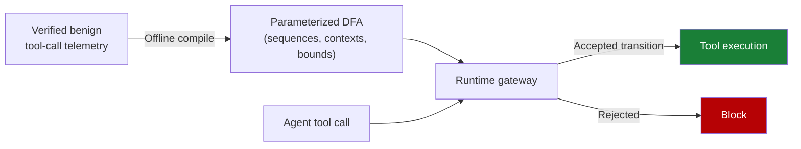

# Behavioral Firewall for Tool-Call Trajectories

> Compile benign tool-call telemetry into a parameterized DFA, then enforce permitted sequences and parameter bounds at runtime. Unwhitelisted string parameters remain the residual attack surface.

## Core concept

A behavioral firewall converts a record of safe tool-call traces into a parameterized deterministic finite automaton (pDFA) that defines permitted tool sequences, sequential contexts, and parameter bounds. Every runtime tool call must traverse a transition the automaton accepts; anything off-path is rejected before reaching the tool ([Dang, 2026](https://arxiv.org/abs/2604.26274v1)).

The mechanism shifts expensive policy synthesis offline. The runtime gateway performs an O(1) state-transition lookup per call, which is why the approach reaches 2.2 ms per-call latency in the published evaluation — roughly 3.7x faster than [AEGIS](https://arxiv.org/abs/2603.12621v1), a stateless pre-execution scanner ([Dang, 2026](https://arxiv.org/abs/2604.26274v1)).

## How it works

Three structural components define the policy:

- Permitted tool sequences — which tool follows which, expressed as automaton transitions
- Sequential contexts — the prior states under which a transition is valid
- Parameter bounds — numeric ranges or enumerated value sets allowed on a transition

The O(1) claim concerns structural state lookup; the gateway also checks parameter bounds. Calls outside the compiled structure are rejected, while permitted paths still need parameter guards ([Dang, 2026, §5](https://arxiv.org/abs/2604.26274v1)).

## When it outperforms stateless scanners

Evaluated on Agent Security Bench (ASB) — 10 scenarios, over 400 tools, 27 attack/defense methods across 13 LLM backbones ([Zhang et al., 2025](https://arxiv.org/abs/2410.02644v4)) — the pDFA firewall reports the following on five scenarios:

| Metric | pDFA firewall | Aegis (stateless) |
|---|---|---|
| Macro attack success rate (5 scenarios) | 5.6% | — |
| Attack success rate (3 structured workflows) | 2.2% | 12.8% |
| ASR on multi-step / context-sequential attacks | 0% | — |
| Per-call latency | 2.2 ms | ~8.1 ms |
| Benign task failure rate | 2.0% | — |

Source: [Dang, 2026](https://arxiv.org/abs/2604.26274v1). Latency comparison computed from the reported 3.7x speedup.

The 0% ASR on multi-step attacks is the structural reason to prefer this approach over stateless content scanners in narrow, repeatable workflows. Stateless scanners evaluate each call in isolation; multi-step obfuscation distributes harmful intent across calls that each look benign — the same gap [mid-trajectory guardrails](mid-trajectory-guardrail-selection.md) address with a model-based check.

The same gap appears before runtime. An arXiv paper argues that auditing each tool in isolation can miss exploits that chain individually benign tools across shared workspace files, environment variables, and chat memory ([arXiv 2611.19764](https://arxiv.org/abs/2611.19764v1)).

## The parameter-whitelist requirement

Sequence enforcement is necessary but not sufficient. Against 1,000 algorithmically spliced exfiltration payloads, only 1.4% matched valid structural paths — but the 14 surviving paths required end-to-end string parameter guards to fail (0 successes, 95% CI [0%, 23.2%]) ([Dang, 2026](https://arxiv.org/abs/2604.26274v1)).

Against the continuous string guard, synonym-substitution attacks reach an 18% evasion rate: adversarial synonyms can remain within its semantic boundary ([Dang, 2026](https://arxiv.org/abs/2604.26274v1)). Exact-match whitelisting of sensitive string parameters bears the final defensive load — sequences contain the attack surface, but unwhitelisted parameters remain a hole.

## When it fits

Conditions where compiling benign trajectories into a fixed automaton pays off:

- Structured workflows — narrow, repeatable agent loops with a small finite vocabulary of tool-call shapes (the paper's strongest results, 0% ASR on multi-step attacks, are confined to this regime)
- Stable call sequences — the paper assumes low behavioral entropy and reproducible parameter distributions ([§8.4](https://arxiv.org/abs/2604.26274v1))
- Sensitive parameters that admit exact-match whitelists — file paths, table names, command verbs where enumeration is feasible

## When it backfires

The pDFA approach is not a drop-in defense for general agents:

- Open-ended agents — larger spaces of valid sequences weaken discrimination; the paper calls for larger profiling corpora and careful threshold tuning ([§8.4](https://arxiv.org/abs/2604.26274v1))
- Free-form string parameters — search queries, URLs, prose arguments that cannot be enumerated leave the synonym-substitution gap the paper itself surfaces
- Drift in benign telemetry — automata learned from yesterday's traces reject novel-but-legitimate sequences; a model-based [mid-trajectory guardrail](mid-trajectory-guardrail-selection.md) adapts without recompilation

## Composition with other defenses

The pDFA firewall layers cleanly with the rest of the security stack:

- Pair with [tool signing and signature verification](tool-signing-verification.md) so the tools whose calls form transitions are themselves trusted
- Pair with [exact-match command whitelists](permission-gated-commands.md) on string parameters to close the synonym-substitution gap
- Treat as one layer of [defense in depth](defense-in-depth-agent-safety.md), not a standalone control — the residual 5.6% ASR confirms a single layer is insufficient
- Use [mid-trajectory guardrail](mid-trajectory-guardrail-selection.md) selection as the model-based complement when trajectory shapes drift

## Key Takeaways

- A pDFA compiled from benign telemetry enforces permitted sequences, contexts, and parameter bounds; its structural lookup is O(1) ([Dang, 2026](https://arxiv.org/abs/2604.26274v1))
- Reported 0% ASR on multi-step and context-sequential attacks in structured workflows — the structural reason to prefer it over stateless scanners on narrow loops
- 18% synonym-substitution evasion against the continuous string guard; sensitive-parameter whitelists require maintained coverage
- Fits structured workflows with stable tool catalogs; misfits open-ended agents and free-form parameters
- Compose with tool signing, command whitelists, and a model-based guardrail rather than treating it as a standalone control

## Related

- [Mid-Trajectory Guardrail Selection](mid-trajectory-guardrail-selection.md) — model-based complement when trajectory shapes drift beyond a finite automaton
- [Detecting Memory-Poisoning Exfiltration by Tool-Call Order (Recall-Before-Send Signature)](recall-before-send-memory-poisoning-detection.md) — a detection counterpart over the same tool-call trajectories, keyed to one attack-forced ordering rather than a whole benign automaton
- [Tool-Invocation Attack Surface](tool-invocation-attack-surface.md) — the argument-generation and return-processing vectors a behavioral firewall constrains
- [MCP Runtime Control Plane](mcp-runtime-control-plane.md) — single policy evaluation point at which a pDFA check can be wired
- [Tool Signing and Signature Verification](tool-signing-verification.md) — ensures the tools whose calls form transitions are themselves trusted
- [Permission-Gated Custom Commands](permission-gated-commands.md) — exact-match whitelists that close the synonym-substitution gap
- [Defense-in-Depth Agent Safety](defense-in-depth-agent-safety.md) — layering principle the pDFA firewall plugs into rather than replaces
- [Single-Layer Prompt Injection Defense](../patterns/anti-patterns/single-layer-injection-defence.md) — anti-pattern the residual 5.6% ASR confirms
