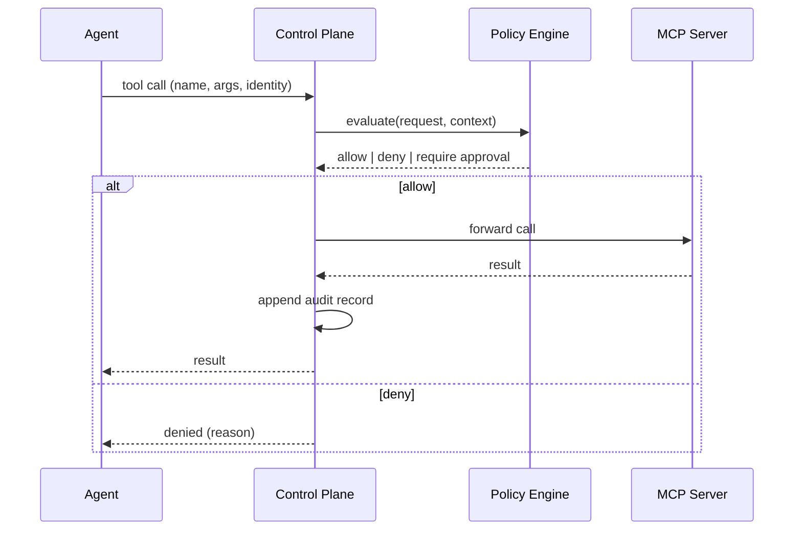

# MCP Runtime Control Plane: Policy Evaluation Between Agent and Tool

> Intercept every MCP tool call at a single policy evaluation point — identity, tool name, arguments, rate limits — before the call reaches the server.

Learn it hands-on with [The Gateway in the Middle](https://learn.agentpatterns.ai/security/the-gateway-in-the-middle/), a guided lesson with quizzes.

An agent connected to many MCP servers inherits each server's ad-hoc authorization model. A runtime control plane collapses those N policies into one evaluation point between the agent and the tool. The plane intercepts every call, checks it against a central policy corpus, and either forwards or denies it, then logs the decision. AWS, Microsoft, and Red Hat ship reference implementations of this pattern, all built on the same primitive: a policy decision point that runs before tool execution.

## Interception loop



AWS Bedrock AgentCore wires this shape explicitly: Policy in AgentCore "intercepts all agent traffic through Amazon Bedrock AgentCore Gateways and evaluates each request against defined policies in the policy engine before allowing tool access" ([AgentCore Policy](https://docs.aws.amazon.com/bedrock-agentcore/latest/devguide/policy.html)). Microsoft's Agent Governance Toolkit takes the same position one layer up, inside the framework: "every tool call, resource access, and inter-agent message is evaluated against policy *before* execution" ([agent-governance-toolkit](https://github.com/microsoft/agent-governance-toolkit)). Microsoft frames the broader pattern as a dedicated control plane that mediates and authorizes every agent tool execution before it reaches the MCP server — an enforcement-gateway model ([Securing MCP: A Control Plane for Agent Tool Execution](https://developer.microsoft.com/blog/securing-mcp-a-control-plane-for-agent-tool-execution)).

## Policy dimensions

Implementations converge on the same evaluation inputs:

| Dimension | Example rule |
|-----------|--------------|
| Identity | Agent acts on behalf of user in group `finance`; non-finance users may not invoke `ledger.write` |
| Tool name | `shell.exec` is blocked regardless of arguments |
| Argument inspection | `deploy(environment=production)` requires a higher approval tier than `deploy(environment=staging)` |
| Rate limit | Agent may call `search` at most 60/min per session |
| Environment | Tool is callable from staging runners, blocked from developer laptops |
| Data labels | Block if input carries `confidential` tag and destination lacks matching scope |

AgentCore expresses these in [Cedar](https://www.cedarpolicy.com/); Red Hat's MCP Gateway reference uses OPA with JWT `resource_access` claims ([Red Hat Developer](https://developers.redhat.com/articles/2025/12/12/advanced-authentication-authorization-mcp-gateway)). The Microsoft toolkit ships a native evaluator keyed on the same fields ([agent-governance-toolkit](https://github.com/microsoft/agent-governance-toolkit)).

## Credential choice and tool lists at the gateway

A gateway can also pick the upstream credential for each call and decide which tools an agent sees. LangChain launched LangSmith Tool Gateway in public beta on November 19, 2026 ([LangChain announcement](https://www.langchain.com/blog/langsmith-tool-gateway)), and its pages document both jobs and where each stops. The announcement says "Tool Gateway is a managed tool layer that allows callers to route tool requests through a single URL" (same post). The docs say "Every tool kit is a standard MCP endpoint. Therefore, any MCP client can call its tools" ([LangSmith clients doc](https://docs.langchain.com/langsmith/tool-gateway-clients)). Those pages describe what LangChain built. They do not evaluate how well it works, and every LangSmith claim below carries that limit.

### The caller never holds the server's token

The LangSmith docs split a call into three authentication steps. "The caller authenticates only to LangSmith. Tool Gateway then picks a stored credential and uses it to authenticate to the MCP server" ([how it works](https://docs.langchain.com/langsmith/tool-gateway-how-it-works)). A call uses one identity, and the overview lists the caller as a user, an agent, or a profile ([overview](https://docs.langchain.com/langsmith/tool-gateway)). A profile holds shared credentials for agents that run with no one signed in (same page). When the stored credential is missing, a user gets a sign-in link. An agent or a profile gets a 409 "because no one is present to sign in" ([how it works](https://docs.langchain.com/langsmith/tool-gateway-how-it-works)).

AWS AgentCore Gateway lists both as outbound OAuth grant types: the authorization code grant for "User-delegated access" and the client credentials grant for "Machine-to-machine authentication" ([AgentCore outbound authorization](https://docs.aws.amazon.com/bedrock-agentcore/latest/devguide/gateway-outbound-auth.html)). For credential placement at a sandbox boundary, see [Scoped Credentials via Proxy](scoped-credentials-proxy.md).

### A kit curates the list and a policy enforces access

A LangSmith tool kit is a curated set of tools served at one MCP URL ([overview](https://docs.langchain.com/langsmith/tool-gateway)). The docs say "A tool kit decides which tools an agent sees" and that a small kit "keeps its tool list relevant and its tool choices accurate" ([how it works](https://docs.langchain.com/langsmith/tool-gateway-how-it-works)). They also say "A kit is not an access control: the same caller can use kits/me/mcp, which serves every tool the caller can use" (same page).

Access control sits in policies. A policy either blocks a call or requires approval. "A call that no policy matches runs", and "Policies check calls, not tool lists. A blocked tool still appears in the tools that a kit lists" ([policies](https://docs.langchain.com/langsmith/tool-gateway-policies)). The overview puts the deny check before credential attachment, and the approval check after it ([overview](https://docs.langchain.com/langsmith/tool-gateway)). Read a kit as a context-size control and write a policy for each tool the agent must not call.

For a large kit, LangSmith offers search mode: "the kit lists three tools instead, and the model uses them to find and call the tools it needs" ([clients doc](https://docs.langchain.com/langsmith/tool-gateway-clients)). Policies "apply to the tool that call_tool runs" in that mode ([policies](https://docs.langchain.com/langsmith/tool-gateway-policies)). AgentCore documents a comparable option. If semantic search was enabled when the gateway was created, an agent can call `x_amz_bedrock_agentcore_search` to look up tools "with a natural language query" ([AgentCore semantic search](https://docs.aws.amazon.com/bedrock-agentcore/latest/devguide/gateway-using-mcp-semantic-search.html)). For the context-cost side of that choice, see [MCP alwaysLoad](../tool-engineering/mcp-eager-vs-jit-loading.md).

### Example: approval before a write

The LangSmith docs show an approval policy for creating a Linear issue. This is the example trimmed to its core fields ([policies](https://docs.langchain.com/langsmith/tool-gateway-policies)):

```json
{
  "name": "approve-linear-issues",
  "effect": "REQUIRE_APPROVAL",
  "scope": {
    "principals": [{"type": "*", "id": "*"}],
    "actions": ["<linear-server-id>_save_issue"]
  }
}
```

Per the docs, "The call runs only after the caller approves it in their MCP client", and "A client that cannot show the form gets 403." The client side of that form is covered in [MCP Elicitation](../tool-engineering/mcp-elicitation.md).

## Distinct from lower layers

The control plane is the runtime governance layer. It is not:

- Network egress policy. Domain allow or deny decides whether a TCP connection leaves the sandbox, below any MCP-level decision — see [Agent Network Egress Policy](agent-network-egress-policy.md).
- Process sandbox. Filesystem and PID isolation constrain what a running tool process can touch. The control plane runs before the process starts — see [Scope Sandbox Rules to Harness-Owned Tools](sandbox-rules-harness-tools.md).
- MCP transport. `initialize`, capability negotiation, and JSON-RPC framing describe how messages move, and policy evaluation rides on top — see [MCP Client/Server Architecture](../tool-engineering/mcp-client-server-architecture.md).

Defense in depth combines all four. The arxiv survey places control planes alongside sandboxing, provenance tracking, and DLP as complementary controls, not substitutes ([Securing the MCP — arxiv 2511.20920](https://arxiv.org/abs/2511.20920)).

## Why deterministic enforcement

Prompt-based safety depends on the model following instructions. Microsoft's Agent Governance Toolkit benchmark reports a 26.67% policy violation rate for prompt-only controls against red-team inputs, versus 0.00% for deterministic application-layer enforcement ([agent-governance-toolkit benchmark](https://github.com/microsoft/agent-governance-toolkit)). The control plane's value is that the decision is independent of model judgment — an injected prompt that instructs the agent to call a denied tool still hits the policy check and is rejected.

## When this backfires

Real limits, documented by practitioners:

1. Off-protocol actions bypass the plane. The gateway sees MCP traffic only. Shell commands, direct HTTP, DB drivers, and headless browsers are invisible to it, creating blind spots that look like coverage ([Security Boulevard](https://securityboulevard.com/2026/03/why-mcp-gateways-are-a-bad-idea-and-what-to-do-instead/)).
2. Clients can skip the plane. Unless every agent runtime is wired through the gateway, direct API calls or shadow connectors reach the server unchecked, so partial coverage gives false confidence ([Strata: Prevent MCP Bypass](https://www.strata.io/blog/agentic-identity/prevent-mcp-bypass/)).
3. Tool-name policies without argument inspection miss injection. Argument-injection attacks against pre-approved commands, for example `shell.exec` with unchecked args, escalate to RCE even with the policy in place ([Trail of Bits: Prompt injection to RCE](https://blog.trailofbits.com/2025/10/22/prompt-injection-to-rce-in-ai-agents/)).
4. Centralized secrets and a single point of failure. Routing all tool calls through one broker makes it a target for compromise and an outage surface. Replicate regionally and keep credentials out of the proxy where possible ([Security Boulevard](https://securityboulevard.com/2026/03/why-mcp-gateways-are-a-bad-idea-and-what-to-do-instead/)).

LangSmith's own docs add the following limits for its beta gateway. They describe one product, and another gateway sets its own.

- Approval is the caller's, not a reviewer's. "The caller approves the call, not a separate reviewer." An agent that runs with no one present "cannot approve calls", so the docs say to use a block policy to stop it calling a tool ([policies](https://docs.langchain.com/langsmith/tool-gateway-policies)).
- Identity is as strong as key custody. "A caller authenticated only by an identity provider token can reach any server or kit in the workspace" ([how it works](https://docs.langchain.com/langsmith/tool-gateway-how-it-works)). A backend that names its users through the `X-LangSmith-Identity` header gets this warning: "Tool Gateway trusts the X-LangSmith-Identity value as sent. Any caller that holds the service key can act as any user" ([identity](https://docs.langchain.com/langsmith/tool-gateway-identity)).
- Output passes through and traces hold metadata. "Tool Gateway passes each server's response to the caller unchanged. Treat tool output as untrusted input to your agent" ([how it works](https://docs.langchain.com/langsmith/tool-gateway-how-it-works)). A trace "never contains tool arguments or results" ([traces](https://docs.langchain.com/langsmith/tool-gateway-traces)).
- The gateway adds its own ceilings. Every call is limited to a 1 MB request, an 8 MB response, 60 seconds for the MCP server to start responding, and 100 requests per second with bursts up to 1,000 ([how it works](https://docs.langchain.com/langsmith/tool-gateway-how-it-works)).
- Small setups may not need one. LangChain says of hard-coding access, control, and visibility into each agent: "When the goal is to build fast in a limited environment, this works. However, this breaks as usage, the number of tools, and the number of users grow" ([LangChain announcement](https://www.langchain.com/blog/langsmith-tool-gateway)). The post gives no threshold.

Pair the control plane with an MCP registry (what tools exist) and framework-level runtime hooks (what the agent did off-protocol) to close these gaps.

## Example

A Cedar policy enforced by AgentCore restricts a deployment agent to staging unless the caller is on-call:

```cedar
permit (
  principal in Role::"deployment-agent",
  action == Action::"invokeTool",
  resource == Tool::"deploy_service"
) when {
  resource.arguments.environment == "staging" ||
  (resource.arguments.environment == "production" &&
   principal.oncall == true)
};
```

AgentCore's gateway evaluates this Cedar document on every `deploy_service` call; production invocations by a non-on-call principal are denied before reaching the MCP server, and both allow and deny decisions are written to the audit log ([AgentCore Policy](https://docs.aws.amazon.com/bedrock-agentcore/latest/devguide/policy.html)).

## Key Takeaways

- A runtime control plane collapses N per-server authorization models into one policy evaluation point between agent and tool.
- Consistent policy dimensions: identity, tool name, argument inspection, rate limit, environment, data labels.
- Deterministic enforcement (Cedar, OPA) is independent of model judgment; prompt-only controls measure ~27% violation rates in red-team tests vs 0% for policy engines.
- The plane covers only traffic that traverses it; pair with a registry, runtime hooks, and argument-level policy to address bypass and blind-spot failure modes.
- Control plane is distinct from network egress policy (lower), sandbox rules (process), and MCP transport; defense in depth combines all four.
- A gateway can also choose the upstream credential and the tool list per agent. In LangSmith's docs a kit curates the list and a policy enforces access, so a kit alone leaves a caller able to use every tool it can reach through another endpoint.

## Related

- [Five-Stage Policy Layer Typology for Generalist Agents](policy-as-code-layer-typology.md)
- [Hybrid Deterministic + Semantic Authorization for Agent Tool Calls](hybrid-deterministic-semantic-tool-authorization.md)
- [Permission Framework Choice Outweighs Model Choice for Limiting Overeager Actions](permission-framework-over-model.md)
- [Agent Network Egress Policy: Admin-Controlled Domain Allow/Deny](agent-network-egress-policy.md)
- [Scope Sandbox Rules to Harness-Owned Tools, Not Third-Party MCP Tools](sandbox-rules-harness-tools.md)
- [Tool-Invocation Attack Surface](tool-invocation-attack-surface.md)
- [Execution-Layer Security Invariants for MCP Runtimes](mcp-execution-security-invariants.md)
- [Human-in-the-Loop Confirmation Gates for Consequential Agent Actions](human-in-the-loop-confirmation-gates.md)
- [MCP Client/Server Architecture](../tool-engineering/mcp-client-server-architecture.md)
- [Agentic Detection and Response at the MCP Boundary](agentic-detection-response-mcp.md) — the observe half of the same architecture: ADR instruments the transport for detection while the control plane enforces
- [Delivery-Bound Tool Authorization: When Progressive Discovery Becomes Access Control](delivery-bound-tool-authorization.md) — an experiment where a generic sequence guard at this layer matched a role-scoped delivery server on premature executions and beat it end-to-end
