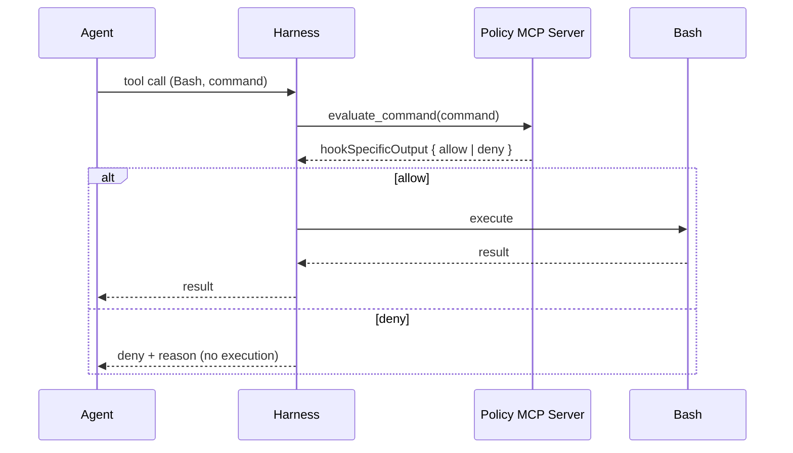

# Hooks Invoking MCP Tools: Closing the Loop Between Policy and Tool Execution

> A Claude Code hook can return `type: "mcp_tool"` to call a connected MCP server directly, for in-harness policy consult and audit. On most events a failed call lets the action go ahead unless the hook sets `"onFailure": "block"` (v2.1.328 or later).

## What the primitive is

Claude Code v2.1.118 (2026-04-23) added `mcp_tool` as a hook handler kind alongside the existing `command` handler. A hook record names a connected MCP server, a tool on it, and a substituted `input` map ([Claude Code changelog](https://code.claude.com/docs/en/changelog)).

| Field | Required | Description |
|-------|----------|-------------|
| `server` | yes | Name of a configured MCP server. Must already be connected; the hook never triggers an OAuth or transport flow |
| `tool` | yes | Name of the tool to call on that server |
| `input` | no | Arguments passed to the tool. String values support `${path}` substitution from the hook's JSON input, e.g. `"${tool_input.file_path}"` |
| `onFailure` | no | `"continue"` or `"block"`. `"block"` blocks the action when the hook fails. On `mcp_tool` hooks it requires Claude Code v2.1.328 or later |

The harness processes the MCP tool's text output exactly like a command hook's stdout. If the output parses as a `hookSpecificOutput` decision document, the harness applies the decision. Otherwise it surfaces as plain text ([hooks reference](https://code.claude.com/docs/en/hooks)).

## Why it exists

Before this primitive, a hook that wanted to consult an MCP server had to spawn a subprocess and run its own MCP client. `mcp_tool` removes that second client. The harness already owns the MCP transport for the agent's own tool calls, and it reuses that transport for the hook. This is the wire-level mechanism for the [MCP Runtime Control Plane](../security/mcp-runtime-control-plane.md) pattern, run inside the harness rather than in front of it as a gateway.

## Two canonical uses

### `PreToolUse` policy consult

A `PreToolUse` hook on `Bash` calls a policy MCP server, which inspects the command and returns an allow/deny `hookSpecificOutput`:

```json
{
  "hooks": {
    "PreToolUse": [
      {
        "matcher": "Bash",
        "hooks": [
          {
            "type": "mcp_tool",
            "server": "policy",
            "tool": "evaluate_command",
            "input": {
              "command": "${tool_input.command}"
            }
          }
        ]
      }
    ]
  }
}
```

The policy server's response is a JSON document with `permissionDecision: "deny"` and a `permissionDecisionReason` — exactly the shape a command hook produces ([hooks reference](https://code.claude.com/docs/en/hooks)). One server, one connection, one schema.

### `PostToolUse` audit

A `PostToolUse` hook calls an audit MCP server, recording the edited file path without spawning a shell:

```json
{
  "hooks": {
    "PostToolUse": [
      {
        "matcher": "Write|Edit",
        "hooks": [
          {
            "type": "mcp_tool",
            "server": "audit",
            "tool": "record_event",
            "input": {
              "file_path": "${tool_input.file_path}"
            }
          }
        ]
      }
    ]
  }
}
```

This matches Claude Code's own security-scan example ([hooks reference](https://code.claude.com/docs/en/hooks)). `PostToolUse` input also exposes `duration_ms` (added in v2.1.119), which gives the audit server the underlying tool's latency ([Claude Code changelog](https://code.claude.com/docs/en/changelog)).

## Decision loop



## Failure mode: set `onFailure`

With `onFailure` unset, a failed hook does not stop the action on most events. The hooks reference says "On most events, when a hook fails or times out, Claude Code still carries out the action" ([hooks reference](https://code.claude.com/docs/en/hooks#block-the-action-when-a-hook-fails)), and a tool that returns `isError: true` "produces a non-blocking error and execution continues" ([hooks reference](https://code.claude.com/docs/en/hooks#how-the-tools-result-is-read)). A `PreToolUse` policy hook routed to a downed server therefore lets the original call through.

From v2.1.328, set `"onFailure": "block"` on the hook to block the action instead ([changelog](https://code.claude.com/docs/en/changelog#2-1-328)):

```json
{
  "type": "mcp_tool",
  "server": "policy",
  "tool": "evaluate_command",
  "input": { "command": "${tool_input.command}" },
  "onFailure": "block"
}
```

With `"block"` set, a failure does what exit code 2 does on that event, except on `PermissionRequest`, where it denies the request. So a `PreToolUse` failure blocks the tool call ([hooks reference](https://code.claude.com/docs/en/hooks#block-the-action-when-a-hook-fails)). For an `mcp_tool` hook these count as failures:

- The server isn't connected, or its tool returns an error.
- The hook reaches its `timeout`.
- The JSON output can't be parsed or fails schema validation.
- On an event such as `PreToolUse` or `UserPromptSubmit`, a non-empty answer, unless it's `{}` or JSON that sets a hook output field other than `reason`.

The last rule bites a policy server that answers in plain text: with `"block"` set, every such answer counts as a failure and blocks the call.

The field does not cover everything:

- It has no effect on `Stop`, `SubagentStop`, `TaskCompleted`, and `TeammateIdle` hooks.
- If you use Code Mode, failures on `PreToolUse` work differently.
- When Claude Code can't read the tool's answer because it is too large, the hooks reference says that on `PreToolUse` Claude Code "refuses the tool call the hook was checking" ([hooks reference](https://code.claude.com/docs/en/hooks#how-the-tools-result-is-read)).

A control outside the hook layer, such as an out-of-process gateway in front of the harness, still fits where the hook layer does not see the traffic (see coverage gaps below) or where you cannot require v2.1.328 ([MCP Runtime Control Plane](../security/mcp-runtime-control-plane.md)).

## When this backfires

- Critical-deny use cases: with `onFailure` unset, `PreToolUse` `mcp_tool` hooks don't block on connection loss or tool error. Set `"onFailure": "block"` on any hook that must deny on a policy-server outage, and run v2.1.328 or later.
- Blocking on failure stops calls: with `"block"` set on a `PreToolUse` hook, a timeout or a non-empty answer that is neither `{}` nor JSON setting a hook output field other than `reason` also blocks the call. A slow or plain-text policy server then stops matched calls.
- Latency on every matched call: each call now waits on a synchronous MCP round-trip plus the server's own work. A slow `PreToolUse` `mcp_tool` hook delays every matched call, the same way a slow shell hook would ([hooks-lifecycle-events.md](hooks-lifecycle-events.md)).
- Setup events: `SessionStart` at launch, including with `--continue` or `--resume`, and every `Setup` event fire before the session's MCP servers are available to hooks. Claude Code skips their `mcp_tool` hooks without calling the tool, so use a `type: "command"` hook on `SessionStart` for anything the session needs at launch ([hooks reference](https://code.claude.com/docs/en/hooks#events-that-fire-before-mcp-servers-are-available)).
- Coverage gaps: hooks already do not always carry into sub-agents, MCP server calls, or pipe mode, and `mcp_tool` actions inherit those gaps. Use OS-level controls when the boundary must hold everywhere ([Boucle, *What Claude Code Hooks Can and Cannot Enforce*, 2026](https://dev.to/boucle2026/what-claude-code-hooks-can-and-cannot-enforce-148o)).
- Output schema mismatch: if the MCP tool's text output looks like JSON but does not match `hookSpecificOutput`, the harness surfaces it as plain text and silently drops any decision the server intended. With `"onFailure": "block"` set on `PreToolUse` or `UserPromptSubmit`, a non-empty answer that is not `{}` or JSON setting a hook output field other than `reason` counts as a failure and blocks.

## Key Takeaways

- `type: "mcp_tool"` lets a hook call a connected MCP server directly with `server`, `tool`, and `${path}`-substituted `input`.
- The MCP tool's text content is treated as command-hook stdout — return `hookSpecificOutput` to drive a permission decision.
- Use it for `PostToolUse` audit unconditionally. With `onFailure` unset, a failed hook does not stop the action on most events. Set `"onFailure": "block"` (v2.1.328 or later) on a `PreToolUse` policy hook that must deny when the server fails.
- With `"block"` set on an event such as `PreToolUse` or `UserPromptSubmit`, a timeout or a non-empty answer that is neither `{}` nor JSON setting a hook output field other than `reason` also blocks. The field has no effect on `Stop`, `SubagentStop`, `TaskCompleted`, and `TeammateIdle` hooks.
- The MCP server must already be connected — `SessionStart` at launch and `Setup` events fire too early.
- `duration_ms` on `PostToolUse` makes the audit-server contract richer.
- This is the in-harness implementation of the runtime control plane pattern; keep an out-of-process gateway where the hook layer does not see the traffic or you cannot require v2.1.328.

## Related

- [Hooks and Lifecycle Events: Intercepting Agent Behavior](hooks-lifecycle-events.md)
- [Hook Catalog: Guardrails, Sandboxing, and CLI Enforcement](hook-catalog.md)
- [Conditional Hook Execution](conditional-hook-execution.md)
- [MCP Client Design: Building Robust Host-Side Logic](mcp-client-design.md)
- [MCP Client/Server Architecture](mcp-client-server-architecture.md)
- [MCP Runtime Control Plane: Policy Evaluation Between Agent and Tool](../security/mcp-runtime-control-plane.md)
- [Hooks for Enforcement vs Prompts for Guidance](../instructions/hooks-vs-prompts.md)
