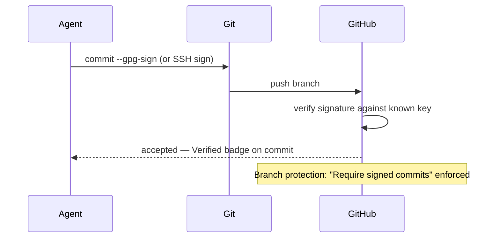

# Agent Commit Attribution: Signed Commits and Agent Identity

> Three fields can say who is behind an agent's commit: the author string, a signature, and, where the platform records it, the authenticated pusher.

## Why attribution matters

When an agent commits code, git records an author name and email. But without extra verification, any commit can claim any identity. As agents become regular contributors, three governance needs emerge:

- Audit trails — regulated code (finance, healthcare, government) may require tracking which changes came from automated systems rather than human engineers
- Regression traceability — when a bug appears, knowing the commit came from a specific agent session (with model version, task reference, and session ID) speeds up root-cause analysis
- Policy enforcement — rulesets can block a push whose identity metadata does not meet the rule, whether that means a missing signature or a committer who is not the pusher

## Three attribution mechanisms

### 1. Cryptographic commit signing

Git supports GPG and SSH signing. A signed commit includes a signature over the commit object, verifiable against the signer's public key. GitHub displays signed commits from known keys as `Verified`.

For agents that push commits directly:

- Dedicated bot accounts with enforced signing — create a GitHub user or GitHub App for the agent, configure the signing key in the agent's git environment, and require all commits from that account to be signed via branch protection or repository rulesets
- Platform-native signing — GitHub's Copilot cloud agent signs all its commits automatically as of April 3, 2026 ([GitHub Changelog](https://github.blog/changelog/2026-04-03-copilot-cloud-agent-signs-its-commits/)). This lets it push to repositories with the "Require signed commits" rule enabled, which previously blocked it

Branch protection enforces signing at the policy layer. Enable "Require signed commits" on `main`, or use a ruleset scoped to the branch pattern. GitHub then rejects a push from any agent that cannot present a valid signature, and unsigned commits on a pull request's head branch can also block the merge.



### 2. Commit metadata annotation

Cryptographic signing establishes who signed. Metadata annotation establishes which session and task produced the commit. The two are complementary.

Standard git trailers (appended after the commit message body) carry structured metadata:

```
docs: add agent commit attribution page

Implement pattern page for agent identity in version control.

Co-authored-by: github-actions[bot] <41898282+github-actions[bot]@users.noreply.github.com>
Agent-Session: sess_01abc123
Model: claude-sonnet-4-6
Task-Reference: #673
```

- `Co-authored-by` — standard GitHub convention that renders co-authors in the commit UI and PR timeline
- `Agent-Session` — links the commit to a specific agent session log for replay and debugging
- `Model` — records the model version at commit time, which matters when a model upgrade changes agent behavior
- `Task-Reference` — ties the commit to the originating issue or ticket

`Agent-Session`, `Model`, and `Task-Reference` are team-defined conventions. No cross-tool standard exists, so adopt whichever trailer names fit your toolchain.

### 3. Pusher identity recorded at push time

Signing and trailers both live inside the commit object, which the pushing client writes. The pusher record does not. GitHub put push attribution into limited public preview on October 12, 2026, and it "durably records the authenticated user who pushed each commit and surfaces that pusher identity in the UI and API alongside the existing author and committer fields" ([GitHub Changelog](https://github.blog/changelog/2026-10-12-push-attribution-public-preview)).

It is a separate signal because the author and committer fields are self-reported: "Commit author and committer fields are just strings that the pushing client supplies, so anyone with write access to a repository can set them to any name and email they choose" (same source). The attack that follows is a compromised account forging a trusted maintainer's commits, "evading review policies and confusing audit trails".

The three fields answer three questions:

| Field | Question it answers |
|---|---|
| Author | Who wrote the change, if the string is honest |
| Signature | Who vouched for the change with a key |
| Pusher | Which authenticated account put it on the branch |

Separately, the three mechanisms a team configures are signing, trailers, and pusher identity.

Availability is the catch: push attribution is "available now as a limited public preview for GitHub Enterprise customers", and joining means asking an account team (same source). The check is not unique to GitHub. Bitbucket Server shipped a Committer Verification hook in 5.0 that "verifies that the committer for each new commit being pushed matches the credentials of the person doing the push" ([Atlassian BSERV-2642](https://jira.atlassian.com/browse/BSERV-2642)).

## Branch protection configuration

GitHub offers three policy-layer options. The first two enforce signatures; the third enforces the pusher relationship. See the [GitHub branch protection documentation](https://docs.github.com/en/repositories/configuring-branches-and-merges-in-your-repository/managing-protected-branches/about-protected-branches) for current UI steps, since menu paths change across GitHub plans.

Option A — branch protection rule (classic): enable "Require signed commits" for the target branch pattern. GitHub rejects any push without a valid signature.

Option B — repository ruleset (recommended for organizations): create a ruleset targeting the branch pattern and add the "Require a signature" rule. Rulesets support actor-scoped conditions, so you can require signing only for bot accounts while letting human contributors push unsigned commits during a migration period. This is a useful control for [agent governance](agent-governance-policies.md).

Option C — require the committer to match the pusher: the push attribution preview adds a rule condition, `Committer must match pusher`, which "blocks pushes where the committer metadata doesn't match any verified email address of the authenticated pusher" ([GitHub Changelog](https://github.blog/changelog/2026-10-12-push-attribution-public-preview)). The rule constrains the relationship between two fields rather than naming an account.

Rulesets do govern "who can push commits to a certain branch". They do it through a bypass list of roles, teams, and GitHub Apps rather than a condition on the pusher ([about rulesets](https://docs.github.com/repositories/configuring-branches-and-merges-in-your-repository/managing-rulesets/about-rulesets)). Check the first condition under "When this backfires" before enabling it.

## Trade-offs

| Factor | Signed commits | Metadata annotation | Pusher identity |
|--------|---------------|---------------------|-----------------|
| Verification | Cryptographic — tamper-evident | None — any actor can write any trailer | Platform-authenticated at push time |
| Operational overhead | Key generation, rotation, distribution to agent environment | None — add trailers in commit message | None; Enterprise preview access |
| Branch protection compatibility | Required for "Require signed commits" rules | Not compatible — rule checks signature, not trailers | Enables `Committer must match pusher` |
| Reviewer experience | `Verified` badge in GitHub UI | Requires reading commit message | Pusher shown alongside author |
| Blast radius of key compromise | Agent's signing key must be revoked and rotated | No key to compromise | No key; a stolen account's pushes are recorded against it |

Cryptographic signing is the right choice when:
- Your repository enforces "Require signed commits"
- Compliance requires tamper-evident agent authorship records
- You are running an agent with broad write access to production branches

Metadata annotation alone is enough when:
- You need session traceability for debugging but not compliance
- Signing infrastructure is not yet in place
- The agent works in a staging or feature branch environment with a human review gate before merge

## Why it works

The push is a different kind of event from the commit. "GitHub already authenticates pushes" ([GitHub Changelog](https://github.blog/changelog/2026-10-12-push-attribution-public-preview)), so the server knows the actor before it accepts the ref update, without reading the payload. Recording that actor per commit moves one identity claim out of writer-controlled data, which is why the pusher record survives the forgery the author field does not.

Signing reaches tamper-evidence through a key the contributor holds, and that depends on adoption the measurements do not support. A study of 50,328 critical open-source GitHub projects found that "the majority of users (95.4%) never signed a commit, and for the majority of projects (72.1%), no commit was ever signed", and that "contribution workflows can be abused in 85.9% of the projects" ([Holtgrave et al., NDSS 2025](https://www.ndss-symposium.org/ndss-paper/attributing-open-source-contributions-is-critical-but-difficult-a-systematic-analysis-of-github-practices-and-their-impact-on-software-supply-chain-security/)). Pusher attribution asks nothing of the contributor, which is its advantage over signing and the reason it proves less.

## When this backfires

The reviewed handoff and the pusher rule are incompatible. When an agent commits under its bot identity and a human pushes the branch, the committer is the bot and the pusher is the human, so `Committer must match pusher` rejects the push.

Enabling the rule forces a choice. Either the agent pushes its own commits under its own credentials, or the human rebases and becomes the committer. The second path erases the bot from the only field the rule reads. Decide which identity owns the push before you turn it on.

Squash merge erases the record on `main`. The branch's commits are replaced by one new commit. Under squash merge "the individual commits in the pull request are ignored" for metadata evaluation ([available rules for rulesets](https://docs.github.com/en/enterprise-cloud@latest/repositories/configuring-branches-and-merges-in-your-repository/managing-rulesets/available-rules-for-rulesets)). A team that squash-merges gets the agent-identity signal on feature branches and nothing on the protected branch.

Showing the pusher invites the opposite error. A GitLab user pushing through a global deploy key found that merge requests linked the commits to their own account while the commit view linked them to the commit's user, and argued that "the path used for pushing the same commits should not affect how they are registered with Gitlab" ([gitlab-foss#40958](https://gitlab.com/gitlab-org/gitlab-foss/-/issues/40958)). Label which question each field answers, or two fields leave a reader less certain than one did. The same labeling problem appears in [landmarking human and agent artifacts](../human/landmarking-human-vs-agent-artifacts.md).

Committer-email rules have to readmit the platform identity. A restriction on committer emails must allow `noreply@github.com` "for web-based merges and other commits created on GitHub.com" (available rules for rulesets, linked above), so the carve-out also covers an agent whose commits are created on GitHub.com rather than on its own machine.

## Example

Before — agent commits without attribution:

```bash
git commit -m "fix: update retry logic"
# Commit author: github-actions <noreply@github.com>
# No signature. No session metadata. Indistinguishable from any other bot commit.
```

After — agent commits with signing and metadata:

```bash
git -c user.signingkey=~/.ssh/agent_ed25519 \
    -c gpg.format=ssh \
    commit -S -m "fix: update retry logic

Agent-Session: sess_01abc123
Model: claude-sonnet-4-6
Task-Reference: #412"
# GitHub displays: Verified ✓
# Blame graph shows: agent identity + session link
```

The reviewed handoff, as the pusher rule sees it:

```bash
# Agent commits under its bot identity; a human pushes the branch.
git -c user.name='agent-bot' -c user.email='agent-bot@example.com' \
    commit -m "fix: update retry logic"
git push origin feature/retry     # transport performed by the reviewing human

# Author:    agent-bot
# Committer: agent-bot
# Pusher:    the reviewer's account
# With "Committer must match pusher" enabled, this push is rejected,
# because the committer email is not a verified email of the pusher.
```

For the [Copilot cloud agent](../tools/copilot/cloud-agent-org-controls.md), signing is automatic with no configuration required. Check that your repository has "Require signed commits" enabled to use it.

## Key Takeaways

- Of the three signals, only a signature makes the commit object itself tamper-evident; trailers are readable but unverified, and the pusher record sits outside the commit entirely.
- GitHub's Copilot cloud agent signs commits automatically as of April 2026, unblocking repositories with mandatory signing policies.
- "Require signed commits" branch protection is the policy lever that forces agent identities into the signed-commit model or blocks them from pushing.
- Metadata trailers (`Agent-Session`, `Model`, `Task-Reference`) complement signing by providing session-level traceability for debugging and auditing.
- Key management for agent signing identities is real operational overhead; weigh it against the compliance requirement.
- Push attribution is a GitHub Enterprise limited preview, so treat the pusher record as one implementation of the idea rather than a mechanism you can assume anywhere.
- `Committer must match pusher` and the agent-commits-then-human-pushes handoff cannot both hold, so pick which identity owns the push before enabling the rule.

## Related

- [Headless Claude in CI](headless-claude-ci.md)
- [Agent Governance Policies](agent-governance-policies.md)
- [Worktree Isolation](worktree-isolation.md)
- [Tool Signing and Signature Verification](../security/tool-signing-verification.md)
- [Secrets Management for Agent Workflows](../security/secrets-management-for-agents.md)
- [Gated Contribution Intake Under Agent Load](gated-contribution-intake.md) — the contribution gates that rely on these identity records to decide who may submit
