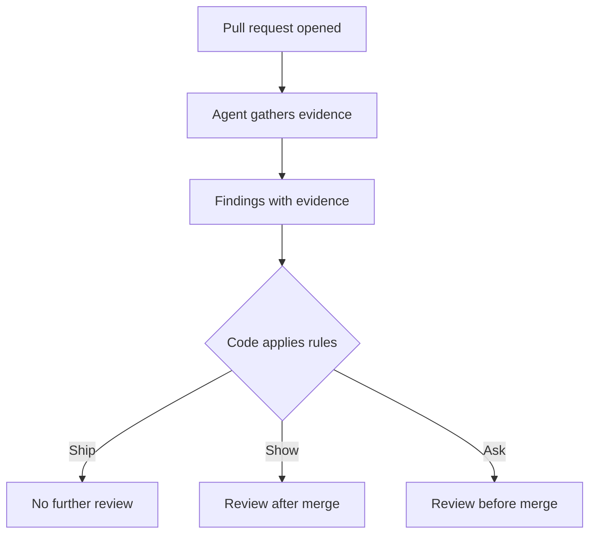

# Review Expectations for an AI Pull-Request Approval Bot

> An approval bot assigns each pull request to Ship, Show, or Ask under written rules, and starts as recommendations the team can challenge.

Ship/Show/Ask review routing replaces one blanket approval rule with three written review paths, and application code selects a path from the agent's evidence. The documented case is a single internal experiment at Sourcegraph, with no review-quality results yet ([Nicolae, Sourcegraph, 10 November 2026](https://sourcegraph.com/blog/what-we-learned-building-a-pr-approval-bot)). It fits only where your rules allow some changes to merge without a prior approval. It also depends on a team that reads Show changes after merge, and on contribution history that tracks real familiarity with the code.

## The single-approval problem

Sourcegraph's GitHub setup required an approval before merging. A routine change and a change that needed detailed discussion cleared the same step. The post states the mismatch directly: "We had different expectations for review, but we were fitting them into one approval requirement" ([Sourcegraph](https://sourcegraph.com/blog/what-we-learned-building-a-pr-approval-bot)).

The team's workaround was a stamp group, where someone would post "Can someone stamp this?" and an available teammate picked it up. Each request still meant finding a person and asking them to switch context. The post ties the pressure to coding agents: "Writing a change gets faster, but understanding its effects and deciding whether it should ship still take time" (same source).

## Three implementation layers

### Layer 1: Written review paths and purposes

The three paths come from the 2021 [Ship/Show/Ask](https://martinfowler.com/articles/ship-show-ask.html) article. Sourcegraph defines them for its policy ([Sourcegraph](https://sourcegraph.com/blog/what-we-learned-building-a-pr-approval-bot)):

| Path | Meaning under the policy |
|---|---|
| Ship | No additional review is needed |
| Show | Someone should see the change, but review can happen after merge |
| Ask | Someone needs to review the change before it merges |

The original article leaves the choice to the author: "People get to merge their own Pull Requests. This way they’re in control of whether their change is a “Show” or an “Ask”" ([Wilsenach, 2021](https://martinfowler.com/articles/ship-show-ask.html)). In Sourcegraph's version, an agent assesses each change against the team's rules instead.

The rules rest on what review is for. Sourcegraph's feedback taught it that review "can catch a problem, share context, or check what we tell customers", and being explicit about those purposes helped it decide when another person's attention was useful ([Sourcegraph](https://sourcegraph.com/blog/what-we-learned-building-a-pr-approval-bot)). Some changes go to review whatever the author's history: "Changes to authentication checks or to how sensitive data is exposed require review regardless of experience" (same source).

### Layer 2: Agent evidence, rules in code

The agent does not pick the path. It examines the diff, the relevant code, and the author's previous contributions, then returns findings with supporting evidence. Application code applies the rules, selects a path, and posts the result on the pull request ([Sourcegraph](https://sourcegraph.com/blog/what-we-learned-building-a-pr-approval-bot)). This is the split described in [the stochastic-deterministic boundary](../patterns/agent-design/stochastic-deterministic-boundary.md): the model proposes, deterministic code commits.

Familiarity is assessed per component, and part of the test has a recency window. Sourcegraph's current policy "looks for two merged PRs reviewed by another person, plus a relevant contribution of code, tests, or technical documentation in the past 30 days" (same source). The post adds a limit: "Working in one part of a system doesn't imply familiarity with all of it" (same source).

### Layer 3: Recommendations first, approvals later

Sourcegraph started with recommendations only, while human review continued as usual. It used feedback to refine the rules and the evidence required to establish familiarity, then rechecked the affected recommendations ([Sourcegraph](https://sourcegraph.com/blog/what-we-learned-building-a-pr-approval-bot)). The post describes this phase as a way "to inspect and challenge the bot's decisions before enabling approvals for eligible changes" (same source).

Shown reasoning made the phase useful. The team could challenge the assumptions behind a recommendation and work out whether the rule or the assessment had to change (same source). [Progressive autonomy](../human/progressive-autonomy-model-evolution.md) describes the same staged expansion in general terms.

## Triggers and constraints

The workflow runs in GitHub Actions, and application code posts each result on the pull request ([Sourcegraph](https://sourcegraph.com/blog/what-we-learned-building-a-pr-approval-bot)). The rules bound the bot's authority: authentication checks and sensitive-data exposure always need review. The rules also weigh the author's familiarity with each affected component. The workflow is tool-agnostic. The post names no model or agent product, and the design rests on the rules and the evidence. If your platform lets an AI reviewer's approval count toward branch protection, [scope that authority](../code-review/agent-approval-authority.md) before you turn it on.

The bot's own output has a cost. "Comments and repeated assessments can become interruptions of their own," and the post counts deciding when the bot should speak, update, or stay quiet as part of designing the workflow (same source).

## Why it works

Review does several jobs, and only some must finish before merge. A study of review across teams at Microsoft found that finding defects is the main motivation, but reviews "provide additional benefits such as knowledge transfer, increased team awareness, and creation of alternative solutions to problems" ([Bacchelli and Bird, ICSE 2013](https://www.microsoft.com/en-us/research/publication/expectations-outcomes-and-challenges-of-modern-code-review/)). Under Show, the change still reaches a reader, so the awareness job survives while the review stops blocking merge. Ask keeps the wait for changes where catching a problem first matters.

Familiarity has some basis in fault data. On Windows Vista and Windows 7, ownership measures such as the number of low-expertise developers "have a relationship with both pre-release faults and post-release failures" ([Bird et al., FSE 2011](https://www.microsoft.com/en-us/research/publication/dont-touch-my-code-examining-the-effects-of-ownership-on-software-quality/)). The timing choice is less settled. A simulation study found the best choice between pre-commit and post-commit review "does depend on the context", with many situations showing no practically relevant difference ([Baum et al., 2017](https://research.uni-hannover.de/en/publications/comparing-pre-commit-reviews-and-post-commit-reviews-using-proces/)).

## When this backfires

- Regulated codebases. Wilsenach notes that in some industries "an approval or review process will be required for every change" ([Ship/Show/Ask](https://martinfowler.com/articles/ship-show-ask.html)). Ship and Show may not be options.
- Codebases where ownership does not predict faults. On seven open-source Java projects, the ownership-fault link was weak, and "fault-proneness seems to be much more influenced by module size than by ownership" ([Foucault, Falleri and Blanc, EASE 2014](https://se.labri.fr/a/EASE14-foucault/)). These results limit the evidence for using familiarity as a proxy for change risk.
- Teams that do not return to Show changes. "With Show, removing the wait means relying on someone to return after merge," and Sourcegraph does not yet know whether those changes get useful attention ([Sourcegraph](https://sourcegraph.com/blog/what-we-learned-building-a-pr-approval-bot)).
- Stale familiarity data. The team says it must keep the bot's view of familiarity current as people and the codebase change (same source).
- Judging success by request volume. Sourcegraph sees fewer requests for a quick stamp, but "Fewer stamp requests tell us little about review quality" (same source). [Risk-score threshold calibration](../code-review/risk-score-threshold-calibration.md) shows Meta's RADAR tracking reverts against a baseline instead.

The strongest case against the workflow is to keep one human approval on every change. It costs a context switch per small pull request, and every change gets a second reader before merge. The bot's alternative rests on a familiarity proxy and on post-merge follow-through, and the Sourcegraph post reports outcome data for neither.

## Key Takeaways

- Sourcegraph found that naming what review is for (catching a problem, sharing context, checking what customers are told) helped it decide when a person should look.
- The agent returns evidence and code applies the rules; shown reasoning let the team ask whether the rule or the assessment needed to change.
- Sourcegraph's familiarity check is per component: two merged PRs reviewed by another person, plus a relevant contribution in the past 30 days.
- Sourcegraph ran recommendation-only, refined the rules from feedback, and only then enabled approvals for eligible changes.
- A drop in stamp requests says little about Show follow-through or review quality, so measure those separately.

## Related

- [Risk-Based Shipping](../verification/risk-based-shipping.md) — a risk matrix that decides which changes auto-ship
- [Layered Code Review with a Human-Approval Budget](layered-review-human-approval-budget.md) — treats human approvals as the budget to minimize
- [Risk-Score Threshold Calibration for Auto-Approval](../code-review/risk-score-threshold-calibration.md) — a learned risk score as the routing input
- [Agent Approval Authority in Code Review](../code-review/agent-approval-authority.md) — scope an AI reviewer's approval before it counts
- [Reviewer Habituation Decay](../code-review/reviewer-habituation-decay.md) — how repeated AI-authored PRs shift human review
