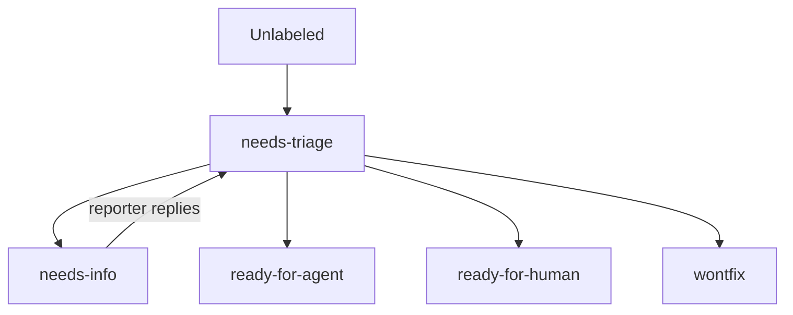

# Backlog Triage as a Named Agent Skill

> A maintainer-directed triage skill checks requests, records unresolved questions, and prepares agent briefs before implementation.

A named triage skill routes issues when a maintainer can resolve product questions and review readiness decisions. Matt Pocock's [`/triage` skill](https://github.com/mattpocock/skills/blob/4ae2317ddb22b046e26455e4f9c9b3aaaf62212d/skills/engineering/triage/SKILL.md) checks existing behavior and prior rejection before refining work for an agent or human. Requests that lack enough detail retain a `needs-info` route. This tool-agnostic intake procedure connects to the broader [factory engineering process](../factory-engineering/index.md).

## Why classification is insufficient

A category describes a request without proving that its premise is correct. Pocock prescribes claim verification before refinement; Vercel separates classification from analysis in its [AI SDK factory](https://vercel.com/blog/building-a-software-factory-for-ai-sdk). Treat readiness as a handoff decision. Keep [authorization gates](../patterns/agent-design/trigger-level-agent-intake-gating.md) and implementation review separate; Vercel retains human approval before merge.

## State machine in labels

Two category roles describe the work:

- `bug` — something is broken
- `enhancement` — new feature or improvement

Five state roles describe lifecycle position:

| State | Meaning |
|-------|---------|
| `needs-triage` | maintainer needs to evaluate |
| `needs-info` | waiting on reporter for more information |
| `ready-for-agent` | fully specified, ready for an AFK agent |
| `ready-for-human` | needs human implementation |
| `wontfix` | will not be actioned |

The skill prescribes one category role and one state role per triaged issue. It checks for conflicting states ([SKILL.md](https://github.com/mattpocock/skills/blob/4ae2317ddb22b046e26455e4f9c9b3aaaf62212d/skills/engineering/triage/SKILL.md)).

Labels record a route. Pocock's [quick state overrides](https://github.com/mattpocock/skills/blob/4ae2317ddb22b046e26455e4f9c9b3aaaf62212d/skills/engineering/triage/SKILL.md) can skip refinement and make brief creation optional. A `ready-for-agent` label alone proves neither verification nor brief writing.

## Per-issue process

The maintainer invokes the skill for intake. Its procedure has five steps ([triage skill](https://github.com/mattpocock/skills/blob/4ae2317ddb22b046e26455e4f9c9b3aaaf62212d/skills/engineering/triage/SKILL.md)):

1. Gather context. Read the issue and comments, check existing implementation, and surface relevant prior rejection records. Separate already-implemented requests from rejected enhancements.
2. Recommend a category and state with reasons, then wait for maintainer direction.
3. Verify the claim before refinement. Reproduce a reported bug or check whether the requested behavior is missing. Report insufficient detail explicitly.
4. Refine unclear requirements through an interview with the maintainer.
5. Apply the agreed outcome. Assign labels and post the relevant comment; close rejected work as appropriate.

Every comment or issue posted during triage must begin with the prescribed AI-generated disclaimer ([triage skill](https://github.com/mattpocock/skills/blob/4ae2317ddb22b046e26455e4f9c9b3aaaf62212d/skills/engineering/triage/SKILL.md)).

Check apparent duplicates before writing a new brief, but distinguish overlapping wording from the same requested behavior. Pocock's [redundancy check](https://github.com/mattpocock/skills/blob/4ae2317ddb22b046e26455e4f9c9b3aaaf62212d/skills/engineering/triage/SKILL.md) checks existing implementation and prior rejection; it does not establish exhaustive duplicate-issue detection. Use [semantic issue search](semantic-issue-search-natural-language.md) to investigate related requests and retain maintainer review of matches.

## The agent brief contract

Pocock's [agent brief template](https://github.com/mattpocock/skills/blob/4ae2317ddb22b046e26455e4f9c9b3aaaf62212d/skills/engineering/triage/AGENT-BRIEF.md) describes the expected behavior and the boundaries of implementation. Its rules are prescribed writing practices:

- Describe interfaces, types, and behavioral contracts. Avoid transient file paths and line references.
- State what the system should do; leave implementation discovery to the executor.
- Include concrete, independently testable acceptance criteria.
- State explicit scope exclusions.

This brief supplies structured input to [issue requirements preprocessing](../patterns/agent-design/issue-requirements-preprocessing.md). The template does not establish a measured context saving or resolution-rate improvement.

## Why it works

Claim verification checks the premise before the agent receives implementation instructions. The brief then records testable behavior and unresolved boundaries. Pocock [prescribes this sequence](https://github.com/mattpocock/skills/blob/4ae2317ddb22b046e26455e4f9c9b3aaaf62212d/skills/engineering/triage/SKILL.md), while Vercel documents [analysis evidence before implementation](https://vercel.com/blog/building-a-software-factory-for-ai-sdk). These sources support the procedure; neither isolates its productivity effect.

## Out-of-scope as institutional memory

The skill records rejected enhancements in `.out-of-scope/<concept>.md` — one file per concept, not per issue. The file records the decision and its reasoning, with links to prior requests ([OUT-OF-SCOPE.md](https://github.com/mattpocock/skills/blob/4ae2317ddb22b046e26455e4f9c9b3aaaf62212d/skills/engineering/triage/OUT-OF-SCOPE.md)). During context gathering on every new issue, the skill reads this directory and surfaces conceptually related prior decisions.

These records preserve prior decisions for maintainer review. Maintainers can reconsider them ([rejection record guidance](https://github.com/mattpocock/skills/blob/4ae2317ddb22b046e26455e4f9c9b3aaaf62212d/skills/engineering/triage/OUT-OF-SCOPE.md)). This is a use of [agent memory](../patterns/agent-design/agent-memory-patterns.md) across separate triage sessions.

## When this backfires

The procedure needs a maintainer who can resolve unclear intent. Preserve the `needs-info` and `ready-for-human` routes when verification or product decisions remain unresolved ([triage skill](https://github.com/mattpocock/skills/blob/4ae2317ddb22b046e26455e4f9c9b3aaaf62212d/skills/engineering/triage/SKILL.md)). Other limits need explicit handling:

- Specified work can still depend on unfinished work. Pocock describes blocked and deferred states as additions users want that have not shipped in the [current walkthrough](https://www.aihero.dev/burn-through-your-backlog-with-my-triage-skill).
- Durable briefs still require review as behavior changes. The [brief template](https://github.com/mattpocock/skills/blob/4ae2317ddb22b046e26455e4f9c9b3aaaf62212d/skills/engineering/triage/AGENT-BRIEF.md) avoids transient references; it supplies no fixed lifetime for a specification.
- Similar requests need maintainer judgment. Review the reason in a [rejection record](https://github.com/mattpocock/skills/blob/4ae2317ddb22b046e26455e4f9c9b3aaaf62212d/skills/engineering/triage/OUT-OF-SCOPE.md) before applying it to another issue.
- Automated intake needs an output owner. Warp's Zach Lloyd advises named ownership and warns against starting with automatic backlog fixing ([rollout advice](https://www.warp.dev/blog/rolling-out-software-factories)).

For a factory, name who reviews the analysis and resolves remaining questions before dispatch. This applies Lloyd's ownership advice to intake. A readiness label does not establish authorization or successful execution. Use the [dispatch contract](issue-tracker-agent-dispatch-surface.md) to specify the handoff.

For unattended or high-volume intake, compare [continuous triage](continuous-triage.md) and [continuous AI](continuous-ai.md) before choosing an interactive procedure. Use [QA session intake](qa-session-to-issues-pipeline.md) for observed product failures and [vulnerability triage](ai-powered-vulnerability-triage.md) for security reports. These are routing choices, not equivalent verification guarantees.

## Example

Vercel's AI SDK factory uses automated classification and analysis before implementation. Pocock's skill instead asks the maintainer for direction during triage ([Vercel account](https://vercel.com/blog/building-a-software-factory-for-ai-sdk), [triage skill](https://github.com/mattpocock/skills/blob/4ae2317ddb22b046e26455e4f9c9b3aaaf62212d/skills/engineering/triage/SKILL.md)). Both check the request before producing implementation instructions, but place human decisions at different stages.

For AI SDK [issue #17898](https://github.com/vercel/ai/issues/17898#issuecomment-5101009222), classification identified a blocked-domain feature request. The subsequent [analysis](https://github.com/vercel/ai/issues/17898#issuecomment-5101058789) reports TS2353 from `issue-17898-type-probe.ts`. The probe file was not available to inspect, so this is reported evidence of the missing feature. The analysis described SDK fit and proposed work while leaving implementation choices open.

Vercel then produced an implementation, and Lars Grammel merged [PR #18033](https://github.com/vercel/ai/pull/18033). The [production account](https://vercel.com/blog/building-a-software-factory-for-ai-sdk) describes human review as a separate stage. This one feature probe does not prove that every requirement is complete or that every backlog item suits automation.

## Key Takeaways

- Check the premise before writing the brief; preserve `needs-info` when evidence is incomplete.
- Inspect the brief and verification record before dispatch, especially after a quick state override.
- Review prior rejection reasons before treating a similar request as already decided.
- Assign an owner to automated analysis output and keep merge review separate from intake readiness.

## Related

- [Work Dispatch and Change Integration in Agent Pipelines](../factory-engineering/work-dispatch-and-change-integration.md)

- [Factory Engineering Across Software Delivery Systems](../factory-engineering/factory-engineering.md)

- [Factory Engineering](../factory-engineering/index.md) — intake within the broader software delivery process
- [Issue-Tracker as Agent Dispatch Surface](issue-tracker-agent-dispatch-surface.md) — the downstream contract that receives the brief
- [Trigger-Level Gating for Autonomous Agent Intake](../patterns/agent-design/trigger-level-agent-intake-gating.md) — authorization at the intake boundary
- [Issue Requirements Preprocessing](../patterns/agent-design/issue-requirements-preprocessing.md) — requirement reconstruction by the executor
- [Continuous Triage: Automating Issue Classification with AI Workflows](continuous-triage.md) — event-driven issue analysis
