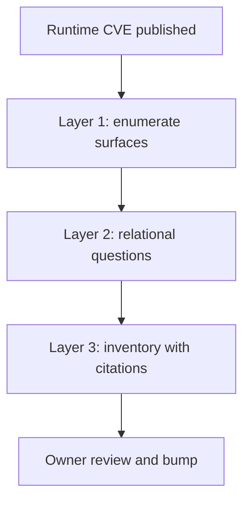

# Build-Surface Inventory for an Interpreter-Level CVE

> Where a runtime version is pinned across many repositories and no attestation records it, the agent's deliverable is a sourced build-surface inventory.

A build-surface inventory is a list of every place a runtime version gets decided in your repositories, with the file each row came from. The agent's job in a runtime CVE is to produce that list. Sourcegraph's write-up of the php2shell pair puts the asymmetry in its title, "patching PHP is easy, finding it is the hard part" ([Sourcegraph, 2026-10-21](https://sourcegraph.com/blog/php2shell-patching-php-is-easy-finding-it-is-the-hard-part)), and the inventory is what you point the cheap half at.

## When this workflow applies

Three conditions have to hold together, and the third is the one teams skip.

1. The vulnerable code sits in a runtime you install, not in a package your manifests declare. The source states the shape directly: "The vulnerable code lives in the interpreter, not in anyone's application. So every place an interpreter got pulled in counts, whether or not a PHP developer ever touched it" ([Sourcegraph](https://sourcegraph.com/blog/php2shell-patching-php-is-easy-finding-it-is-the-hard-part)).
2. The version is pinned in more than one kind of file, across repositories with different owners.
3. Your images do not already carry build provenance. A Docker provenance attestation in `mode=min` records "Source repository and revision" ([Docker Docs](https://docs.docker.com/build/metadata/attestations/slsa-provenance/)), which answers the repo half of the scanner's gap deterministically. The ownership half, which the source names alongside it, stays a separate lookup, so where attestations exist the inventory narrows rather than disappears.

One thing this workflow does not claim: that enumeration comes before the first patch. The source's remediation list opens with "Patch internet-facing mod\_php first.", which it calls "the confirmed pre-application path" ([Sourcegraph](https://sourcegraph.com/blog/php2shell-patching-php-is-easy-finding-it-is-the-hard-part)). Patch the front door you already know about, and run the inventory alongside it for the long tail.

## Why a deployment scan is the wrong instrument

A vulnerability scanner reads a running fleet, so it reports a symptom of build configuration rather than the configuration. The source names the gap in one sentence: "A scanner sees what's deployed right now. It doesn't tell you which repo builds it, who owns it, or where the next build will pull the old version back in" ([Sourcegraph](https://sourcegraph.com/blog/php2shell-patching-php-is-easy-finding-it-is-the-hard-part)). That last clause is the workflow's reason to exist. A fix driven off a scan can be undone by the next CI run, which is why the same list says "Rebuild images, don't just redeploy them."

Dependency tooling is no better placed here, for the opposite reason. Software composition analysis walks manifests, and the source's Composer search surfaces declared minimum versions. The source lists `composer.json` separately for exactly that reason, as the file that "shows the minimum version each app claims to support" ([Sourcegraph](https://sourcegraph.com/blog/php2shell-patching-php-is-easy-finding-it-is-the-hard-part)). The interpreter that answers a request arrives through a `FROM` line or an `apt install` argument instead, so a declared minimum does not identify it. The library case contrasts rather than parallels. For Log4Shell, Google reported that "Most artifacts that depend on log4j do so indirectly", and that in its histogram of how deeply the vulnerability first appears in consumer dependency graphs, for "greater than 80% of the packages, the vulnerability is more than one level deep, with a majority affected five levels down" ([Google Security Blog, 2021-12](https://security.googleblog.com/2021/12/understanding-impact-of-apache-log4j.html)). Those depths are edges that tooling can traverse. A declared minimum does not name the installed version.

## Three implementation layers

### Layer 1: enumerate the surfaces

Sourcegraph's enumeration for PHP names official base images, OS package-manager installs buried in Dockerfiles, Helm charts for off-the-shelf applications, CI images, and the minimum version each application declares, which "tells you how far a branch upgrade has to go" ([Sourcegraph](https://sourcegraph.com/blog/php2shell-patching-php-is-easy-finding-it-is-the-hard-part)). Treat that list as the reusable half of this workflow. The source generalizes the question rather than the categories, asking of the next runtime CVE "where does this run, and who owns it?", so read the categories as our shape for answering it: a `FROM` line, a package-manager argument, a chart value, a CI version key, and a declared floor.

The mechanism behind the list is dispersion. "Each of those pins its version somewhere different", as the source puts it, and that is why one query over one file type never finishes the job.

### Layer 2: ask the questions pattern search cannot

Regular expressions bound you to the strings you can already guess: "Regex only finds the strings you already know to look for" ([Sourcegraph](https://sourcegraph.com/blog/php2shell-patching-php-is-easy-finding-it-is-the-hard-part)). The questions that need an agent are relational. The source's example is "which repos build on an internal base image that started from php:7.4?" A two-hop question like that needs traversal from a derived image back to its parent, which matching cannot do.

This layer borrows from ordinary agent search work, so reuse the retrieval discipline in [Agent-Tuned Code Search](../context-engineering/agent-tuned-code-search.md) rather than inventing a one-off prompt.

### Layer 3: make provenance the deliverable contract

Require that every row name the file it came from, and reject rows that do not. The source frames its own output this way, as an answer "with links to the exact files it used", and describes what you get as "a starting inventory with sources, not a spreadsheet you have to fill in from scratch" ([Sourcegraph](https://sourcegraph.com/blog/php2shell-patching-php-is-easy-finding-it-is-the-hard-part)). Read the word "starting" as part of the contract. An uncited inventory cannot be reviewed by the team that owns each repository, and an inventory presented as complete invites a second blind spot in place of the one regex had.

## Triggers and constraints

The trigger is an advisory, not a schedule. That makes this a manual pipeline a human starts, which bounds the agent's authority usefully: it reads repositories and writes a report. Version bumps are a separate pass with its own review. The vendor post's own description of its bump tooling is mixed rather than fully agentic, using "a script for the mechanical tag bumps and Claude Code or Codex where a change needs judgment" ([Sourcegraph](https://sourcegraph.com/blog/php2shell-patching-php-is-easy-finding-it-is-the-hard-part)). Keep the split. An agent that both enumerates and merges leaves no reviewable artifact between the two.

Two constraints on the inventory itself. It covers repositories you build, so a third-party image you only consume has its pin in someone else's Dockerfile and will not appear. And restarting matters as much as the bump, because "A new package doesn't help a worker that still has the old binary in memory."

## Multi-tool coverage

Tool-agnostic. Any agent that can search across your repositories, follow a derived image back to its parent, and cite file paths can produce the inventory. Layer 3's contract is what makes the output checkable.

## Why it works

The running version of an interpreter is an output of build configuration rather than a property of the container, and that configuration is spread across file types no single query covers. A runtime scan observes the output, so a remediation that changes the output without changing the pin is reverted by the next build, the gap the source describes as "where the next build will pull the old version back in" ([Sourcegraph](https://sourcegraph.com/blog/php2shell-patching-php-is-easy-finding-it-is-the-hard-part)). An inventory keyed to the pin survives a rebuild because it names the thing the rebuild reads. The citation requirement adds the second property: it routes each row to the team that owns that file, which is the other half of the scanner's blind spot.

## When this backfires

- Your images already carry provenance attestations or a build-keyed SBOM. A `mode=min` attestation records source repository and revision ([Docker Docs](https://docs.docker.com/build/metadata/attestations/slsa-provenance/)), so the enumeration becomes a query over attestations rather than a search over code. Running an agent over the estate instead trades a deterministic answer for a probabilistic one.
- One build path, one repository, one owner. The enumeration is a single grep, and reviewing an agent's version of it costs more than running it yourself.
- A known internet-facing instance is still unpatched. The source's own ordering patches that first. An inventory-first policy spends the window of highest exposure on enumeration and ships nothing.
- Most of the fleet is third-party images. There is no build surface in your repositories to inventory, and searching your own code cannot find a pin that lives in someone else's.
- The inventory gets read as exhaustive. An agent answering in prose can present a partial list as a complete one, and that failure is harder to see than a regex which obviously missed a file type. The same risk shape appears in [Treating a Clean Static Scan as Security Evidence](../patterns/anti-patterns/static-clean-as-security-evidence.md).
- Note the vendor alignment in the primary source. Sourcegraph sells the search product its post recommends, so read the hard-part framing as a claim to check against your own estate. The post gives no figure for a saving, only a range of effort: "In simple environments, patching may take minutes. In the world's most complex codebases you are looking at hours, days, weeks, even months with traditional tools."

## Key Takeaways

- A runtime CVE is a search problem because application manifests can constrain a PHP version without identifying the interpreter each build deploys, so dependency tooling cannot find it from them.
- A deployment scanner reports what runs, not which repository builds it, so a scan-driven fix can be reverted by the next CI run.
- The surface list transfers across runtimes: base images, package-manager installs, charts, CI images, and declared minimum versions.
- Require a file citation on every row. An uncited inventory cannot be routed to an owner, and an inventory read as complete replaces one blind spot with another.
- Check for build provenance first. Where attestations record source repository and revision, the repo half of the question is already answered.
- Enumeration runs alongside patching the known internet-facing path, not before it.

## Related

- [Whole-Codebase Visibility as a Migration Prerequisite](whole-codebase-visibility-migration-prerequisite.md) — the planned-migration counterpart, where enumeration decides whether to stand up visibility infrastructure at all.
- [Supply-Chain Security Debt in Agent Pull Requests](../security/supply-chain-security-debt-agent-prs.md) — the same files read in the other direction, as debt agents introduce rather than debt they find.
- [Downstream Disclosure Coordination for Agent-Found Defects](downstream-disclosure-coordination.md) — the library case, where there is a dependency hop to traverse and a severity call at each one.
- [Swarm Migration Pattern](../patterns/multi-agent/swarm-migration-pattern.md) — the execution layer that consumes a complete list once owners have signed off on the rows.
- [Agent-Tuned Code Search](../context-engineering/agent-tuned-code-search.md) — the retrieval building block Layer 2 depends on.

## Sources

- [Sourcegraph — php2shell: patching PHP is easy, finding it is the hard part](https://sourcegraph.com/blog/php2shell-patching-php-is-easy-finding-it-is-the-hard-part)
- [Docker Docs — Provenance attestations](https://docs.docker.com/build/metadata/attestations/slsa-provenance/)
- [Google Security Blog — Understanding the Impact of Apache Log4j Vulnerability](https://security.googleblog.com/2021/12/understanding-impact-of-apache-log4j.html)
