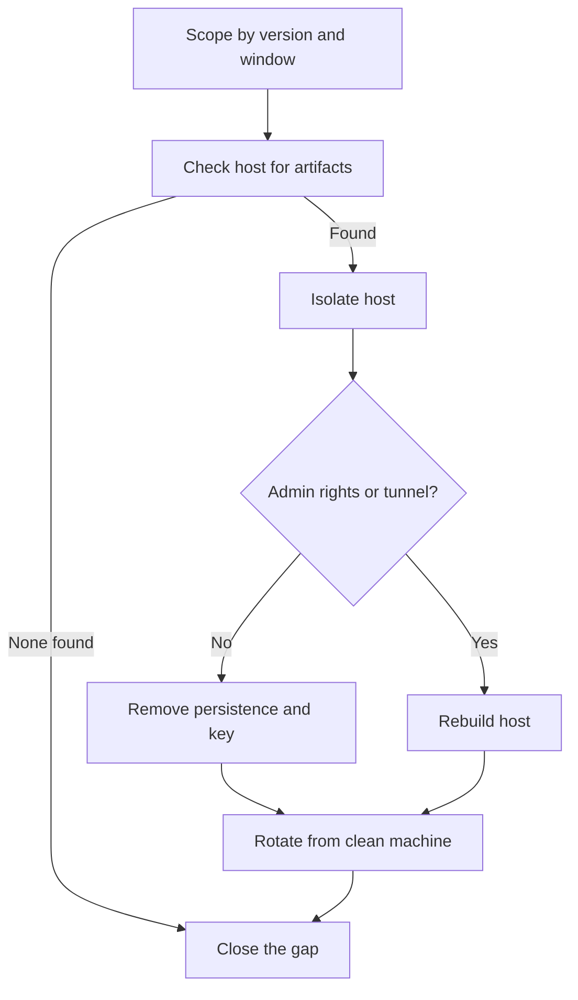

# Responding to a Compromised Agent Extension Release

> A tampered agent extension release runs a payload as the developer. Respond to what it left on the host, because uninstalling may leave it running.

Responding to a compromised agent extension release means scoping the fleet by version and install window, then checking each host for the payload's own artifacts. Credentials are rotated from a machine the payload never touched. The October 2026 Claude Code extension incident in Cursor shows each step. Cursor warned that uninstalling the extension may not be enough, because the payload drops persistence scripts that keep running on their own ([Cursor](https://cursor.com/blog/claude-code-extension-security-notice)).

## When this workflow applies

Run the full sequence only when these conditions hold:

- The extension runs with the user's privileges and can reach files, shell, SSH keys, and credentials.
- The vendor or a researcher has published the affected versions, the exposure window, and indicators of compromise.
- You have install records or endpoint telemetry that can name the machines that pulled the bad build.

The weight of the response should follow the evidence on each host. In the Cursor case the SSH-service step failed without admin rights, so on most hosts the attacker could not log in through the tunnel. Cursor noted that the key, the persistence, and the host beacon still landed, and told everyone to follow the remediation steps regardless ([Cursor](https://cursor.com/blog/claude-code-extension-security-notice)).

## The uninstall problem

Cursor reported two tampered builds, "Anthropic.claude-code version 2.1.312 and 2.1.313 for Windows and MacOS", served from its marketplace between about 2:27am and 1:35pm PT on 2026-10-29 ([Cursor](https://cursor.com/blog/claude-code-extension-security-notice)). Anthropic did not build them. Cursor's follow-up traced the tampering to its own serving layer. The attacker used a stolen credential to place copies "directly on the cache used to serve the Cursor VS Code extension marketplace". Cursor adds: "The marketplace source, Open VSX, never had the malware" ([Cursor update](https://cursor.com/blog/security-incident-update)). By Cursor's count, at most 5,000 users who requested the affected cached versions "potentially received the malicious build" ([Cursor update](https://cursor.com/blog/security-incident-update)).

The payload collected host details, including environment variable names and Git email. It appended an attacker key to `authorized_keys`, tried to open a reverse SSH tunnel, and installed a LaunchAgent on macOS or a scheduled task on Windows. Background scripts retried the tunnel about every 60 seconds ([Cursor](https://cursor.com/blog/claude-code-extension-security-notice)).

The key, the LaunchAgent or scheduled task, and the retry scripts all sit in the home directory, the temp folder, or the OS task scheduler, outside the extension folder ([Cursor](https://cursor.com/blog/claude-code-extension-security-notice)). Cursor's notice states the consequence: "Uninstalling the extension may not be sufficient — the payload drops standalone persistence scripts that keep running." A team that treats removal as remediation can leave the attacker key and the retry loop in place.

Two facts shape the response. Cursor published a SHA-256 hash for each modified VSIX, so a package hash separates the tampered build from a clean copy of the same version. The payload also lives outside the extension, so the check has to look at the host.

## Five response layers

### Layer 1: Scope the fleet by version and window

List every machine that installed or updated to an affected version inside the window. Cursor's scoping instruction is to "Search across endpoint, network, and extension-installation telemetry for the indicators below" ([Cursor](https://cursor.com/blog/claude-code-extension-security-notice)). On VS Code, `code --list-extensions --show-versions` prints installed IDs and versions per account ([VS Code](https://code.visualstudio.com/docs/enterprise/extensions)). Match the published VSIX SHA-256 hashes where your telemetry records package hashes. A version string alone can match a clean build: Open VSX, the upstream source, "never had the malware" ([Cursor update](https://cursor.com/blog/security-incident-update)).

### Layer 2: Check each host for the payload's artifacts

Look for what the payload wrote, not for the extension. In this incident the marker is a public key labeled `svc-telemetry` in `~/.ssh/authorized_keys`. The named persistence is `~/Library/LaunchAgents/com.apple.sysmond.plist` on macOS, and the `SysMon` scheduled task with a Startup `sysmon.cmd` fallback on Windows ([Cursor](https://cursor.com/blog/claude-code-extension-security-notice)). Search network logs for the published attacker address and the beacon on port 8099. A machine that no longer has the extension installed can still carry all of these.

### Layer 3: Isolate, then choose clean or rebuild

Cursor's step is to "Isolate hosts showing evidence of payload execution or backdoor installation". It then says to remove the key, the persistence, and the tunnel processes, "and assess whether the host should be rebuilt" ([Cursor](https://cursor.com/blog/claude-code-extension-security-notice)). Cursor shipped per-platform scripts that do the removal and "exit with a non-zero status if anything remains". Rebuild when the editor ran with admin rights or when logs show a working tunnel. Cursor's notice ties the login risk to admin rights: without them "the step fails and the attacker could not have logged in through the tunnel". Where that step may have worked, the attacker may have had an SSH session, and the host cannot vouch for what that session did.

### Layer 4: Rotate credentials from a trusted system

Rotate every credential and session the host could reach, and do it from a different machine. Cursor gives the reason: "The limited env-var collection does not rule out later credential access over the backdoor" ([Cursor](https://cursor.com/blog/claude-code-extension-security-notice)). Rotating from the infected host can hand the new secrets to the same payload.

### Layer 5: Close the gap before the next release

VS Code can pin extensions to approved versions through `extensions.allowed`. Its docs state: "If you block an extension or version that is already installed, VS Code disables it" ([VS Code](https://code.visualstudio.com/docs/enterprise/extensions)). That makes a pin a way to switch off a named bad version across the fleet. A pin is not a content check. The same docs say that for locally supplied VSIX packages the rules "do not verify the package's origin", and a tampered build can carry a real version number. The default auto-update delay is 12 hours ([VS Code](https://code.visualstudio.com/docs/configure/extensions/extension-marketplace)), longer than the 11-hour window here. I found no source that says Cursor honors either setting, so confirm it in your editor before you count on it.

## Triggers and constraints

The trigger is a vendor notice or a researcher report that names versions and indicators. Layers 1 to 4 run under incident authority: an operator can isolate and wipe machines. Layer 5 is a change to fleet policy and goes through the normal review for editor configuration. Each layer has an exit check. Every in-window host is listed, every listed host is checked, every positive host is cleaned or rebuilt, and every reachable credential is rotated.

## Tool coverage

The incident and its indicators are specific to Cursor's marketplace. The response layers are tool-agnostic, because any editor extension runs with the user's privileges. The prevention controls differ: `extensions.allowed` ([VS Code](https://code.visualstudio.com/docs/enterprise/extensions)), `extensions.autoUpdate`, and `extensions.autoUpdateDelay` ([VS Code](https://code.visualstudio.com/docs/configure/extensions/extension-marketplace)) are documented VS Code settings. For a fork such as Cursor, check the vendor's documentation for the equivalent before relying on it.

## Why it works

An extension update runs code on the developer's machine. OX Security's analysis of this incident: "an extension update can write to a developer's SSH keys, register startup tasks and open network tunnels" ([OX Security](https://www.ox.security/blog/malicious-claude-code-extension-cursor-ssh-backdoor/)). This payload put its persistence in places the extension manager does not own: the SSH key file, a LaunchAgent or scheduled task, and standalone retry scripts. The same analysis says "The payload was built to outlive the extension". Removing the extension leaves those files behind, so detection that keys on the payload's artifacts finds the compromise whether or not the extension is still present.

## When this backfires

- No install telemetry. Without records of who pulled which version, scoping means checking every developer machine by hand. That costs more than the targeted response assumes.
- Indicators taken as complete. The artifacts list covers one payload. A different tampered build writes different files, so a clean grep for `svc-telemetry` proves nothing about the next incident.
- Over-response on low-risk hosts. A host can show no key and have never run the editor with admin rights. Rebuilding it and rotating everything costs engineer time on a payload that could not log in.
- Pins without enforcement. An allowlist the editor does not enforce is advice. Publish-path compromise recurs: in 2025 leaked publisher tokens could be abused "to publish or modify extensions" on Open VSX ([Eclipse Foundation](https://blogs.eclipse.org/post/mika%C3%ABl-barbero/open-vsx-security-update-october-2025)).

## Key Takeaways

- Confirm scope with the published package hash, since a version string can match a clean build from another source.
- The extension may already be gone when you look, so check the host for the payload's files and keys.
- Rebuild a host that ran the editor with admin rights or whose logs show a working tunnel, and clean the rest with the vendor's script.
- Rotate from a machine the payload never ran on.
- A version pin switches off a known bad version but does not check package content. An update delay longer than the exposure window helps only if your editor enforces it.

## Related

- [Containment Playbook: npm-to-Signing-Channel Compromise](../security/npm-signing-channel-containment-playbook.md)
- [Enterprise-Managed Plugin Governance for Agent CLIs](../security/enterprise-managed-plugin-governance.md)
- [Blast Radius Containment: Least Privilege for AI Agents](../security/blast-radius-containment.md)
- [Setup Documentation as an Install-Time Attack Vector](../security/setup-documentation-install-time-attacks.md)
- [Incident-Time Code Grounding for Drifted Runbooks](incident-time-code-grounding.md)
