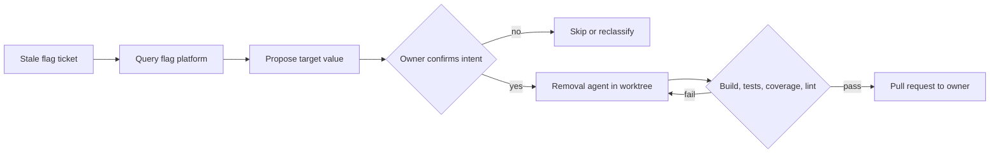

# Flag Cleanup Grounded in Deployed State

> An agent removing a stale feature flag takes the surviving value from the flag platform's deployed state, never from the default written in source.

The pipeline needs queryable flag state and an owner who can confirm the proposed value. Stale flags can include abandoned experiments and partial rollouts ([Chandratre and Datar, 2026](https://arxiv.org/abs/2610.31351v1), §III-A).

DoorDash reports the shape in production. An orchestrator reads stale-flag tickets, queries live rollout state over MCP, and proposes a target value. An engineer confirms it. Parallel removal agents edit code in isolated git worktrees and open one pull request each. Across 50 stale flags the system produced engineer-approved removal pull requests for 45, at an average of 13.8 minutes and $4.79 per cleanup ([Chandratre and Datar, 2026](https://arxiv.org/abs/2610.31351v1), Table I). Each flag was processed once, and the authors note that "LLM non-determinism means re-running could yield different outcomes" ([Chandratre and Datar, 2026](https://arxiv.org/abs/2610.31351v1), §V).

## The target-value problem

The backlog is what forces automation. DoorDash's experimentation platform holds over 56,000 flags across roughly 623 repositories, 1,659 of them stale. About 2,300 new flags arrive monthly, against a manual cleanup cost the company estimates at one to two hours each ([Chandratre and Datar, 2026](https://arxiv.org/abs/2610.31351v1), §I).

Deleting a flag replaces a runtime lookup with a literal, so something has to decide which literal. Source code is the wrong place to look it up. The default argument was written when the flag was created and usually carries the pre-rollout value, while the value serving traffic lives in the flag platform. DoorDash states the gap directly: "When a DV has been fully rolled out, the code default may differ from the production value. A tool operating on source code alone could silently hardcode the wrong value" ([Chandratre and Datar, 2026](https://arxiv.org/abs/2610.31351v1), §II-B). DV is their term for a feature flag.

Nothing about that gap is specific to agents. The authors generalize it: "Without access to live rollout state, any automated cleanup approach, whether rule-based or LLM-based, risks hardcoding incorrect values and preserving the wrong behavior after flag removal." ([Chandratre and Datar, 2026](https://arxiv.org/abs/2610.31351v1), §V) Uber's Piranha, the AST-rewrite tool that removed roughly two thousand stale flags, avoids the problem by requiring the answer as an argument. It "takes as input the name of the flag, expected treatment behavior, and the name of the flag's author" ([Uber, 2020](https://www.uber.com/en-CA/blog/piranha/)). Someone still supplies the value; the only question is whether a pipeline fetches it or a person types it.

## Three implementation layers

### Layer 1: Fetch the deployed value

Read the rollout record before reading the code. DoorDash's orchestrator calls two endpoints on the experimentation platform over MCP to retrieve "the current production rollout state, including rollout percentage and winning variant" ([Chandratre and Datar, 2026](https://arxiv.org/abs/2610.31351v1), §III-A). The abandoned-experiment case shows why the percentage matters rather than the code. A flag whose feature was dropped reads 0%, so the agent removes it using the baseline value instead of assuming the feature shipped.

The authors count the integration among their strongest design choices: it "added negligible latency while eliminating a recurring source of target-value errors" ([Chandratre and Datar, 2026](https://arxiv.org/abs/2610.31351v1), §V).

### Layer 2: Confirm intent with the owner

A rollout percentage reports traffic, not plans. PostHog's cleanup guidance puts the limit plainly: "A flag at 100% rollout might mean \"ship it, remove the old path\" or \"about to roll back, keep the old path.\" The API can tell you the rollout state, not the team's intent" ([PostHog, 2026](https://posthog.com/docs/feature-flags/cleaning-up-stale-flags)). Uber found the same thing when deciding staleness: "even when flags are completely rolled out, they still might be in use", because teams keep flags as kill switches or to gate debug output ([Uber, 2020](https://www.uber.com/en-CA/blog/piranha/)).

So the fetched value enters the pipeline as a proposal. DoorDash gates on it: "The engineer verifies each DV's proposed target value before cleanup proceeds. This acts as a safety check and ensures DVs with ambiguous rollout states, such as partial rollouts or abandoned experiments are correctly handled" ([Chandratre and Datar, 2026](https://arxiv.org/abs/2610.31351v1), §III-A). This is a narrow gate with one question, not a review of the diff. For where else a gate like this belongs, see [human-in-the-loop placement](human-in-the-loop.md).

### Layer 3: Gate the diff on checks the agent does not run

Do not accept the agent's account of its own validation. DoorDash's removal agents must clear build, tests, patch coverage at 95% or above, and the Detekt linter before they open a pull request, and CI re-checks coverage. The self-check was the weak link: "While the agent's system prompt explicitly mandates 95% patch coverage locally, we observed occasional miscalculations in its LLM-driven self-assessment. DoorDash's CI pipeline caught these discrepancies as it fails if patch coverage is <95%" ([Chandratre and Datar, 2026](https://arxiv.org/abs/2610.31351v1), §IV-B). Insufficient patch coverage was the most common cause of a revision, 6 of the 14. The pattern underneath is a [deterministic precondition gate](../patterns/agent-design/deterministic-precondition-gates.md).

Parallel removal agents each get their own [git worktree](worktree-isolation.md). DoorDash ran up to four per repository and reports that skipping isolation broke: "Early experiments without worktree isolation led to race conditions where concurrent agents modified the same files, producing corrupted diffs." ([Chandratre and Datar, 2026](https://arxiv.org/abs/2610.31351v1), §V)

## Why it works

Rollout state is the authoritative record of which branch users are getting, so fetching it closes the one gap a static read cannot close, and the authors treat that as binding on rule-based tools too ([Chandratre and Datar, 2026](https://arxiv.org/abs/2610.31351v1), §V). It does not close the second gap. Intent lives with the owner and no endpoint returns it, which is why the fetched value is confirmed rather than applied.

The split also explains the observed failure mode. Across all 50 pull requests the authors "did not observe any bugs or regressions introduced by the changed code, indicating that the system's reliability boundary is one of completeness, not correctness" ([Chandratre and Datar, 2026](https://arxiv.org/abs/2610.31351v1), §IV-B). In this evaluation, the remaining failures concerned incomplete cleanup. Owner confirmation and live-state lookup reduce target-value risk; they do not prove correctness for future runs.

## Triggers and constraints

The trigger is a schedule, not a push. A flag counts as stale after 90 days without modification, while it is still referenced in code and not archived, retired, or on an exclusion list. A daily cron job finds them and files a ticket against each flag's creator ([Chandratre and Datar, 2026](https://arxiv.org/abs/2610.31351v1), §II-A). The same cadence makes this a [codebase-hygiene loop](entropy-reduction-agents.md) rather than an incident response.

Two bounds cap authority. The agent's output is a pull request assigned to the flag's owner. A one-hour hard timeout bounds each agent session ([Chandratre and Datar, 2026](https://arxiv.org/abs/2610.31351v1), §III). The authors suggest three practical prerequisites for teams copying the design: "a reliable source of deployed flag state, worktree isolation for parallel edits, and deterministic validation gates before PR creation" ([Chandratre and Datar, 2026](https://arxiv.org/abs/2610.31351v1), §V).

## When this backfires

The flag is not dead, only fully rolled out. Kill switches and debug gates read 100% and are meant to stay, and PostHog warns that cleanup order matters because "disabling it in PostHog turns the feature off for everyone" if code still checks the flag ([PostHog, 2026](https://posthog.com/docs/feature-flags/cleaning-up-stale-flags)). Deployed state makes the agent right about today's traffic and silent about next quarter's rollback.

Call sites hit the flag API directly. DoorDash's own external-validity note concedes the ground: "Organizations using direct flag API calls where tools like Piranha are more directly applicable may see different results" ([Chandratre and Datar, 2026](https://arxiv.org/abs/2610.31351v1), §V). Where an AST rule engine applies, compare its coverage and maintenance cost before paying for LLM-based cleanup.

The dead code threads through deep call chains. Complex flags cleared only 22 of 26, and across the whole set of 50 the five cases needing engineer intervention were distinguished by "call-chain depth with cross-interface parameter threading, not flag type or file count" ([Chandratre and Datar, 2026](https://arxiv.org/abs/2610.31351v1), §IV-B). Complex flags also averaged 17.7 minutes and $6.20, with outliers at 40 minutes and $19.

There is no authoritative deployed-state input. If flags use config files or environment variables, adapt Layer 1 to read the deployed values. A repository default alone still does not establish what production uses.

The evidence base is one company and one language. The evaluation covers Kotlin repositories at DoorDash with wrapper-function access via dependency injection, and the manual baseline of one to two hours per cleanup "is based on internal engineering experience rather than precise wall-clock measurement" ([Chandratre and Datar, 2026](https://arxiv.org/abs/2610.31351v1), §V). Measure your own baseline before quoting a saving.

## Key Takeaways

- Read the surviving value from the flag platform, not the source default. After a rollout the two may disagree, so a source-only answer can fail silently.
- The same requirement binds rule engines. Piranha takes the expected treatment behavior as an input, which is the same fact arriving by hand.
- Rollout percentage does not encode intent, so route the fetched value through the owner as a proposal. A flag at 100% may be a kill switch.
- Gate the diff on checks the agent does not run. CI caught occasional errors in the agents' coverage self-checks. Insufficient coverage caused 6 of the 14 revisions.
- Give each parallel removal agent its own worktree. Without isolation, concurrent agents produced corrupted diffs.
- Expect incompleteness rather than incorrectness. The 5 intervention cases all involved deep call chains, and no regression was observed across 50 pull requests.
- Compare an applicable AST rule engine's coverage and maintenance cost with LLM-based cleanup. Both approaches still need the intended surviving value.

## Related

- [Entropy Reduction Agents: Automated Codebase Hygiene](entropy-reduction-agents.md) — the scheduled hygiene loop this cleanup is one instance of
- [Deterministic Precondition Gates for Tool-Using Agents](../patterns/agent-design/deterministic-precondition-gates.md) — the Layer 3 building block, stated as a single-agent pattern
- [Worktree Isolation: Parallel Agent Sessions in Safe Sandboxes](worktree-isolation.md) — why the parallel removal agents each need their own checkout
- [Human-in-the-Loop Placement: Where and How to Supervise](human-in-the-loop.md) — where a one-question gate beats a full review
- [Discovery-Only Refactor Pass: Surface Candidates Before Touching Code](discovery-only-refactor-pass.md) — the enumerate-before-editing half, for cleanups with no platform to query
