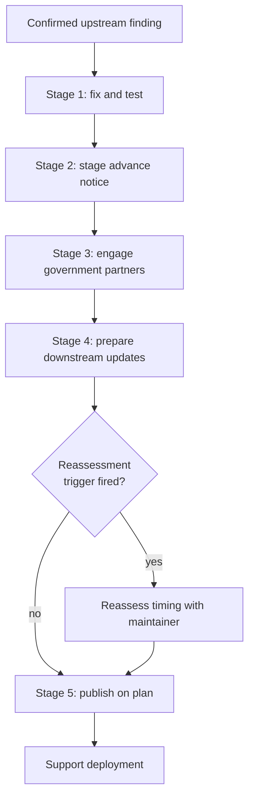

# Ecosystem-Scale Pre-Disclosure Coordination for Agent-Found Vulnerabilities

> Pre-disclosure coordination across an ecosystem stages distributors, providers and government agencies by protective role, so protections are ready the day the patch ships.

Three conditions determine whether this cycle applies. The maintainer must be free to brief selected parties ahead of the public, which the Linux kernel security team is not. Greg Kroah-Hartman describes the kernel's constraint as "the only policy by which all the legal/governmental agencies have agreed to allow us to operate in, so we are stuck with it" ([LWN, 2026-05-06](https://lwn.net/Articles/1070698/)). The finding must affect many products, and the notification window must account for independent rediscovery.

## The coordination problem

OpenAI led a coalition of maintainers, researchers and security providers on two critical PHP flaws, then published the response process it used as unfinished work. "Drawing on our experience thus far, we're sharing a proposed approach, appropriate for the AI era, to responding to critical vulnerabilities in widely used software, and we're asking the security community to help improve this framework" ([OpenAI, 2026-10-21](https://openai.com/index/coordinated-disclosure-of-critical-vulnerabilities)). Read it as a proposal from an interested party, because the coalition lead here also sells the model used to find the bug.

PHP's advisory covers "all PHP installations serving web requests", and the two flaws "can allow unauthenticated remote code execution" ([php.net, 2026-10-21](https://www.php.net/archive/2026.php#2026-10-21-5)).

The practice this depends on is contested at the same time. Reporting on the oss-security debate five months earlier, LWN found that "maintainers are seeing parallel discovery of the same security flaws within the embargo window", and concluded that "coordinated security disclosures may become a thing of the past" ([LWN](https://lwn.net/Articles/1070698/)). Clemens Lang, who works on the Red Hat Enterprise Linux crypto team, reported "duplicate reports of the same issue found by multiple independent groups that use LLMs, within the embargo period", and Kroah-Hartman reported kernel developers "seeing duplicate reports of the same issue from different groups within the time period it takes to get a fix merged" ([LWN](https://lwn.net/Articles/1070698/)).

My reasoning from these reports is that staging has to fit inside whatever embargo window remains.

## Five response stages

OpenAI proposes five possible response stages, listed below ([OpenAI](https://openai.com/index/coordinated-disclosure-of-critical-vulnerabilities)).

### Stage 1: validate and fix upstream

The maintainer, the researchers and the technical partners confirm the finding, assess its impact, and develop and test the fix. One step here is specific to the AI era: the process "includes adversarial testing with frontier models to look for ways around the patch and related variants of the vulnerability" ([OpenAI](https://openai.com/index/coordinated-disclosure-of-critical-vulnerabilities)).

### Stage 2: stage advance notice by protective role

This stage is what makes the workflow ecosystem-scale, and its selection rule is written down. The framework "considers an organization's protective role, including protecting its own systems and customers, the time needed to act, and its ability to handle sensitive information", with "maintainers deciding whom to involve ahead of disclosure" ([OpenAI](https://openai.com/index/coordinated-disclosure-of-critical-vulnerabilities)).

The maintainer decides. Briefings vary with each party's needs, from "network logs with indicators of compromise to more sensitive working proof-of-concept exploits", weighed against the risk that limited details can reveal a vulnerability ([OpenAI](https://openai.com/index/coordinated-disclosure-of-critical-vulnerabilities)).

PHP's maintainers confirm advance notification. "Linux distributions and LTS vendors received the patches in advance, so check your vendor for updated packages" ([php.net](https://www.php.net/archive/2026.php#2026-10-21-5)).

### Stage 3: coordinate with government partners

Agencies are in the cohort for reach the maintainer does not have. The framework holds that they "play an essential role in coordinating a wider response and helping security guidance reach organizations responsible for critical infrastructure and other essential services". For PHP, OpenAI reports engaging "multiple parts of the U.S. government, including the White House's Super Intelligence Force, the Office of the National Cyber Director (ONCD), the Cybersecurity and Infrastructure Security Agency (CISA), as well as international partners" ([OpenAI](https://openai.com/index/coordinated-disclosure-of-critical-vulnerabilities)).

### Stage 4: prepare updates across affected products

The framework names three shapes of the preparation a briefed party can start on. "A distributor might adapt a fix for an older release, a hosting provider might test a mitigation, and a security provider might prepare detection or prevention measures, including web application firewall (WAF) rules" ([OpenAI](https://openai.com/index/coordinated-disclosure-of-critical-vulnerabilities)).

In PHP that extended to branches upstream no longer supports. "Given the severity of these vulnerabilities, the PHP security team provided minimal source-backports for PHP 7.4, PHP 8.0, and PHP 8.1 to help people building from source or without access to an LTS vendor" ([php.net](https://www.php.net/archive/2026.php#2026-10-21-5)).

### Stage 5: publish guidance and support deployment

Guidance exists so operators can "assess their exposure, find authoritative updates or interim mitigations, and check that a fix is running", and the framework calls for continued support during deployment ([OpenAI](https://openai.com/index/coordinated-disclosure-of-critical-vulnerabilities)).

State the limits of mitigations. The advisory is blunt that "while only an update is a complete solution, the following measures reduce exposure to specific attack paths but do not make an installation safe" ([php.net](https://www.php.net/archive/2026.php#2026-10-21-5)), and the framework commits to making interim protections' "limits and operational tradeoffs clear" ([OpenAI](https://openai.com/index/coordinated-disclosure-of-critical-vulnerabilities)).

## Triggers and constraints

The cycle starts on a confirmed finding, never a candidate. Below that bar the problem is report triage, which [AI-powered vulnerability triage](ai-powered-vulnerability-triage.md) covers.

Four named events reopen the clock once it is running. The framework reassesses the timeline "if there's active exploitation in the wild, a leak, a revealing public patch, or increased risk to users from stalled remediation" ([OpenAI](https://openai.com/index/coordinated-disclosure-of-critical-vulnerabilities)). Publish these conditions in the coordination plan.

The work continues past the release. PHP published a further advisory two days after the fix, restating an existing configuration mitigation for a newly identified attack path and deferring a third CVE to the normal release cycle ([php.net, 2026-10-23](https://www.php.net/archive/2026.php#2026-10-23-1)).

For an agent-assisted implementation of this workflow, keep cohort selection and disclosure timing behind maintainer approval. Agents can draft advisories and run the patch tests. This is an implementation recommendation; the proposal assigns advance-notice decisions to maintainers ([OpenAI](https://openai.com/index/coordinated-disclosure-of-critical-vulnerabilities)).

This is tool-agnostic. Nothing in the five stages depends on which assistant produced the finding.

## Why it works

I read pre-disclosure staging as converting work that would follow publication into work done in parallel before it, because backports, packaged builds, provider mitigations and firewall rules cannot begin until the party doing them knows. The PHP record shows that work finished ahead of time: distributions and LTS vendors held patches before the announcement, and end-of-life branches got source backports they would not otherwise receive ([php.net](https://www.php.net/archive/2026.php#2026-10-21-5)).

The Copy Fail privilege-escalation flaw (CVE-2026-31431) was announced with a working proof-of-concept script and no distribution heads-up. Gentoo contributor Sam James named the gap: "unless the reporter chooses to bring it to the linux-distros \[mailing list], there is no heads-up to distributions. It did not happen here." On the following day Debian, Red Hat Enterprise Linux, SUSE and Ubuntu had no fix ready for their users ([LWN](https://lwn.net/Articles/1070698/)). PHP's advisory put every web-facing install in scope, and Copy Fail gave local users root on most Linux distributions that were not already on the newest kernels. Advance notification differs between these cases; this comparison does not isolate its causal effect.

Across 1,290 package-side fixing releases inside a network of 1,553,325 npm releases, "stale clients require additional migration effort, even if the package-side fixing release was quick" ([arXiv:1907.03407v5](https://arxiv.org/abs/1907.03407v5), abstract). Consumers can remain exposed after an upstream release; [downstream disclosure coordination](downstream-disclosure-coordination.md) covers that half of the problem.

OpenAI's own priority claim is self-reported and hedged. "To our knowledge, frontier AI found these vulnerabilities before attackers did" ([OpenAI](https://openai.com/index/coordinated-disclosure-of-critical-vulnerabilities)). The cited account cannot rule out earlier attacker discovery.

## When this backfires

- The maintainer cannot stage anything. The kernel security team's role ends when a fix reaches Linus's tree ([LWN](https://lwn.net/Articles/1070698/)). Stage 2 has nowhere to run, and a short clock plus a loud release is the whole available plan.
- The bug is cheap to rediscover. Where duplicates land inside the window, the window protects the attacker too. Willy Tarreau puts the inversion plainly: "Embargoes now play against security, for all the time we don't act, users stay exposed to anyone having the luck to find the same problem" ([LWN](https://lwn.net/Articles/1070698/)).
- The project has one maintainer. Markus Klyver wrote about maintainers in general, not single-maintainer projects, that embargoes "impose delays, administrative overhead and a nontrivial burden on maintainers who must preserve confidentiality/track disclosure windows/manage downstream communication" ([oss-security, 2026-05-22](https://www.openwall.com/lists/oss-security/2026/05/22/10)). With one maintainer, I expect that burden to come out of the same hours that would ship the fix.
- Private handling becomes the leak source. Jeremy Stanley, a member of OpenStack's vulnerability management team, reported that handling report volume privately produced "accidents breaking our embargoes before things are ready or distros/deployers have been given sufficient advance warning" ([LWN](https://lwn.net/Articles/1070698/)). A larger cohort is more surface for that.
- The coalition lead also sells model access through Daybreak. Its proposal applies equal criteria to comparable organizations and gives maintainers the decision about whom to involve ([OpenAI](https://openai.com/index/coordinated-disclosure-of-critical-vulnerabilities)). Keep cohort selection under maintainer control and publish the criteria.
- The queue is slop rather than findings. Coordination machinery pointed at unvalidated agent output adds load to the teams it is meant to relieve. Gate the finding first with a [reproduce-before-report verification gate](../code-review/reproduce-before-report-verification-gate.md).

## Example

Two 2026 disclosures in widely deployed components, with different advance-notification histories.

| | PHP RCE pair, Oct 2026 | Copy Fail, Apr 2026 |
|---|---|---|
| Advance notice to distributors | Distributions and LTS vendors received patches before publication | None; no linux-distros notification |
| Older branches | Source backports supplied for PHP 7.4, 8.0, 8.1 | Backport to older stable kernels unavailable until the day after announcement |
| Reported distributor readiness | At PHP disclosure, distributions and LTS vendors already held patches; operators were told to check their vendor | On April 30, the day after Copy Fail disclosure, Debian, RHEL, SUSE and Ubuntu still had no fix ready |
| What shipped with the announcement | Fixed releases plus documented interim mitigations | A working proof-of-concept script |

Sources: [php.net](https://www.php.net/archive/2026.php#2026-10-21-5), [LWN](https://lwn.net/Articles/1070698/).

## Key Takeaways

- Answer "may this maintainer brief anyone early" before planning a cohort. Under the kernel's constraint the answer is no, so the pre-disclosure cohort cannot run.
- Treat the window as bounded by rediscovery, not by how much preparation you want. Clemens Lang of Red Hat reports duplicate LLM-assisted findings inside the embargo period. Greg Kroah-Hartman reports that kernel developers see them before a fix merges ([LWN](https://lwn.net/Articles/1070698/)).
- Brief each party down to what its protective role needs. Advance notice to a distributor buys a packaged build; a working proof of concept buys detection, and costs you another copy of the exploit.
- Say what the interim mitigation does not cover, in the same message. PHP's advisory states that only an update is a complete solution and that the stopgaps "do not make an installation safe".

## Related

- [Downstream Disclosure Coordination for Agent-Found Defects](downstream-disclosure-coordination.md) — the same defect from one consumer's side, traversing its own dependency chain after somebody else's report
- [AI-Powered Vulnerability Triage for AI Agent Development](ai-powered-vulnerability-triage.md) — the staged decomposition that produces the confirmed finding this cycle starts from
- [Reproduce-Before-Report Verification Gate](../code-review/reproduce-before-report-verification-gate.md) — the precondition that keeps coordination machinery off unvalidated output
- [Agent-Driven Fuzzing with Human-Gated Crash Triage](agent-driven-fuzzing-human-gated-triage.md) — where the human gate sits in the loop that generates findings at this volume
- [Supply-Chain Security Debt in Agent Pull Requests](../security/supply-chain-security-debt-agent-prs.md) — what a fixed version meets once it reaches a consumer's queue
