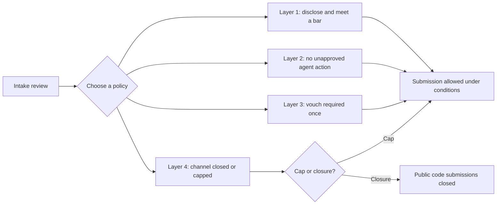

# Gated Contribution Intake Under Agent Load

> Gated contribution intake sets submission conditions; compare disclosure, approval, vouching, and channel limits before choosing a policy for agent-generated work.

## Read the adoption count as adoption, not as effectiveness

A 50-document review found seven adopted project policies among 12 documents that restricted contributions. Among 11 documents proposing a pull-request replacement, only Zed reported use, by its own staff ([Treude and Baltes, 2026](https://arxiv.org/abs/2610.34933v1), §IV-B). These are document-level findings, not industry adoption rates. [Knowledge-based pull requests](knowledge-based-pull-requests.md) records the corpus, coding method, and adoption limits.

Nothing in that corpus tested whether gating helps. Of the 44 documents that took a position, 15 offered only arguments, eight offered anecdotes, and six repeated numbers published elsewhere. The review is explicit: "None of these measurements tested whether any mechanism in Table III improves review" ([Treude and Baltes, 2026](https://arxiv.org/abs/2610.34933v1), §IV-C). Use the adopted policies as examples to evaluate. Record a review date and criteria for changing the gate.

## The cost asymmetry gating responds to

Agent volume is the trigger. GitHub reported agents opening more than 17 million pull requests per month in June 2026 ([Treude and Baltes, 2026](https://arxiv.org/abs/2610.34933v1), §I). The commit that introduced Ghostty's contributor policy named the cause directly: "agentic programming has eliminated the natural effort-based backpressure that previously limited low-effort contributions" (quoted in [Treude and Baltes, 2026](https://arxiv.org/abs/2610.34933v1), §IV-A).

Robles and German examined AI-related contribution policies across 209 open-source projects ([§II](https://arxiv.org/abs/2609.12236v1)). They describe a rate problem: "The cost of writing code is falling faster than the cost of deciding whether it should be accepted into the project. In practice, this means pull request volume rises while review capacity stays flat, producing a bottleneck" ([Robles and German, 2026](https://arxiv.org/abs/2609.12236v1), §I). Receiving an external change still means understanding its intent, judging correctness and fit, integrating it, and owning its maintenance.

## Four implementation layers

The following layers group documented policies by what they control. Disclosure and approval concern the contribution process; vouching and channel limits govern submission access.

### Layer 1: disclosure and a quality bar

The weakest gate keeps the channel open and attaches conditions. Rust permits model-generated changes only with disclosure and only when they are "Pre-arranged, non-critical, high-quality, well-tested, and well-reviewed", and its reviewers may close a non-compliant pull request "no questions asked" ([Treude and Baltes, 2026](https://arxiv.org/abs/2610.34933v1), §IV-B). The trailer conventions in [restraint rules need external enforcement](../instructions/restraint-rules-need-external-enforcement.md) are how a disclosure requirement becomes a check rather than a request.

### Layer 2: no agent action without human approval

LLVM bans "agents that take action in our digital spaces without human approval" ([Treude and Baltes, 2026](https://arxiv.org/abs/2610.34933v1), §IV-B). The prohibition concerns agent actions without human approval. It does not establish a blanket ban on approved agent actions.

### Layer 3: identity or a vouch

Ghostty requires a maintainer to vouch for a first-time contributor before they may submit pull requests, and the vouch persists for later contributions ([Robles and German, 2026](https://arxiv.org/abs/2609.12236v1), §II). This permits subsequent submissions without a new vouch. It does not establish acceptance of the submitted code.

### Layer 4: closed channel, with a platform cap as the softer form

Some policies close public code submissions while retaining other participation routes. Ladybird "has stopped accepting public pull requests and continues to welcome bug reports, testing, reductions, standards discussion, security reports, and other forms of participation". OpenAI's Codex repository moved to an invitation-only model "where outsiders are encouraged to provide reports, analysis, and context rather than code implementations" ([Robles and German, 2026](https://arxiv.org/abs/2609.12236v1), §II).

The paper describes two stages of GitHub controls. The first disables pull requests or restricts their creation to collaborators. The later controls add "persistent limits on pull requests from users without write access, with exemptions for trusted contributors" ([Robles and German, 2026](https://arxiv.org/abs/2609.12236v1), §I). That cap "turns the same policy into a platform setting" ([Treude and Baltes, 2026](https://arxiv.org/abs/2610.34933v1), §IV-B), but a cap still permits submissions within its limit. Closure and a cap have different effects on access.

## Triggers and constraints

This workflow is tool-agnostic: choose the contribution policy before configuring a particular coding assistant. Enforce the selected conditions at the repository boundary.

- Trigger: review the intake policy when volume exceeds review capacity or contributions fail stated conditions. Layers 1 and 2 cover disclosure, quality, and human approval. Layers 3 and 4 cover vouching and submission access; permission to submit does not establish code acceptance.
- Constraint: the gate bounds intake only. Table III records restriction as limiting two of the five pull-request roles, accountability and external contribution, and taking over none ([Treude and Baltes, 2026](https://arxiv.org/abs/2610.34933v1), Table III and §II). Whatever sits behind the gate still needs the review and rationale records the pull request was carrying.
- Constraint: check whether review moved outside pull requests before interpreting repository metrics. Review moved into an agent conversation leaves no pull-request comments, so a merged-without-review rate computed from pull-request records "could appear to rise further as review moves elsewhere, even if every change were reviewed" ([Treude and Baltes, 2026](https://arxiv.org/abs/2610.34933v1), §V). Fix the measurement before you read the trend.

## Why it works

What follows explains why projects reach for a gate, not that a gate improves review. Nothing in the corpus measured the latter.

Robles and German explain the attraction of a smaller implementation group: "Restricting implementation to a small group is not itself new in OSS, but agentic development allows maintainers to produce more of the code themselves, reducing their dependence on external code contributions and making this model more attractive" ([§I](https://arxiv.org/abs/2609.12236v1)). This is the authors' explanation, not a measured reduction in review cost.

Restriction is one policy response among several. The review also documents the Assisted-by trailer adopted by the Linux kernel and LLVM ([Treude and Baltes, 2026](https://arxiv.org/abs/2610.34933v1), §IV-B). A contribution policy does not require closing the submission channel.

## When this backfires

- Your contributor pipeline is your maintainer pipeline. Closing self-initiated code contributions removes one route into the development group. A narrower or more selectively admitted pool of future maintainers may increase bus-factor risk when key maintainers leave ([Robles and German, 2026](https://arxiv.org/abs/2609.12236v1), Table II). The same paper warns these consequences "may take years to become visible", so their timing and magnitude remain uncertain.
- The project's value comes from heterogeneous user needs. When external implementations are closed, users may still report a need, but "they can no longer increase the likelihood of their adoption by providing the implementation themselves" ([Robles and German, 2026](https://arxiv.org/abs/2609.12236v1), §III-A). The paper identifies a risk for requirements outside maintainer priorities.
- Admission runs on who the core already knows. Because entry depends on recognition or endorsement, homophily may reproduce the existing social network in the contributor population and then in the maintainer core ([Robles and German, 2026](https://arxiv.org/abs/2609.12236v1), §III-A).
- Everyone already has write access. On an internal repository there is no external channel to close, so the binding constraint is review throughput. Review prioritized by risk was the single most common mechanism in the review, appearing in 14 documents, and it leaves the channel open ([Treude and Baltes, 2026](https://arxiv.org/abs/2610.34933v1), §IV-B). An [explain-the-change review gate](explain-the-change-review-gate.md) is the same move at the merge boundary.
- You need the knowledge transfer. Restriction "may also reduce opportunities for the knowledge transfer" that Bacchelli and Bird documented in code review. It "may also reduce the visible activity through which project owners" in Dabbish et al.'s study assessed newcomers before granting commit rights ([Treude and Baltes, 2026](https://arxiv.org/abs/2610.34933v1), §V). Both are hedged inferences from prior work, not measurements of a gated project.

Robles and German do not conclude that gates should reopen: "We do not suggest reopening unrestricted external pull requests: doing so would restore the review and integration costs that made gating attractive in the first place" ([Robles and German, 2026](https://arxiv.org/abs/2609.12236v1), §IV). They ask projects to manage the possible participation loss. Their conclusion states: "Keeping humans in the loop with AI, however, does not ensure that humans remain in the loop with one another."

## Key Takeaways

- Record which condition the gate enforces: disclosure, quality, human approval, vouching, or submission access.
- Distinguish a submission cap from closure. A vouch authorizes submission; code acceptance remains a separate decision.
- Document how newcomers can become trusted contributors or maintainers. Treat succession effects as risks to monitor, not measured outcomes.
- Locate review activity before calculating review coverage from pull-request records alone.
- Set a review date and criteria for changing the policy. The reviewed corpus establishes adoption, without testing whether the mechanisms improve review.

## Related

- [Knowledge-Based Pull Requests for Cross-Trust-Boundary Contributions](knowledge-based-pull-requests.md) — the alternative that keeps the external channel open by regenerating the contribution in-house instead of closing intake
- [Explain-the-Change Review Gates for Agent Code](explain-the-change-review-gate.md) — raising review throughput at the merge boundary rather than lowering the arrival rate
- [Restraint Rules Need External Enforcement](../instructions/restraint-rules-need-external-enforcement.md) — how a Layer 1 disclosure requirement becomes an enforced commit-trailer check
- [Agent Commit Attribution: Signed Commits and Agent Identity](agent-commit-attribution.md) — the identity records a Layer 2 or Layer 3 gate depends on
- [Concurrent Agent Pull Requests and Merge-Conflict Cost](concurrent-agent-pr-merge-conflicts.md) — the downstream cost of the volume that makes a gate attractive
