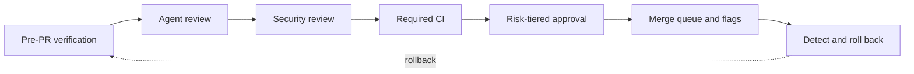

# Layered Code Review with a Human-Approval Budget

> A layered review loop treats human approvals as the budget to minimize and the revert rate as the guardrail that says whether it worked.

Anthropic's Claude Code team first reached high review coverage. It then optimized for minimum human review time without increasing reverts or incidents. It aims for most pull requests to merge with at most one human in the loop, with no increase in reverts or incidents ([Osmani, Lunt and Wang, 15 October 2026](https://claude.dev/blog/solving-code-review-at-anthropic/)). The loop below is that team's published process, assembled as a workflow. Treat the process as documented and the outcomes as self-reported: the team that built the reviewer is the team reporting how well it works.

## Why coverage stops being the right metric

Agent authorship raises change volume faster than reading capacity. Anthropic reports that changes landing per day in its monorepo went from about 2,500 in May 2026 to more than 30,000 in September, and that Claude Code's own repository, which sits outside that monorepo, is also under heavy pressure ([claude.dev](https://claude.dev/blog/solving-code-review-at-anthropic/)). At that rate, asking whether a human read the code stops discriminating between a safe change and a dangerous one, because the answer is yes for everything or no for everything. The team calls that question an imprecise proxy and replaces it with a different one: what could go wrong with this change, and which check is the right one to catch it ([claude.dev](https://claude.dev/blog/solving-code-review-at-anthropic/)).

Counting approvals exposes a trap coverage hides. Human time appears twice in review's ledger: the hours spent reviewing, and the hours spent repairing what bad code broke. Cutting the first while the second rises moves the cost rather than removing it. The team tracks approvals per pull request at median and 95th percentile, human comments, and time waiting on a person. Its constraint is explicit: "Revert and incident rates are the guardrail: if they rise, we haven't saved human time, we've only moved it" ([claude.dev](https://claude.dev/blog/solving-code-review-at-anthropic/)).

## Four conditions before you copy it

Three of these the published account states as its own setup; the fourth is the cost of building it. None is argued for, and all four are load-bearing.

1. Undo costs minutes. The post says flags, reverts, and staged releases undo most mistakes in minutes, and every dropped approval is priced against that. A change those tools cannot undo in minutes loses the backstop, and the approval you removed was carrying that risk alone.
2. You have a labeled incident set. The reviewer improves by being scored daily against past incident-causing pull requests whose bugs engineers confirmed by hand. Without that corpus, a change to the reviewer's prompts or model is unmeasured, and recall can fall with nothing to show it.
3. Most authors are trusted insiders. Only authors on a repository's trusted list get the lighter approval paths, mostly the team that owns the code. In open-source repositories, where the study does not report one, agent-only review measures a markedly lower merge rate than human review ([arXiv:2604.03196v1](https://arxiv.org/abs/2604.03196v1)).
4. Volume justifies the machinery. A risk classifier, a verifier committee, a daily eval, a merge queue, and rounds-to-pass tracking are a standing engineering cost. At low pull request volume, reading them may cost less than building the apparatus that avoids reading them. The post gives no threshold.

## Seven layers, no single gate

No layer is trusted to be complete. The team's own framing: "Each layer catches some problems and misses others. Few get through all of them, and rollback handles the rest" ([claude.dev](https://claude.dev/blog/solving-code-review-at-anthropic/)).

### Layer 1: verify before the pull request exists

The agent runs the tests, the build, and a linter, and shows the output rather than asserting completion. A subagent then reviews the diff with fresh context, which is the [agent self-review loop](../code-review/agent-self-review-loop.md) as a standalone pattern. When the reviewer keeps flagging the same thing, the team fixes it at the source in a lint rule, a skill, or an instruction file.

### Layer 2: agent review on every pull request

Every pull request gets an agent review before a person looks at it, read against the whole repository and the stated intent. Several agents hunt for bugs at once, a separate group votes on each finding, and only findings enough of them agree on get posted. Survivors are sorted by severity and tagged as important, nit, or pre-existing, so a bug the change did not introduce does not read as the author's fault.

### Layer 3: security review that blocks the merge

Security runs as its own automated pass. A pull request cannot merge while any finding from the bug review or the security review is open. Clearing a false positive means closing the thread with a short reason.

### Layer 4: required CI

Lint, type checks, cross-platform tests, build, and packaging. Red blocks the merge. The pull request template asks how the change was tested and how to undo it; the agent can draft both, and the person who asked for the change signs off.

### Layer 5: human approval scaled by risk

A classifier reads the change and assigns a risk tier. A second classifier then asks whether this change needs another person even when its tier says it does not. Docs, copy, internal-only features, and additive changes behind a flag need no approval once automated review and security checks are green; ordinary product changes need one person; the highest-risk code needs two. [Tiered code review](../code-review/tiered-code-review.md) covers the routing itself. Two rules keep the tier honest here. The change sets the tier, not the author. And an agent approval never substitutes for a person: "Automated review can clear a low-risk change, but it can't fill a slot that calls for a human" ([claude.dev](https://claude.dev/blog/solving-code-review-at-anthropic/)).

### Layer 6: merge queue, flags, and a staged release

The merge queue re-runs every check against main with the change applied, so two pull requests that pass separately cannot combine into a broken main. New behavior usually ships behind a flag to Anthropic employees first, then to a `latest` release channel, with `stable` trailing it.

### Layer 7: detection and rollback

Flags turn off without a deploy, a weekly on-call watches, and incident reviews ask which layer should have caught the escape. The team names the control it lacks: "We don't yet have circuit breakers that tighten approval when those numbers move; engineers here want them before more code moves to zero-human merges" ([claude.dev](https://claude.dev/blog/solving-code-review-at-anthropic/)).

## Making the review loop converge

An agent author and an agent reviewer will keep each other busy. One of this team's pull requests went through more than fifty rounds of review and fixes overnight before its author intervened. Blame-annotating what the reviewer kept flagging showed "about 59% of it was code that had been there since the reviewer's first pass" ([claude.dev](https://claude.dev/blog/solving-code-review-at-anthropic/)).

The team made four changes:

- A cap at three rounds, after which the reviewer asks the author to reconsider the approach.
- Re-review of only the new diff after the first few passes.
- Flagging the class of bug, so the author fixes every instance.
- Suppressing findings already posted.

Anthropic reports that internal pull requests passing after one review-and-fix round rose from 65% to 78%, those needing five or more rounds fell from 8.9% to 1.5%, and mean reviews to pass fell from 2.08 to 1.32 ([claude.dev](https://claude.dev/blog/solving-code-review-at-anthropic/)). Track rounds-to-pass next to recall, because a round cap that lowers recall looks identical on a throughput dashboard.

## What the team kept human

This is the part worth copying first, because it is a list of decisions rather than a code percentage. Five things stayed with people ([claude.dev](https://claude.dev/blog/solving-code-review-at-anthropic/)):

- Should we build this at all. Direction, taste, and scope. One team that considered its review bottleneck solved still kept human review for changes arriving from outside the team.
- Risky code, such as billing, the auto-updater, and CI workflows. Any path the owners list as sensitive and any CI workflow file always needs a person, whatever the classifier says.
- Architecture that sets a pattern others will copy.
- Reading the evidence: test output, the command and its result, a screenshot, the reviewer's findings. If you cannot say what the checks would miss, ask for a real review instead of a fast approval.
- Owning the outcome. On an agent-written pull request the person who directed the agent counts as a required reviewer, the same as if they had typed it.

## Triggers and what bounds agent authority

Layer 1 runs on the author's machine before the pull request exists. Layer 2 runs on every pull request. Layer 7 relies on flags and a weekly on-call rotation, and review agents also run nightly over existing code. Many authors also run internal skills by hand before opening a pull request, and `/code-review` runs a lighter review locally.

The post names these limits on agent authority:

- A path list that always demands a person.
- An author allowlist that gates the lighter tiers.
- Required status checks that block the merge.
- Approvals that expire when a commit the system cannot vouch for lands.

The shape is tool-agnostic. The pieces named here are Claude Code's, so an equivalent build on another assistant needs its own reviewer, instruction-file convention, and eval harness.

## Why it works

Two mechanisms carry this, and they come apart cleanly.

Defense in depth under cheap reversal does the first job. Dropping the human approval on a low-risk change removes one filter from a stack of seven, and the recovery layer bounds what an escape costs. Remove minutes-scale rollback and the argument collapses, which is why it heads the conditions above.

Convergence does the second, and here the post reports figures. In the team's blame analysis, about 59% of what the reviewer kept flagging predated its first pass. The post says extra rounds can pay off on a risky change but not on every pull request. The four convergence changes together cut the review rounds per internal pull request. The post gives no recall result for them, so track recall alongside rounds-to-pass, as the team says it does. The division of labor has independent support: across 278,790 review conversations in 300 open-source GitHub projects, over 95% of agent comments fall under defect detection and code improvement, while human comments spread across understanding questions, knowledge transfer, and testing feedback ([arXiv:2603.15911v2](https://arxiv.org/abs/2603.15911v2)). The study describes what agents and humans comment on. It does not test reassigning review.

## When this backfires

- Agent findings go unacted on. The same study measures that "code suggestions made by AI agents are adopted into the codebase at a significantly lower rate than suggestions proposed by human reviewers (16.6% vs. 56.5%)", and that in a sample of 383 unadopted agent suggestions, 28.7% were incorrect and 24.0% were fixed another way ([arXiv:2603.15911v2](https://arxiv.org/abs/2603.15911v2)). A layer whose output is ignored is not a layer.
- The population is open-source. Across 3,109 pull requests drawn from the AIDev dataset, "CRA-only PRs achieve a 45.20% merge rate, 23.17 percentage points lower than human-only PRs (68.37%), with significantly higher abandonment" ([arXiv:2604.03196v1](https://arxiv.org/abs/2604.03196v1)). The study does not say whether those projects keep trusted-author lists or incident-derived evals, so the two results may differ for that reason or for others.
- The reviewer shares a model family with the author. Several agents voting filters noise, and it does not break a shared training distribution. See [human-AI review synergy](../code-review/human-ai-review-synergy.md) for the correlated-failure case.
- Reviewers habituate. Routing more volume past fewer people runs toward the curve in [reviewer habituation decay](../code-review/reviewer-habituation-decay.md), where approval rates rise while comment counts fall.
- No control group. The headline result is "From June to September, merged pull requests to Claude Code's codebase more than doubled while the share that had to be reverted fell by more than 40 percent" ([claude.dev](https://claude.dev/blog/solving-code-review-at-anthropic/)). Over four months with no comparison arm, a team improving at everything at once produces the same chart.

## Key Takeaways

- Instrument first: human approvals per pull request at median and p95, plus the revert rate. Without the second number you cannot tell a saving from a transfer, and the first alone will look like progress either way.
- Cap review rounds at three, after which the reviewer asks the author to reconsider the approach, and re-review only the new diff after the first few passes. The Claude Code team's blame analysis of what its reviewer kept flagging found about 59% predated the reviewer's first pass.
- Write the always-human path list before you relax any tier, and check it is enforced by CODEOWNERS or branch protection rather than by the classifier you are about to trust.
- Treat every figure in a vendor's account of its own process as a hypothesis about your repository. The independent open-source measurements report lower agent-suggestion adoption (16.6% vs. 56.5%) and a lower agent-only merge rate (45.20% vs. 68.37%). Whether the preconditions above explain the gap is not measured.

## Related

- [Tiered Code Review: AI-First with Human Escalation](../code-review/tiered-code-review.md) — the risk-routing layer on its own, without the surrounding stack
- [Agent Self-Review Loop](../code-review/agent-self-review-loop.md) — layer 1 as a standalone pattern
- [Human-AI Review Synergy in Agentic Code Review](../code-review/human-ai-review-synergy.md) — the measured difference in what agents and people comment on
- [Reviewer Habituation Decay](../code-review/reviewer-habituation-decay.md) — what sustained agent-PR volume does to an individual reviewer
- [Explain-the-Change Review Gates for Agent Code](explain-the-change-review-gate.md) — a different answer to the question of where human attention buys the most
