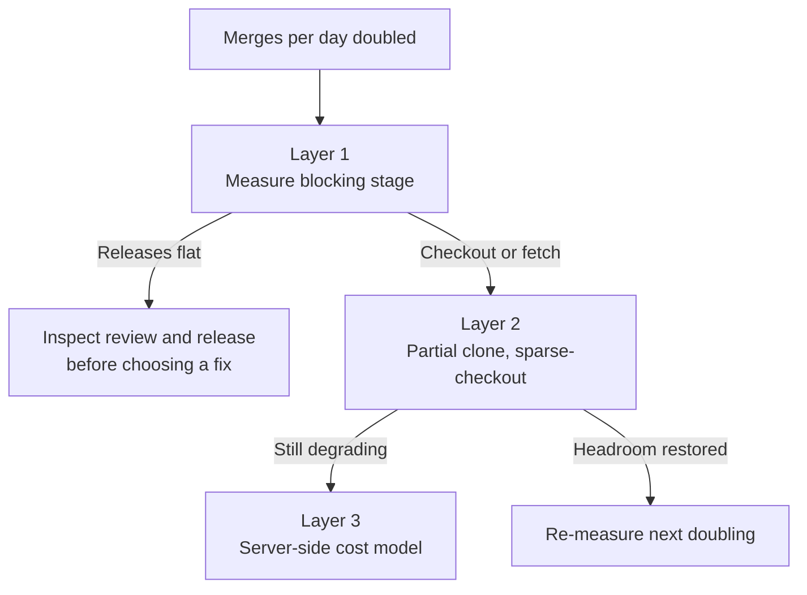

# Developer Infrastructure Readiness at Agent Merge Rates

> When merge rate outgrows what source control, builds, and CI were sized for, the binding constraint moves from writing code to that infrastructure.

The condition is a merge rate your chain was never sized for. Anthropic averaged around 2,500 code changes merged per day in May 2026 and over 30,000 per day by September, and states the consequence: "The bottleneck, now, is all of the developer infrastructure built for human scale: source control, builds, and CI" ([Anthropic, Redesigning source control](https://www.anthropic.com/research/redesigning-source-control)). Most teams are nowhere near that, and the same post is explicit about it: "While we don't expect many organizations to have these problems in the very near term, we suspect it won't be too long before others who use AI coding tools experience these same pressure points". Treat what follows as a readiness check against your own stack. It is not an argument for writing a version control system.

## Why source control is the stage that breaks

The price git pays for offline work is a complete local copy. "Git is a decentralized system: every clone is a complete, self-contained repository that can compute diffs, read history and blame, and check out any revision while fully offline", and "For the vast majority of repositories, this is the right design, and it's a large part of why git became the standard" ([Anthropic, Redesigning source control](https://www.anthropic.com/research/redesigning-source-control)).

Anthropic's figures show the scale. Its main branch history alone is almost 100 GB and a compressed working copy is over 25 GB. On top of that it runs "on the order of 25 million code checkouts per day for CI, before counting developer environments, agent sandboxes, and research jobs". The post puts the naive cost of that volume at "over 600 PB of git traffic per day" ([Anthropic](https://www.anthropic.com/research/redesigning-source-control)).

The assumption that failed was offline-first clients: "like most companies, we were using git as a centralized system with one authoritative copy, but nearly all of our clients were agents and jobs that are online by definition" ([Anthropic](https://www.anthropic.com/research/redesigning-source-control)).

## Three readiness layers

### Layer 1: find the stage the pipeline waits on

Rank operations by whether something blocks on them, not by how slow they look. Microsoft's monorepo team made that distinction the basis of a design decision, and the Example below shows which way it went ([GitHub Blog, The Story of Scalar](https://github.blog/open-source/git/the-story-of-scalar/)).

Three numbers separate the candidate stages, and each should be read as merge rate climbs. The reading attached to each is this page's heuristic, not a finding from the sources:

- Push to usable checkout in CI. A long wait here suggests source control is the constraint.
- Green build to merged change. A long wait here suggests the merge queue is the constraint.
- Share of CI wall-clock spent fetching rather than testing. A rising share suggests source control even when total CI time looks flat.

Use these measurements to identify candidate constraints, then test whether improving one reduces the time your pipeline blocks.

### Layer 2: spend git's own headroom first

The techniques that bought Microsoft's monorepos their headroom now ship inside git itself. Scalar became part of Git v2.38, and "By simply switching from `git clone` to `scalar clone`, you will have all of Git's most impactful performance features, such as partial clone, sparse-checkout, background maintenance, and advanced config options neatly configured for your repository" ([GitHub Blog](https://github.blog/open-source/git/the-story-of-scalar/)).

Anthropic worked through the same family first. "Git offers tools for working with a slice of a repository, such as shallow clones, sparse checkouts, and promisor remotes", plus mirrors and blob-storage seeds, and at peak it "operated several hundred internal git mirrors to deal with the load" ([Anthropic](https://www.anthropic.com/research/redesigning-source-control)). Repository size is not what ended that approach. A failure mode developed under load: "Seeds fell further from the tip of main between refreshes, and it took more and more care to keep operations that depend on history, like diff and blame, working on partial clones." Watch for that symptom. A size threshold will not tell you.

### Layer 3: move the cost model, not only the tool

Anthropic's answer re-indexes the cost to change size rather than repository size. Every commit, rebase, and merge happens on the server, so there is nothing to push. The query surface opens up with it, because "all of the source control queries the client uses are also exposed via API" ([Anthropic](https://www.anthropic.com/research/redesigning-source-control)). A CI job that wants a diff against its merge base asks for it instead of checking anything out.

A second human-scale assumption goes with it. The same post reports that "A proper merge queue, for example, doesn't make much sense at agent scale", and that Anthropic could not replicate a global repository lock on the merge queue, so "we've invested in post-merge and pre-deploy automated testing. This does mean that concurrent changes can conflict, but Claude can typically fix these conflicts faster than humans can even identify them." That second clause carries the decision, and it is a premise about the agents. A source control redesign does not supply it. The reported results were an infrastructure footprint "200x smaller than our previous git mirroring infrastructure in terms of CPU and memory requirements", CI and research jobs checking out code "two orders of magnitude faster (in seconds rather than minutes)", and a 25% CPU capacity win in CI ([Anthropic](https://www.anthropic.com/research/redesigning-source-control)).

## Why it works

The constraint comes from one term in a cost model, and that term is observable before it binds. An operation whose price tracks total repository size still carries only the work of one change, so everything above the change size is overhead. Merge rate multiplies the number of clients paying that overhead. Track degradation as merge volume rises; the reported volumes do not establish a general threshold. Anthropic states the invariant as a design rule: "The cost of creating a commit and updating its downstream data structures has to scale with the size of the change, not the overall size of the repo, or the server can't keep up" ([Anthropic](https://www.anthropic.com/research/redesigning-source-control)).

## Triggers and constraints

A suggested trigger is each doubling of merges per day. This is a planning heuristic; Anthropic does not validate a review cadence.

Bound what each layer may authorize. Layers 1 and 2 are measurement and reversible configuration, safe for an agent or a single engineer to carry out. Layer 3 is neither. Anthropic notes that Scion "requires its own code review, code search, and CI", so leaving git means rebuilding the chain around it, and the company states that "Scion is by no means a suitable replacement for git for general use" ([Anthropic](https://www.anthropic.com/research/redesigning-source-control)). The scope of that rebuild is a budgeting input. Anthropic reports that a team of seven people built Scion and its code review tool Antique, "not to mention half a dozen related systems, and fully migrated to them in five months", at an organization whose "ability to spend tokens for internal use far exceeds what any other business would realistically want to spend".

Tool-agnostic. The constraint sits in the source control, build, and CI chain. Claude Code, Copilot, and Cursor teams therefore run the identical check.

## When this backfires

- The binding stage is human review. Across more than 500,000 GitHub developers, autonomous coding agents raised commits by 240% cumulatively, but "the 240% cumulative effect falls to 80% for the number of projects, and to 30% for actual releases", which the authors describe as "consistent with the weak-link hypothesis: the strong productivity gains from AI are attenuated by human bottlenecks in the production chain" ([Demirer, Musolff and Yang, NBER working paper 35275](https://www.nber.org/papers/w35275)). Faster checkouts then deliver a longer review queue sooner. [The bottleneck migration](../human/bottleneck-migration.md) owns that half.
- Merge rate has not moved. Measure checkout and fetch delays before attributing a slowdown to agent volume. The sources establish no general merge-rate threshold.
- The repository is poly-repo or modest. Scion's premises are monorepo premises: one authoritative history, cross-cutting blame and ancestry queries. A service repo that clones in seconds has no term to attack.
- Agents are not the dominant client. The always-online premise fails where most clients are laptops on unreliable networks that need offline diff, blame, and checkout for real.
- Layer 1 is skipped. Ranking by latency inverts the order the Scalar team measured, and the re-architecture then optimizes an operation nothing waits on.

## Example

Microsoft's Scalar work records a Layer 1 decision and its consequence. Moving the Office monorepo from a virtual filesystem onto sparse-checkout made checkout slower, and the team tested whether that mattered before treating it as a defect. It did not: "Build times can take hours in this monorepo after taking new changes, so users typically do not use `git checkout` until the end of the day when they are ready to trigger a long build overnight. For this reason, `git checkout` was not a critical path for their developers" ([GitHub Blog](https://github.blog/open-source/git/the-story-of-scalar/)).

The command they did optimize was `git status`: "Our critical performance measurement was the `git status` command, and we were seeing performance within three or four seconds" ([GitHub Blog](https://github.blog/open-source/git/the-story-of-scalar/)). Two commands, different roles on the critical path. A readiness check that ranked by latency alone would have spent the budget on the wrong one.

## Key Takeaways

- Instrument push-to-checkout, green-build-to-merge, and CI fetch share now, while merge rate is still low. The check needs a trend, and a trend cannot be measured retroactively.
- Write down which operations in your chain already depend on full history, such as blame, bisect, and ancestry queries. Those are the ones Anthropic reports needed more care on partial clones, and a stale mirror or seed can impair them.
- If commit count climbs while release count stays flat, stop. Inspect review and release stages before choosing an infrastructure change. Flat releases alone do not identify the cause.
- Price Layer 3 as a replacement of code review, code search, and CI as well as of source control. Anthropic reports seven people and five months; this single case establishes neither a minimum nor an estimate for your team.

## Related

- [The Bottleneck Migration When Humans Supervise Agents](../human/bottleneck-migration.md) — the human half of the same shift, where review and judgment are the constraint
- [Reducing Fixed CI Overhead Before Adding Shards](ci-setup-overhead-before-sharding.md) — the per-job form of measure before you buy capacity
- [Concurrent Agent Pull Requests and Merge-Conflict Cost](concurrent-agent-pr-merge-conflicts.md) — what a rising merge rate does to overlapping branches
- [Continuously Built Agent Environments](../patterns/agent-design/continuously-built-agent-environments.md) — the agent sandboxes that make up part of the checkout volume
- [Post-Merge Fix Signals for Agent Merges](../verification/post-merge-fix-signals-agent-merges.md) — what to measure once post-merge testing replaces the queue lock
