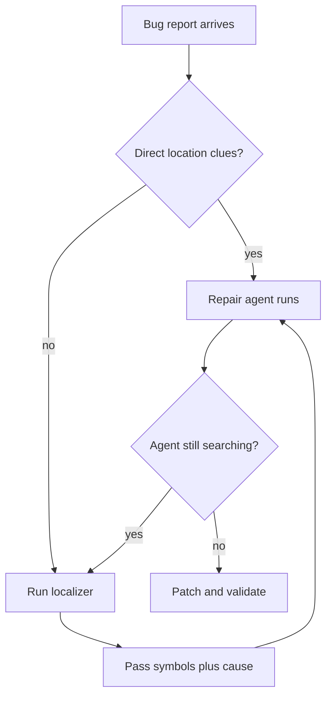

# On-Demand Fault Localization for Agentic Repair

> Run the localizer when the bug report is thin on location clues, and count its tokens on the same ledger as the repair.

Putting a fault-localization stage in front of a repair agent that can already browse the repository does not reliably raise the fix rate. In a study of 16,248 repair trajectories covering six published FL methods, two benchmarks and three models, "the change in pass@1 across the 18 With-FL settings ranges from −4.45 to +0.40 percentage points and is negative in 17 settings" ([arXiv:2610.25826v1, §4.1.1](https://arxiv.org/abs/2610.25826v1)). The stage still earns a conditional place in the pipeline. It shortens the agent's path to the right code, and the conditions under which it pays are measurable before you invoke it.

## The mandatory preprocessing problem

Most FL methods run before every repair and are graded on how well they rank known fault locations. The premise behind that design is that the repair model cannot reach code the localizer did not hand it, because "software repositories often span millions of tokens, far exceeding current LLM context limits" ([arXiv:2601.18044v1](https://arxiv.org/abs/2601.18044v1)). For an agent with a shell and the whole checkout, that premise does not hold. Unguided, the agent in this study inspected a file from the reference patch in 88.6% to 99.4% of targets, against 87.1% to 99.6% with guidance ([arXiv:2610.25826v1, §4.2.1](https://arxiv.org/abs/2610.25826v1)).

So the unconditional stage pays twice and collects once. It spends its own tokens to hand the agent an entry point the agent was mostly going to find anyway. Worse, when the list is wrong it is still initially followed: across the completely misleading cases, "initial anchoring ranges from 34.5% to 100.0%, showing that agents frequently begin their search from locations suggested by FL even when none of those locations is correct" ([arXiv:2610.25826v1, §4.2.3](https://arxiv.org/abs/2610.25826v1)).

## What the studied methods bought, and what they cost

Four measures across the same 18 settings pull in different directions.

| Measure | Effect of adding an FL stage |
|---|---|
| pass@1, paired per bug | −4.45 to +0.40 pp; negative in 17 of 18 settings |
| Mean first step reaching a reference file | Lower in all 18 settings, by 0.11 to 2.04 steps |
| Repair-stage tokens | Down in 16 of 18 settings; range −31.3% to +9.8% |
| End-to-end tokens, localizer included | Up in 13 settings, down in 5; range −16.4% to +129.8% |

The navigation row compares displayed means, not paired changes for the same targets, as the authors report it.

Source: [arXiv:2610.25826v1, §4.1.1 and §4.2](https://arxiv.org/abs/2610.25826v1).

Read the pass@1 row as a null. In 16 of the 18 settings the unadjusted McNemar p-value was at least 0.05, and the two significant decreases did not survive Holm adjustment ([arXiv:2610.25826v1, §4.1.1](https://arxiv.org/abs/2610.25826v1)). Every setting produced both gains and losses, so individual bugs flip while the aggregate stays put.

The end-to-end row decides whether to build the stage. "Overall, localization often consumes more tokens than it saves during repair" ([arXiv:2610.25826v1, §4.2.4](https://arxiv.org/abs/2610.25826v1)), and the sign depended on the repair model and the FL method: all six GPT-5.6 Luna settings got more expensive end to end, while the five reductions landed on DeepSeek-v4 Flash (FlexFL, LocAgent, OrcaLoca) and Gemini 3.1 Flash Lite (AutoFL, SoapFL). Measure your own pair before assuming either direction.

## Keep the gold-guidance arm separate

The gold-guidance experiment measures a different intervention from the six studied FL methods. Keep its repair-success gains separate from their navigation and token results. That arm fed GPT-5.6 Luna locations and bug-cause descriptions derived from the reference patch, a ceiling on what a perfect localizer could deliver rather than a result for any shipping method. On SWE-bench Verified with the original issues, gold symbols alone were worth +2.8 pp and gold symbols plus a bug-cause description +6.6 pp ([arXiv:2610.25826v1, §4.3.1](https://arxiv.org/abs/2610.25826v1)).

Two things in that arm transfer to a design decision. The payoff grows as the issue text gets less helpful: on localization-reduced issues, where direct location clues were stripped out, the same pair reached +13.0 pp. "FL yields larger gains in repair success when issues contain fewer direct location clues" ([arXiv:2610.25826v1, §4.3.1](https://arxiv.org/abs/2610.25826v1)). And explaining the failure beat naming the file. Bug causes alone outscored gold symbols by 1.6 pp on the original issues, 2.4 pp on the reduced ones and 4.8 pp on SWE-bench Multimodal ([arXiv:2610.25826v1, §4.3.2](https://arxiv.org/abs/2610.25826v1)).

The 39.2% token figure belongs to one cell of this arm: the gold-symbol repair-token reduction on localization-reduced issues, counting repair tokens only ([arXiv:2610.25826v1, §4.3.1](https://arxiv.org/abs/2610.25826v1)). It is not an end-to-end saving, and none of the six studied methods achieved it.

## Three implementation layers

This workflow is tool-agnostic.

### Layer 1: Detect search needs

Use the report's location clues and the agent's search progress as triggers.

### Layer 2: Request localization

Pass suggested symbols and causes without restricting repository access.

### Layer 3: Repair and evaluate

Validate the patch and compare total tokens with the no-FL baseline.

## Triggers and constraints

The paper argues the gate directly: its evidence supports FL's "use on demand rather than as a mandatory preprocessing step for every repair" ([arXiv:2610.25826v1, §4.3.1](https://arxiv.org/abs/2610.25826v1)).

- Trigger on clue poverty in the report. Stack traces, file paths and symbol names signal that the agent will localize unaided. Their absence moved the gold-guidance gain from +6.6 pp to +13.0 pp ([arXiv:2610.25826v1, §4.3.1](https://arxiv.org/abs/2610.25826v1)).
- Trigger on observed search failure. The paper's implications name "when the bug input provides few location clues or the agent struggles to find relevant code" as the conditions worth studying ([arXiv:2610.25826v1, §5](https://arxiv.org/abs/2610.25826v1)). A step or token count crossing a threshold with no edit yet is the second trigger.
- Constrain the stage's authority to a suggestion. The agent kept the full repository and the same tools in both arms, and that is what let it escape bad guidance. Recovery among anchored trajectories ran from 34.8% to 95.9% ([arXiv:2610.25826v1, §4.2.3](https://arxiv.org/abs/2610.25826v1)). Narrowing the repair stage's view to the localizer's output removes that escape route.
- Prefer a cause over a coordinate list where the fix is small. On SWE-bench Verified, symbols plus cause was the best of the four guidance cells under both issue inputs ([arXiv:2610.25826v1, §4.3.2](https://arxiv.org/abs/2610.25826v1)).
- Grade the stage on one ledger: localizer tokens plus repair tokens, against a no-FL baseline on the same tasks. Repair-stage savings alone will tell you the stage is free when it is not.

## Example

The study compares original SWE-bench Verified issues with versions stripped of direct location clues. With GPT-5.6 Luna, no-FL repair scores 73.4% on original issues and 68.4% on reduced issues. Gold symbols plus bug causes raise those scores to 80.0% and 81.4%, respectively ([Table 5](https://arxiv.org/abs/2610.25826v1)).

Use that comparison to identify reports where localization deserves a trial. It does not prove that a shipping localizer will reproduce gold guidance. For the cost decision, the same paper reports 138.7K repair tokens without FL on Verified. OrcaLoca reduces repair tokens to 129.6K but raises total tokens to 318.7K, including localization ([Table 4](https://arxiv.org/abs/2610.25826v1)). Count the 318.7K total when deciding whether to keep that stage.

## Why it works

The gate works because the repair agent is already a localizer, so the FL stage competes with a capability the harness supplies at no extra charge. Reachability sits near its ceiling without guidance, which caps what a localizer can add; the entry point is what it can still change, and it does. Adoption of recommended files during initial inspection rose in all 18 settings, by 0.8 to 27.9 percentage points, and mean first-reach step fell in all 18 ([arXiv:2610.25826v1, §4.2.1 and §4.2.2](https://arxiv.org/abs/2610.25826v1)). The repair-stage token reductions are consistent with the shorter navigation paths, and pass@1 did not move.

Localization accuracy fails to convert into repair success, and the study finds a correlation consistent with a confound. Across all 18 settings the no-FL pass@1 was higher for top-1 hits than for misses, 79.2% against 63.0% in one Defects4J setting. "This suggests that bugs that are easier to localize are often also easier for the agent to repair without FL" ([arXiv:2610.25826v1, §4.1.2](https://arxiv.org/abs/2610.25826v1)). I read this as headroom sitting where localization is hardest, so accuracy gains may land where they convert worst.

Diagnostic text helped beyond coordinates in the gold-guidance arm. One reference patch is also a narrow definition of the location: among model-target pairs with at least two successful patches, modified lines differed in 44.7% of Defects4J cases and 39.3% of SWE-bench Verified cases ([arXiv:2610.25826v1, §4.3.3](https://arxiv.org/abs/2610.25826v1)).

## When this backfires

- Your repair model cannot browse the repository. The null depends on the agent holding a shell and the full checkout. The nearest study in the opposite regime gave its model no "tool use, iterative reasoning, or environment interaction" and found file-level localization to be "the dominant factor", worth 15 to 17 times a no-file baseline on the same 500 SWE-bench Verified instances ([arXiv:2604.05481v1](https://arxiv.org/abs/2604.05481v1)). Skipping the stage there is not a saving.
- Your pipeline is localize-then-repair by construction. Improving the localizer there does pay: RGFL reports that "Integrating our localization into Agentless yields a 12.8% end-to-end repair success improvement" ([arXiv:2601.18044v1](https://arxiv.org/abs/2601.18044v1)). This gate is for harnesses that let the agent search, not for [constrained two-phase pipelines](../patterns/agent-design/agentless-vs-autonomous.md).
- Your repairs are large and spread across files. On the SWE-bench Pro bug subset, where "Patches modify 3.85 files on average, and 82.8% span multiple files, compared with 1.25 files and 14.2% in SWE-bench Verified", bug causes scored 52.9% against gold symbols' 53.8%, and adding causes to symbols left it at 52.9% ([arXiv:2610.25826v1, §4.3.2](https://arxiv.org/abs/2610.25826v1)). Prefer-the-cause does not transfer to this stratum.
- Your repair model recovers badly from bad guidance. Recovery stayed below 50% in all three Gemini 3.1 Flash Lite Defects4J settings, against a 34.8% to 95.9% range overall ([arXiv:2610.25826v1, §4.2.3](https://arxiv.org/abs/2610.25826v1)). Where recovery is that low a wrong location ends the run in the wrong place, so tighten the gate instead of loosening it.
- You read small pass@1 deltas as decisions. The authors "run each task once per setting given the scale of our experiments and the high cost of repeated runs" ([arXiv:2610.25826v1, §6](https://arxiv.org/abs/2610.25826v1)). A one-point difference is not separable from run-to-run variance, and both benchmarks may overlap model training data.

## Key Takeaways

- Put the localizer's tokens and the repair tokens on one ledger before you judge the stage. The repair stage alone says it saves tokens in 16 of 18 settings; the full ledger says it costs more in 13.
- Gate the stage on how few location clues the report carries. That one condition took the gold-guidance gain from +6.6 pp to +13.0 pp.
- Ship the failure explanation alongside the coordinates, and prefer it where the fix is small; it beat gold symbols on three of four settings.
- Leave the repair agent its own search tools. Recovery from wrong guidance ran as high as 95.9%, and it only exists because the agent could look elsewhere.
- Check which regime you are in first. The decision inverts when the repair model cannot read the repository for itself.

## Related

- [Agentless vs Autonomous: When Simple Beats Complex](../patterns/agent-design/agentless-vs-autonomous.md) — the two-phase localize-then-repair pipeline this gate does not apply to, because there the localizer is the repair model's only route to the code
- [The Recall Trap: Tuning a Code Retriever on Recall@k at a Fixed Slot Budget](../patterns/anti-patterns/recall-trap-retriever-tuning.md) — the same objective mismatch one stage earlier, scoped to a fixed context pack; its agentic-harness arm is a powered null, and that is the arm measured here
- [Domain-Scoped Parallel Exploration for Multi-File Change Localization](../patterns/agent-design/domain-scoped-parallel-localization.md) — how to run the localization phase once you have decided to run it
- [Evidence-First Reports From Failure-Diagnosis Agents](../patterns/agent-design/evidence-first-diagnosis-reports.md) — the same preference for failure evidence over a named verdict, measured on engineers
- [Latency-Budgeted Repair: Size the Run to the Wait](latency-budgeted-repair-agents.md) — the sibling budget decision on the repair stage itself, capped on wall clock rather than tokens
