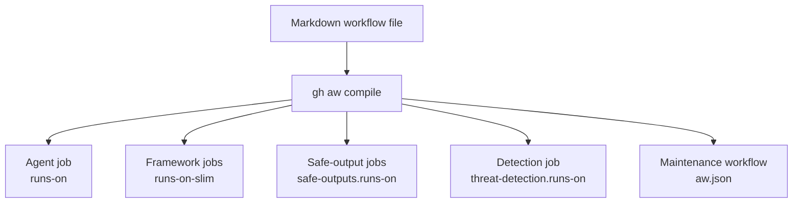

# Per-Job Runner Placement in Agentic Workflows

> `runs-on` sets the agent job's runner. Other job classes read their own placement fields, and detection inherits the agent's runner unless overridden.

On GitHub-hosted runners, leave this alone. Hosted runners "execute code within ephemeral and clean isolated virtual machines" ([GitHub Docs: Secure use](https://docs.github.com/en/actions/reference/security/secure-use)), and the Cloud Hypervisor micro-VM runtime requires a "GitHub-hosted Ubuntu x86_64 KVM runner" ([gh-aw Security Architecture](https://github.github.io/gh-aw/introduction/architecture/)). Moving placement gives up both. The decision below starts once something forces the move anyway.

[GitHub Agentic Workflows](../tools/copilot/github-agentic-workflows.md) reached general availability on 2026-10-28, and the Actions Runner Controller path is one of the named additions since the public preview: "Run agentic workflows on self-hosted ARC runners with Docker-in-Docker" ([GitHub Changelog](https://github.blog/changelog/2026-10-28-github-agentic-workflows-generally-available)). That addition is what puts placement in front of a team running agentic workflows on its own infrastructure.

## Why one runs-on is not enough

A Markdown workflow file compiles into "standard Actions YAML" ([GitHub Changelog](https://github.blog/changelog/2026-10-28-github-agentic-workflows-generally-available)), and the jobs that come out are not peers. Setting `runs-on` pins one of them. The project's reference states the split without hedging: "`runs-on` controls only the main agent job. `runs-on-slim` controls all framework/generated jobs. `safe-outputs.runs-on` still takes precedence over `runs-on-slim` for safe-output jobs specifically" ([gh-aw Self-Hosted Runners](https://github.github.io/gh-aw/reference/self-hosted-runners/)).

The shared-configuration route does not help either. The same reference notes that "`runs-on` must be set in each workflow — it is not merged from imports", so an `imports:` fragment that looks like it standardizes placement across a repository does not.



## Three placement layers

### Layer 1: the agent job

`runs-on` takes a single label, an array the runner must match in full, or a runner-group object with optional label filters. The floor is narrow: "Runners must be Linux with Docker support. macOS and Windows are not supported." An Actions Runner Controller deployment needs `runner.topology: arc-dind` as well, which the reference prescribes where a Docker-in-Docker sidecar puts the runner container and the Docker daemon container "across separate filesystems" ([gh-aw Self-Hosted Runners](https://github.github.io/gh-aw/reference/self-hosted-runners/)).

### Layer 2: framework, safe-output, and detection jobs

Of these, only the detection job follows the agent's `runs-on`. The rest read fields of their own, and the reference names them alongside their default:

> Framework jobs — activation, pre-activation, safe-outputs, unlock, APM, update_cache_memory, and push_repo_memory — default to `ubuntu-slim`.

`runs-on-slim` moves that whole set at once. Safe-output jobs read `safe-outputs.runs-on` in preference to it, and the threat-detection job has its own field again. Detection is the one worth setting deliberately, because "the detection job runs on the agent job's runner by default" and the reference gives two reasons to override it: a runner that "lacks outbound internet access for AI detection", or a wish to "run the detection job on a cheaper runner" ([gh-aw Self-Hosted Runners](https://github.github.io/gh-aw/reference/self-hosted-runners/)). Pin the agent job to an egress-restricted runner and the check that inspects its output follows it there.

### Layer 3: the generated maintenance workflow

This layer is configured outside workflow frontmatter entirely. The reference records that "The generated `agentics-maintenance.yml` workflow defaults to `ubuntu-slim` for all its jobs", and the override is `maintenance.runs_on` in `.github/workflows/aw.json` ([gh-aw Self-Hosted Runners](https://github.github.io/gh-aw/reference/self-hosted-runners/)). A repository that has moved every workflow file still has this one running on the hosted default.

## Triggers and constraints

Every placement field above sits in workflow frontmatter or `aw.json`, and "`runs-on` must be set in each workflow", so each file carries its own placement whatever fires it ([gh-aw Self-Hosted Runners](https://github.github.io/gh-aw/reference/self-hosted-runners/)). What bounds the agent's authority is separate machinery: agents "run with read-only permissions by default", outputs are validated through the safe-outputs process, and a dedicated threat-detection "job scans all proposed changes before they are applied" ([GitHub Changelog](https://github.blog/changelog/2026-10-28-github-agentic-workflows-generally-available)).

Two constraints bind at compile time rather than run time. "To enforce self-hosted runners for every generated job", set `require_self_hosted_runners` in `aw.json`; the check is not limited to the agent, because "The compiler checks all generated jobs, including framework and safe-output jobs" ([gh-aw Self-Hosted Runners](https://github.github.io/gh-aw/reference/self-hosted-runners/)). The micro-VM runtime and the Actions Runner Controller topology are also alternatives rather than a stack, because "Cloud Hypervisor is incompatible with `runner.topology: arc-dind`" and "The compiler rejects incompatible runtime, topology, and AWF-version combinations" ([gh-aw Security Architecture](https://github.github.io/gh-aw/introduction/architecture/)).

Tool coverage follows from where the fields live. They belong to the workflow runner rather than to the model behind it, so the same runner carries whichever engine the workflow picks; the architecture reference describes gh-aw as running "AI coding agents — GitHub Copilot, Claude Code, OpenAI Codex, Google Gemini, or Pi — inside GitHub Actions". The default engine carries a license condition of its own: "Using the default GitHub Copilot CLI engine to power a workflow requires a Copilot license" ([GitHub Changelog](https://github.blog/changelog/2026-10-28-github-agentic-workflows-generally-available)).

## Why it works

Placement splits because the compiler splits the work. The architecture reference also separates two axes that are easy to merge: "Runner topology determines where the Docker daemon and workspace live. Agent runtime determines the isolation boundary around the agent process" ([gh-aw Security Architecture](https://github.github.io/gh-aw/introduction/architecture/)). Every field on this page moves the first axis; the second is the sandbox runtime setting.

That separation is why the egress control survives the move to Actions Runner Controller instead of lapsing. "ARC DinD preserves AWF's egress policy through Docker network topology rather than host `iptables`", and in that arrangement "the runner container remains unprivileged and does not need `NET_ADMIN`" (same source). The per-job shape matters for the same reason. The reference's own illustration of a job class needing something its sibling does not is the detection job's outbound access for AI detection, and no single `runs-on` can express that.

## When this backfires

- Hosted runners already suffice. They give the ephemeral clean VM quoted above, and the Cloud Hypervisor micro-VM runtime runs on eligible GitHub-hosted Ubuntu x86_64 KVM runners ([gh-aw Security Architecture](https://github.github.io/gh-aw/introduction/architecture/)). Moving placement costs operator work and gives up both.
- Self-hosted without the host work. The project declines to vouch for the host: "A self-hosted runner processes potentially hostile repository content even in private or internal repositories. The agent sandbox does not establish that the underlying host is clean" ([gh-aw Self-Hosted Runners](https://github.github.io/gh-aw/reference/self-hosted-runners/)). GitHub's Actions security reference is blunter, saying self-hosted runners "do not have guarantees around running in ephemeral clean virtual machines, and can be persistently compromised by untrusted code in a workflow", and that the obvious mitigation is unreliable because "there is no way to guarantee that a self-hosted runner only runs one job" ([GitHub Docs: Secure use](https://docs.github.com/en/actions/reference/security/secure-use)).
- Treating the routing fields as the control. They are not. "Runner labels, runner-group selection, and `require_self_hosted_runners` route or constrain jobs; they do not prove host ephemerality or enforce this checklist" ([gh-aw Self-Hosted Runners](https://github.github.io/gh-aw/reference/self-hosted-runners/)).
- Counting on the GA label for the isolation features. The changelog lists micro-VM isolation and cross-repository enclaves among its additional capabilities for general availability. The project's own reference marks that runtime "Cloud Hypervisor (preview)" in its supported-combinations table, and its documentation groups Private Repository Enclaves under an Experimental section ([gh-aw Security Architecture](https://github.github.io/gh-aw/introduction/architecture/)). Read the reference before planning around either.

The evidence here is single-vendor. Three of the four external sources on this page are GitHub describing its own product, and the fourth is GitHub's Actions security reference. No independent operator report of running agentic workflows on Actions Runner Controller was available at the time of writing, so treat the behavior described as what the vendor documents rather than as something corroborated in the field.

## Example

A workflow pinned across every layer. The agent, framework, and safe-output jobs go to the self-hosted fleet; the detection job stays on a hosted runner because it needs outbound model access. The reference documents the framework-job override and the detection override under separate headings, so this block combines its two examples rather than reproducing either.

```yaml
---
on: issues
runs-on: [self-hosted, linux, x64]
runs-on-slim: [self-hosted, linux, x64]
safe-outputs:
  runs-on: [self-hosted, linux, x64]
  create-issue: {}
  threat-detection:
    runs-on: ubuntu-latest
---
```

The maintenance workflow is still unplaced, because it is not configured there:

```json
{
  "maintenance": {
    "runs_on": ["self-hosted", "linux", "x64"]
  }
}
```

This mixed placement leaves `require_self_hosted_runners` disabled, because the example puts detection on `ubuntu-latest`. Enable it only when every generated job targets self-hosted infrastructure. Re-run `gh aw compile` after changing `aw.json`.

## Key Takeaways

- The hosted default is the right answer until something forces a move off it. Reaching for self-hosted placement without that trades a clean ephemeral VM for a checklist.
- Placement is read from several fields: `runs-on`, `runs-on-slim`, `safe-outputs.runs-on`, `safe-outputs.threat-detection.runs-on`, and `maintenance.runs_on` in `aw.json`.
- `require_self_hosted_runners` makes the compiler check every emitted job, not just the agent's. Set it, or read the compiled lock file by hand.
- The threat-detection job inherits the agent's runner, so an egress-restricted agent runner moves the safety check somewhere it may not reach a model.
- The micro-VM runtime and the Actions Runner Controller topology are mutually exclusive, and the compiler rejects the combination.

## Related

- [GitHub Agentic Workflows](../tools/copilot/github-agentic-workflows.md) — the workflow format, the safe-outputs pipeline, and the security architecture this page assumes
- [Agent Environment Bootstrapping](agent-environment-bootstrapping.md) — the same runner question for the Copilot coding agent, where self-hosted runners drop the built-in firewall instead of preserving it
- [Cloud Agent Organization Controls](../tools/copilot/cloud-agent-org-controls.md) — runner groups, labels, and firewall policy at the organization level
- [Session Harness Sandbox Separation for Long-Running Agents](../patterns/agent-design/session-harness-sandbox-separation.md) — the building block underneath: why the sandbox is a replaceable layer rather than part of the loop
- [Safe Outputs Pattern](../security/safe-outputs-pattern.md) — what the safe-output jobs do once they are placed
