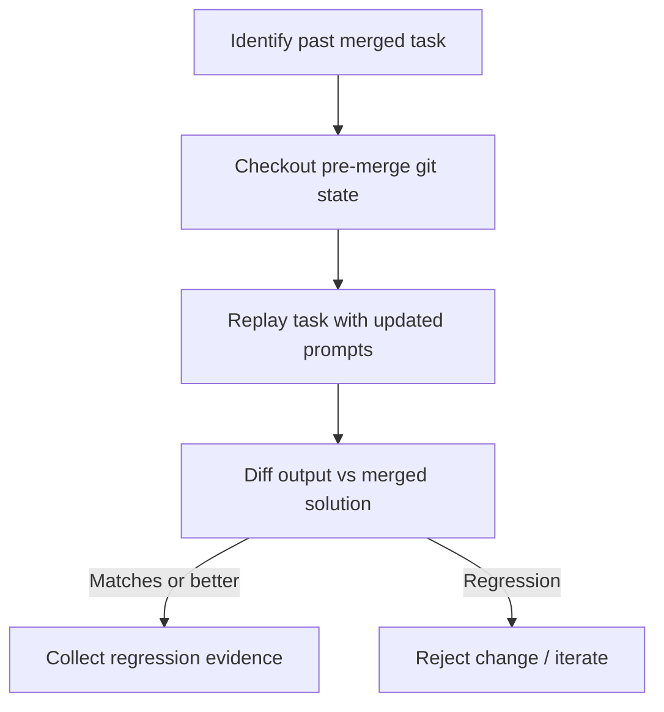

# Simulation and Replay Testing for Agent Verification

> Replay recorded tasks to collect regression evidence; a matching past result does not establish readiness for new tasks.

## The problem

When you change an agent's instructions, how do you know the change improves output? Intuition and manual testing on new tasks are unreliable. New tasks have different context, different difficulty, and different [success criteria](eval-driven-development.md). You cannot compare them cleanly to the previous agent's performance.

Simulation and replay testing uses recorded tasks as fixtures for bounded comparisons.

## Why it works

Replay testing can hold recorded task inputs fixed for comparison. The [merged output](../verification/red-green-refactor-agents.md) supplies a comparison artifact. Instructions are not necessarily the only variable: leftover files, caches, and resource conditions can affect trials ([Anthropic's evaluation guidance](https://www.anthropic.com/research/demystifying-evals-for-ai-agents)).

Checking out a recorded commit restores recorded repository files ([Git checkout](https://git-scm.com/docs/git-checkout)). External task state needs separate capture; a completed tracker item differs from its original state ([Warp](https://www.warp.dev/blog/build-production-software-factory)). Environment state also needs separate treatment. Identical model inputs can still produce different outputs ([Claude glossary](https://platform.claude.com/docs/en/about-claude/glossary)). Use [reconstructable factory run records](../factory-engineering/reconstructable-factory-runs.md) to declare captured boundaries, missing evidence, and replay authority.

## The technique

The core loop:

1. Identify a task that was previously completed and merged — a recorded comparison artifact with known acceptance evidence.
2. Roll back to the git state just before that task was completed (the "before" state).
3. Replay the task using the updated agent instructions.
4. Diff the agent's output against what was actually merged.

A matching result supplies regression evidence for this task. Require repeated trials and broader cases before promotion, following [controlled factory experiments](../factory-engineering/controlled-factory-experiments.md). Define acceptable differences before comparing outputs.



## Using worktrees for isolation

Git worktrees let you check out multiple working trees from one repository ([`git worktree add`](https://git-scm.com/docs/git-worktree) is a standard git feature since Git 2.5). A simulation runs in an isolated worktree, so it does not interfere with the main working directory or other parallel simulations.

```bash
# Create an isolated worktree at the pre-merge commit
git worktree add ../sim-test <pre-merge-commit-sha>

# Run the task in the isolated worktree
cd ../sim-test
# ... invoke agent with updated prompts ...

# Record the replay output in its own commit before this comparison
git diff <expected-output-commit-sha> <replay-output-commit-sha> -- <target-files>
```

Multiple simulations can run in parallel across separate worktrees — one for each prompt variant you evaluate.

## What "better" means

Define success criteria before you run the simulation, not after:

- Structural match — the output follows the same shape as the merged solution
- Content match — key claims, code paths, or decisions align
- Regression check — the updated agent does not omit things the original agent got right
- Improvement — the updated agent catches something the original missed

Automated diff scoring (line count, structural similarity) is a starting point for flagging obvious regressions. You still need human judgment on the diff for qualitative assessment.

## Regression testing agent behavior

Simulation replay is most valuable for regression testing:

- After a prompt change that fixes a known failure, verify it does not break passing cases
- After updating a skill file, replay several past tasks that used the skill
- After tool configuration changes, verify the agent still reaches the correct outcome

A library of "golden" past tasks — completed, merged, and known-good — forms a regression suite for agent behavior, much like snapshot testing in software.

## Integration with the content pipeline

In a content pipeline (research → draft → review → publish), simulation replay lets you test individual stage prompts:

- Change the researcher's instructions → replay a past research task → compare findings against what was merged
- Change the reviewer's format → replay a past review → compare structured output against the previous review

Each stage has an independently testable input/output boundary.

## Limitations

- Simulation tests past conditions, not future ones — novel task types may not be represented in the golden library
- Replay is not deterministic: the same agent instructions on the same task may produce different output on each run. Even at temperature 0, outputs remain only "mostly deterministic" because floating-point non-associativity on parallel GPU kernels shifts logits across runs ([Feng et al., 2025, *Get Experience from Practice: LLM Agents with Record & Replay*](https://arxiv.org/abs/2505.17716); [OpenAI Developer Community: Clarifications on temperature = 0](https://community.openai.com/t/clarifications-on-setting-temperature-0/886447))
- A "better" output is easier to define for structured tasks (code, structured documents) than for open-ended ones
- Naive record-and-replay of agent executions has its own failure modes: too-concrete replays break on minor context drift, while too-abstract replays lose task-specific detail. [AgentRR (Feng et al. 2025)](https://arxiv.org/abs/2505.17716) argues that reliable replay needs a trust-anchor check function to verify preconditions before replay is allowed to apply — prompt-diff replay as described here is a lightweight analogue and carries the same risk when the upstream context (tools, skills, repo state) has shifted since the golden run was recorded

## Key Takeaways

- Use past merged tasks as test fixtures — check the merged solution against current acceptance criteria
- Worktrees provide isolation for replay runs without affecting the main working directory
- Define success criteria before running the simulation to avoid post-hoc rationalization
- Parallel simulations across worktrees let you test multiple prompt variants simultaneously
- Build a library of golden past tasks to form a regression suite for agent behavior

## Comparing recorded outputs

Keep the expected-output commit and the new replay-output commit as separate identifiers. Comparing the pre-task commit with the historical merge only displays the old patch. It does not inspect the replay result. Record new files in the replay commit too; a comparison that omits them cannot assess the full output.

## Related

- [Incremental Verification: Check at Each Step, Not at the End](../verification/incremental-verification.md)
- [Worktree Isolation for Parallel Agent Work](worktree-isolation.md)
- [Layered Accuracy Defense](../verification/layered-accuracy-defense.md)
- [Red-Green-Refactor with Agents: Tests as the Spec](../verification/red-green-refactor-agents.md)
- [Eval-Driven Development](eval-driven-development.md)
- [LLM-as-Judge Evaluation with Human Spot-Checking](llm-as-judge-evaluation.md)
- [One-Shot Record and Deterministic Replay for Periodic Agent Tasks](../tool-engineering/one-shot-record-deterministic-replay.md) — the production counterpart; same recording substrate used for cost elimination rather than verification.
